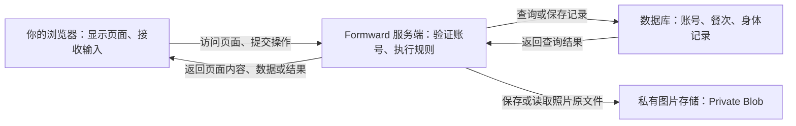
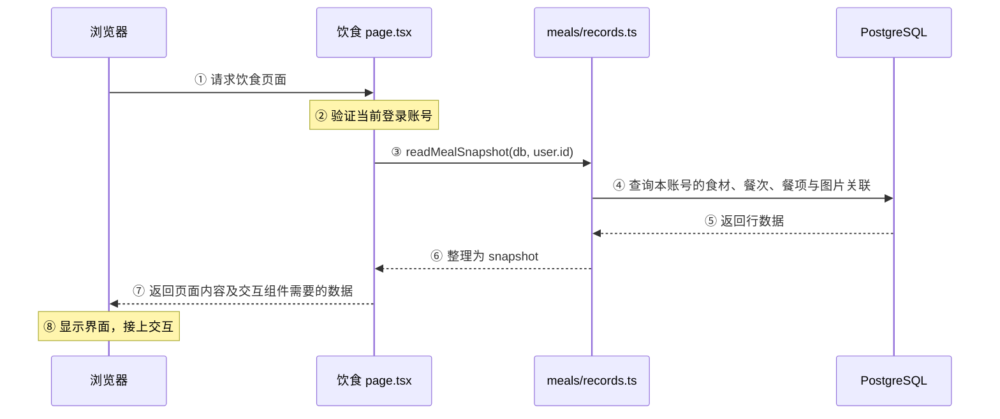

# Formward：从零看懂网页、后端与数据库

这份指南从一个问题开始：**我在网页里填了一餐，点了保存，这些文字和数字到底去了哪里？**

你只需要初步认识 HTML 和 TypeScript。这里会先解释概念，再把概念对应到 Formward 的真实文件。正文可以独立阅读；链接用于核对源码和深入学习，不要求先读完各目录 README。

全文使用虚构的“示例食物 A”和“示例饮料 B”，不代表真实食物的营养，也不会向系统写入任何示例记录。

## 怎样阅读

第一次按第 1–6 章顺序读，先看懂一条完整链；第 7 章再把它扩展到其他功能。后面的查阅区用于找文件、表和检查入口，不需要一开始记住全部名称。

| 想先解决的问题 | 阅读位置 |
| --- | --- |
| 前端、后端、数据库分别在哪里？ | [1. 网页背后的参与者](#architecture-map) |
| 一个页面到底由哪些文件构成？ | [2. 从 HTML 到饮食页面](#ui-map) |
| 为什么有时服务器生成页面，有时浏览器又在运行组件？ | [3. 页面在不同时间怎样工作](#lifecycle-map) |
| 从打开饮食页到保存一餐，数据经过了谁？ | [4. 跟着一餐走完整条链](#data-flow) |
| 接口是什么，网页和 AI 怎么连接同一套业务？ | [5. 后端与接口](#logic-map) |
| 数据库的表和代码文件是什么关系？ | [6. 数据怎样存下来](#database-map) |
| 登录、身体记录、AI、图片和导入怎么串起来？ | [7. 其他功能的完整路线](#other-flows) |
| 打开哪些工具，才能亲眼看到每一端？ | [8. 在哪里观察系统](#observe-map) |
| 想改功能，应该找哪里？ | [9. 文件与修改速查](#file-map) |
| 想查看全部表、设计取舍与测试入口？ | [10. 数据表查阅](#table-map)、[11. 设计与待验证项](#issue-map)、[12. 开发与检查](#runtime-map) |

读完后，你应该能回答四件事：页面由谁组成；首次显示和后续交互有什么不同；一次保存经过哪些文件；数据最终存在哪里。

阅读时要分清**代码名称、文件路径和职责说明**。例如 `PageLoadingProvider` 是源码中的组件函数名，`src/components/page-loading.tsx` 是定义它的文件，“统一等待反馈”是对它职责的中文说明。组件与文件并非一一对应：一个文件可以定义多个组件。第 2 章会把饮食页的每个组件名与定义文件对上。

<a id="architecture-map"></a>

## 1. 先认识网页背后的参与者

### 1.1 你看到一个网页，背后有几处东西在工作

假设你打开 Formward 的饮食页。屏幕上的图表、输入框、按钮在**浏览器**里显示，例如电脑上的 Chrome 或手机上的 Safari。浏览器是用户这一侧，所以也叫客户端。

浏览器需要从另一个正在运行的程序那里取得页面和数据。这个负责响应访问、验证账号、处理保存的程序，是本项目的**服务端程序**。它可以运行在你的电脑，也可以运行在云平台提供的机器上。“服务器”在下面通常指运行这个程序的环境。

服务端程序还要连接**数据库**。数据库负责长期保存账号、餐次、身体记录等结构化数据。关闭网页后记录仍在，是因为它们已经写入数据库，而不是因为页面一直记着。

照片另外有一个存放原文件的地方：**私有图片存储**。本项目使用 Private Blob。数据库记录照片的编号、类型、归属和关联，存储服务保存真正的图片字节。



这是参与者之间的通信关系，不是所有操作都必须走完的固定顺序。普通看餐次不一定读取原图；网页上传照片还有浏览器直传存储的步骤，见第 7.5 节。

### 1.2 前端和后端是什么

先从职责理解：

| 名称 | 负责什么 | Formward 中能感受到的例子 |
| --- | --- | --- |
| 前端 | 把内容显示出来，让人能操作 | 饮食图表、日期选择、弹窗、输入后立即变化的合计 |
| 后端 | 验证请求、执行业务规则、读写存储、返回结果 | 判断是不是当前账号、餐次是否合法、保存是否重复 |
| 数据库 | 按结构长期保存数据并执行查询 | 查出某账号的餐次，保存一餐的多条食物记录 |

“前端”不等于一个叫 `frontend` 的文件夹，“后端”也不一定是另一个仓库。本项目在同一个 Next.js 应用中同时实现页面和后端，所以你会在 `src/app` 中同时看见页面文件和处理请求的文件。

还有一个稍后要解释的特点：**有些界面内容先由服务端生成，再交给浏览器显示**。所以“负责界面”和“代码在哪里运行”是两个不同的问题。此刻只需先知道它存在，第 3 章会按时间顺序展开。

### 1.3 技术名称分别对应什么

不要把下表当成要背的工具清单。它解释的是：你已经认识的参与者，具体用什么实现。

| 名称 | 用容易理解的话说 | 在项目中找什么 |
| --- | --- | --- |
| HTML | 描述标题、表格、输入框等内容结构 | 组件最终生成的标签；浏览器 Elements 面板中的元素 |
| CSS | 描述颜色、大小、间距和布局 | `.css`、`.module.css` 文件 |
| JavaScript | 浏览器能够执行的程序，负责交互等逻辑 | 按钮事件、输入变化、网络请求；构建后生成的脚本 |
| TypeScript | 在 JavaScript 写法上增加类型检查，帮助发现代码错误 | `.ts`、`.tsx`；类型不会作为检查器自动留在浏览器中 |
| React | 让我们用组件组合界面，并在数据变化时更新它 | `MealsView`、`MealEditor` 等组件以及它们保存的交互状态 |
| Next.js | 在 React 基础上组织网址、页面生成、服务端函数和请求入口 | `src/app`、`page.tsx`、`layout.tsx`、`route.ts` |
| Node.js | 在浏览器外运行 JavaScript 的环境 | 本地开发服务、服务端代码、维护脚本 |
| PostgreSQL | 实际管理表、保存行、执行查询的数据库系统 | 餐次、餐项和账号等表 |
| Neon | 托管 PostgreSQL 的云服务 | 线上数据库所在地，不是另一种前端框架 |
| Drizzle | 帮助 TypeScript 代码描述表和发出数据库查询的工具 | `src/db/schema.ts`，业务代码中的 `db.select()` 等 |
| Better Auth | 帮助项目处理密码登录、登录状态和 AI 授权的库 | `src/features/auth` 与认证请求入口 |
| Vercel | 构建和运行线上 Next.js 应用的平台 | 线上部署、运行日志、环境配置 |
| Private Blob | 只允许按授权读取的文件存储 | 用户上传的照片原文件 |

例如 React 决定“合计变化后界面如何更新”；Node.js 让服务端程序运行起来；Neon 保存记录。它们不是三个互相替代的选择。

### 1.4 本地与线上分别在哪里

| 部分 | 本地开发时 | 正式站运行时 |
| --- | --- | --- |
| 浏览器 | 你的电脑或手机 | 仍是访问者的电脑或手机 |
| Formward 程序 | 启动 `pnpm dev` 的那台电脑或远程工作区 | Vercel 提供的运行环境 |
| 数据库 | 由连接配置决定，可能仍然连接云端 Neon | 使用正式环境配置的 Neon |
| 图片存储 | 由当前环境的存储配置决定 | 正式站的 Private Blob |

`localhost:3000` 表示“访问这台电脑上的 3000 端口”。端口是同一台机器上区分服务的数字。如果程序运行在远程工作区，需要把相应端口转发到浏览器能访问的位置。

**本地页面不等于本地数据库。** 打开本地网址，只能证明应用入口在本地；数据连向哪里，要看服务端连接配置。第 12 章说明配置入口，这里不需要打开密钥文件。

**试着回答**：关闭浏览器后，已经保存的一餐为什么还在？运行在 Vercel 上的是数据库还是应用？答案分别在第 1.1、1.4 节。

<a id="ui-map"></a>

## 2. 从你认识的 HTML，走到真正的饮食页面

### 2.1 为什么不是一个巨大的 HTML 文件

你可能写过一段包含标题、按钮和表格的 HTML。Formward 的页面也需要这些内容，但不同页面会重复使用页头，一个编辑框内部又有很多输入和按钮。如果全部写在一个文件里，很难维护。

React 允许把一块界面写成一个**组件**：接收一些输入，描述应该显示什么。组件通常是函数，函数名以大写字母开头。页面可以组合许多组件；一个组件也可以包含更小的组件。

下面只是讲解组件的简化示例，不是可直接替换源码的完整实现：

```tsx
function MealTitle({ name }: { name: string }) {
  return <h2>{name}</h2>;
}

// 使用这个组件，会得到内容为“午餐”的二级标题。
<MealTitle name="午餐" />
```

`name` 是传给组件的输入。React 把这一类输入称为 **props（属性）**。`<MealTitle ... />` 表示把这个组件放进界面，并不表示浏览器认识一种叫 MealTitle 的 HTML 标签。

上面像 HTML 的写法叫 **JSX**；在 TypeScript 文件里使用时，文件后缀通常是 `.tsx`。构建工具会把它处理成运行所需的 JavaScript。浏览器不会直接把仓库里的 `.tsx` 当 HTML 文件打开。

回到真实项目，`MealsView` 也是组件函数名，定义在 [src/features/meals/meals-view.tsx](../src/features/meals/meals-view.tsx) 中。同一文件还定义了 `MealList` 和 `EditorDialog`。所以，看到组件名后，要找的是“哪个文件定义了这个函数”，不能直接假定存在 `MealList.tsx` 这样的同名文件。

还要区分**框架约定的文件名**与**开发者起的函数名**。Next.js 按目录和 `page.tsx`、`layout.tsx` 等文件名识别页面与布局，并使用文件默认导出的组件。`MealsPage`、`RootLayout`、`DashboardLayout` 是本项目为这些函数起的名字；`PageLoadingProvider` 则是项目自己定义、由其他组件引入使用的组件。名字里的 Page、Layout、Provider 帮助表达用途，实际行为要看定义和使用位置。

### 2.2 先看饮食页的组成，不追执行顺序

访问 `/dashboard/meals` 时，可以把界面理解成下面的嵌套结构。**树里的英文名称都是真实组件函数名，括号里是定义文件相对于仓库根目录的路径。** 中文职责和可点击的文件链接在下一节逐项列出。

```text
RootLayout（src/app/layout.tsx）
└─ PageLoadingProvider（src/components/page-loading.tsx）
   └─ DashboardLayout（src/app/dashboard/layout.tsx）
      └─ MealsPage（src/app/dashboard/meals/page.tsx）
         └─ Content（src/app/dashboard/meals/page.tsx，同文件中的另一个组件）
            ├─ DashboardHeader（src/app/dashboard/header.tsx）
            └─ MealsView（src/features/meals/meals-view.tsx）
               ├─ NutritionChart（src/features/meals/nutrition-chart.tsx）
               ├─ MealList（src/features/meals/meals-view.tsx）
               ├─ FoodTable（src/features/meals/presets.tsx）
               └─ EditorDialog（src/features/meals/meals-view.tsx，按用途显示不同弹窗）
                  ├─ FoodDetails（src/features/meals/presets.tsx，食材详情弹窗内）
                  └─ MealEditor（src/features/meals/meal-editor.tsx，餐次编辑弹窗内）
                     ├─ NutritionFields（src/features/meals/nutrition-fields.tsx）
                     ├─ SourceFields（src/features/meals/nutrition-fields.tsx）
                     └─ PhotoFields（src/features/meals/photos.tsx）
```

这个树表示**谁容纳谁**，不是程序按从上到下的顺序逐一执行。某些区域按条件出现；`FoodDetails` 对应食材详情弹窗，`MealEditor` 对应餐次编辑弹窗。树里只列学习主线需要的部分，省略了 HTML 容器、React 的 `Suspense` 等外层，以及其他弹窗内容。

`MealsPage` 是页面入口组件，`Content` 是同文件里负责取数和组装内容的另一个组件。这里没有名为 `MealsPageContent` 的函数；定位时应写成 `src/app/dashboard/meals/page.tsx → Content`，因为其他页面也可以有各自的 `Content`。

另外，`DashboardLayout` 当前只做登录检查并返回子页面，页头是页面自己放进去的。不能因为名字里有 Layout，就假定它一定画了导航栏。

### 2.3 每一块具体在哪个文件

下面按树里的代码名称查定义。所有链接都指向当前仓库；文件名相同但目录不同，代表不同文件。同一文件出现在多行，表示它定义了多个组件。

| 组件函数名 | 定义所在的真实文件 | 它收到或使用什么 | 它负责什么 |
| --- | --- | --- | --- |
| `RootLayout` | [src/app/layout.tsx](../src/app/layout.tsx) | 当前页面 `children` | 全站外壳；输出 `html`／`body`，接入全局样式和等待层 |
| `PageLoadingProvider` | [src/components/page-loading.tsx](../src/components/page-loading.tsx) | `children`、后代组件登记的等待任务 | 提供共享等待状态，按任务状态显示全局等待提示 |
| `DashboardLayout` | [src/app/dashboard/layout.tsx](../src/app/dashboard/layout.tsx) | 当前访问的登录状态、子页面 | 登录后区域的公共检查；未登录返回首页，已登录返回子页面 |
| `MealsPage` | [src/app/dashboard/meals/page.tsx](../src/app/dashboard/meals/page.tsx) | 登录状态、网址里的可选日期 | 页面默认导出的入口组件；检查登录，将账号和日期交给 `Content` |
| `Content` | [src/app/dashboard/meals/page.tsx](../src/app/dashboard/meals/page.tsx) | `MealsPage` 传来的账号和日期 | 同文件内的组件；读取餐次、食材和审核操作，组装页头与 `MealsView` |
| `DashboardHeader` | [src/app/dashboard/header.tsx](../src/app/dashboard/header.tsx) | 当前账号邮箱、当前网址 | 显示 Logo、邮箱、AI 接入和退出等入口 |
| `MealsView` | [src/features/meals/meals-view.tsx](../src/features/meals/meals-view.tsx) | 餐次／食材数据、日期、保存函数 | 管理日期、页签、弹窗、保存等待和结果 |
| `NutritionChart` | [src/features/meals/nutrition-chart.tsx](../src/features/meals/nutrition-chart.tsx) | 日期、每日合计、显示方式等 | 绘制每日摄入柱图并响应选择 |
| `MealList` | [src/features/meals/meals-view.tsx](../src/features/meals/meals-view.tsx) | 餐次、忙碌状态、编辑／删除回调 | 同文件内的组件；显示餐次及食物明细 |
| `FoodTable` | [src/features/meals/presets.tsx](../src/features/meals/presets.tsx) | 食材、查看详情和操作回调 | 显示食材库表格；文件名不代表仍有基础预设采用功能 |
| `FoodDetails` | [src/features/meals/presets.tsx](../src/features/meals/presets.tsx) | 选中的食材 | 显示食材规格、营养依据和照片 |
| `EditorDialog` | [src/features/meals/meals-view.tsx](../src/features/meals/meals-view.tsx) | 标题、关闭回调、忙碌状态、`children` | 提供弹窗外壳；具体内容由使用它的位置传入 |
| `MealEditor` | [src/features/meals/meal-editor.tsx](../src/features/meals/meal-editor.tsx) | 初始草稿、食材库、保存回调 | 搜索和选择食材、修改用量、编辑本餐 |
| `NutritionFields` | [src/features/meals/nutrition-fields.tsx](../src/features/meals/nutrition-fields.tsx) | 营养数值、修改回调、只读状态 | 组合热量、蛋白质、碳水、脂肪输入字段 |
| `SourceFields` | [src/features/meals/nutrition-fields.tsx](../src/features/meals/nutrition-fields.tsx) | 来源与依据、修改回调 | 组合营养依据选择、补充说明和来源链接字段 |
| `PhotoFields` | [src/features/meals/photos.tsx](../src/features/meals/photos.tsx) | 照片编号、上传状态、修改回调 | 提供照片选择、上传和回看 |

与这些组件并列使用的样式文件还有 [src/features/meals/meals.module.css](../src/features/meals/meals.module.css) 和 [src/app/globals.css](../src/app/globals.css)：前者控制饮食区域的布局和外观，后者提供全局样式。它们是 CSS 文件，表中的名称则是 `.tsx` 文件内的组件函数。

`children` 是 React 用来接收“放在这个组件里面的内容”的属性名。根布局可以像一个画框，当前页面是框里的画；切换页面并不意味着把画框重新写一份。

### 2.4 哪些文件并列看，哪些要顺着看

学习一个区域，常常需要同时看几种不同关系：

| 关系 | 本项目例子 | 该怎么阅读 |
| --- | --- | --- |
| 界面包含 | `MealsView` 内显示 `MealEditor` | 看外层何时显示它、传了哪些属性，再看内层怎么画 |
| 并列依赖 | `MealEditor` 使用 `model.ts` 的计算和 `meals.module.css` 的样式 | 计算与样式分别解决问题，不是“先执行 CSS 再执行计算” |
| 函数调用 | 保存入口调用 `submitMealOperation` | 顺着参数、返回值和下一次调用追下去 |
| 跨网络请求 | 浏览器调用保存入口 | 这里会离开浏览器，在服务端验证和处理，然后返回结果 |

例如“表格太挤”通常从编辑器结构与 CSS 并列查看；“用量改为 150g 后热量算错”要看编辑器提供的用量和计算函数；“保存报错”才继续追服务端调用。它们不是同一种问题。

在代码里辨认一个组件，可以依次找**定义、引入、使用**。以真实的 `PageLoadingProvider` 为例：

1. 打开 [src/components/page-loading.tsx](../src/components/page-loading.tsx)，搜索 `export function PageLoadingProvider`。这里是定义：函数体写明它怎样管理等待状态、显示内容。`export` 表示其他文件可以引入它。
2. 打开 [src/app/layout.tsx](../src/app/layout.tsx)，会看到下面的引入语句：

   ```tsx
   import { PageLoadingProvider } from "@/components/page-loading";
   ```

   左边是引入的组件名，右边是定义文件的路径简写。这里的 `@/` 对应 `src/`，所以能找到 `src/components/page-loading.tsx`。
3. 同一根布局文件的返回内容里有下面这段使用代码：

   ```tsx
   <body><PageLoadingProvider>{children}</PageLoadingProvider></body>
   ```

   它表示根布局使用这个组件，并把当前子页面作为 `children` 传进去。要理解等待反馈内部怎样工作，再回到第 1 步的定义文件。

`MealList` 则是在 `meals-view.tsx` 内用 `function MealList` 定义、由同文件使用的组件，不需要从另一个文件引入。饮食页的 `Content` 同理；搜索 `async function Content` 可以找到它。`export default` 表示文件的默认导出，`MealsPage`、`RootLayout` 和 `DashboardLayout` 都采用这种写法。

用编辑器阅读时，可以先打开第 2.3 节给出的文件，再搜索对应的函数名；编辑器支持时，也可以在组件使用处选择“转到定义”。这样能区分“在哪里定义”和“在哪里被使用”，也能避免被其他文件中的同名 `Content` 混淆。

`import` 本身不等于发出网络请求。`./model` 这样的相对路径表示同目录下的 `model.ts`；和上面的 `@/` 一样，它用于定位代码文件。

样式也是通过名字连接的：组件里的 `className` 对应 HTML 的 `class`。饮食组件先引入 `meals.module.css` 为 `styles`，再用 `className={styles.meal}` 选择其中的 `.meal` 规则。这样的文件叫 **CSS Module**，构建工具会处理类名，减少不同区域的同名样式相互干扰。CSS 控制这块界面的外观，不是负责读取下一份业务数据的函数。

### 2.5 页面输入、组件状态与正式记录

假设你在编辑框填了 150g，这个值需要暂时被程序记住，才能继续显示和计算。React 把这种随交互变化、会影响显示的记忆称为 **state（状态）**。

在真实源码中，`useState` 就是组件建立这份记忆的方式；`setDraft` 这样的函数负责换成新草稿，让界面随之更新。`onChange`、`onClick`、`onSubmit` 分别连接输入变化、点击和表单提交：它们把用户动作交给代码中的处理函数。

| 例子 | 谁管理 | 是否已经保存到数据库 |
| --- | --- | --- |
| 选中了哪一天、弹窗是否打开 | `MealsView` 的交互状态 | 否 |
| 这一餐尚未提交的食物和用量 | `MealEditor` 的 `draft` 状态 | 否 |
| 页面打开时从服务端收到的餐次／食材 | `MealsView` 收到的 `snapshot` 属性 | 这些是当时从数据库读取并整理的数据 |
| 保存成功后返回的餐次／食材 | `MealsView` 用来更新显示的本地状态 | 对应服务端已经确认保存的数据 |

**回调**是“交给另一个组件、让它在某个时机调用的函数”。编辑器收到一个叫 `save` 的属性，意思是“用户提交时，调用外层交给我的函数”。它不要求编辑器自己知道数据库密码或写入规则。

这里有两个不同层次的 `save`：`MealEditor` 的 `save` 是 `MealsView` 提供的浏览器回调；`MealsView` 收到的 `save` 对应页面传下来的服务端保存入口。第 4 章会把它们连起来。

**试着回答**：`MealsPage` 和 `Content` 是两个文件还是同文件中的两个组件？`MealList` 定义在哪里？饮食表格布局与换算分别去哪里找？关闭未保存的编辑框后，能否期待刷新还能看到草稿？答案在第 2.2–2.5 节；完整失败情况在第 4.6 节。

<a id="lifecycle-map"></a>

## 3. 页面在不同时间怎样工作

### 3.1 先解释“渲染”

假设数据是“午餐，180 kcal”，组件描述要用一个标题和一个数字区域展示。把数据和组件描述变成界面结果，这个过程通常叫**渲染（render）**。

这个词可能出现在不同阶段：服务端生成 HTML 等页面内容；浏览器里的 React 根据数据更新页面元素；浏览器最终计算布局并把像素画在屏幕上。**服务端生成 HTML，不代表服务器替你的屏幕画好了像素。**

所以，看到“服务端渲染”，先理解为“服务器先准备可显示的页面内容”，不要理解成“用户看到一张服务器截图”。

### 3.2 服务端组件与客户端组件

组件可以承担不同工作。Next.js 让某些组件留在服务端完成取数与页面组装，再让需要交互的组件由浏览器接管。

| 类型 | 先用中文理解 | Formward 例子 | 适合做什么 |
| --- | --- | --- | --- |
| 服务端组件（Server Component） | 组件本身的逻辑在服务端执行，浏览器接收结果 | 饮食页 `page.tsx` | 查当前账号、读取数据库、把数据交给界面 |
| 客户端组件（Client Component） | 包含要交给浏览器运行的交互代码 | `MealsView`、`MealEditor` | 记住输入、处理点击、切日期、打开弹窗 |

Next.js 的 `page.tsx`、`layout.tsx` 默认属于服务端组件。交互组件文件顶部的 `"use client"` 声明一个客户端代码边界。它直接引入的普通组件和工具也可能进入浏览器代码，不必每个文件都重复写这句话。

但“放在客户端组件里面”不等于“被它直接引入”。例如根布局把服务端准备的子页面作为 `children` 交给客户端的等待层外壳，子页面不会因此自动变成客户端组件。第 2.2 节的包含树用于找界面，运行位置还要看这种实际连接方式。

不要由后缀或目录猜运行位置：`.tsx` 既可以是服务端组件，也可以是客户端组件；`src/features` 里既有业务读写，也有交互组件和两侧都能使用的计算函数。

### 3.3 首次打开或刷新：先显示，再接上交互

打开饮食网址时，可以把主过程分成下面几个阶段：

```text
① 浏览器请求 /dashboard/meals
② 服务端验证账号，读取餐次／食材，运行页面组件
③ Next.js 准备 HTML，以及后续组合页面所需的数据和脚本
④ 浏览器先用 HTML 显示页面内容
⑤ 浏览器加载交互代码，React 将点击、输入等处理接到已有元素上
⑥ 用户可以选择日期、打开编辑器、输入和保存
```

第⑤步叫 **hydration（水合）**。先按“给已经出现的界面接上交互能力”理解即可。标题和数字可能已经看得到，但某些由 React 控制的按钮要等相关交互代码就绪后才能工作。

**客户端组件也可以参与第③步的 HTML 生成。** `"use client"` 说明交互代码要在浏览器运行，并不表示“这个组件从来不能在服务器上准备首次内容”。这正是“初次加载可能由服务端渲染”的具体含义。

为什么这样做？浏览器可以先显示准备好的内容，不必等待所有交互代码执行后才从空白开始搭建页面；数据库取数和密钥也能保留在服务端。不同页面可能分段返回内容，数据等待期间本项目的 `Suspense` 会显示 `RouteLoading`。这不改变上述角色划分。

### 3.4 站内跳转：可以更新页面的一部分

从总览点击链接进入饮食页，通常由 Next.js 在已打开的应用里处理导航。它可能提前获取目标内容，也可能使用缓存；需要的新页面结果仍由服务端准备，但浏览器通常不必重新下载整个 HTML 文档、销毁全部页面再开始。

这时，Next.js 可以传回用于组合界面的数据，让浏览器里的 React 更新相应区域。客户端组件在浏览器中渲染这次的新界面，仍可能显示服务端组件准备的结果。

因此不要把“页面没有整页刷新”理解成“没有访问服务器”，也不要要求每次站内跳转都在 Network 中找到一份新的完整 HTML。直接输入网址或刷新，又会回到首次加载的过程。

### 3.5 输入、切换显示与保存不是一回事

| 动作 | 通常在哪里完成 | 是否需要处理这个动作的网络请求 | 是否改变正式餐次 |
| --- | --- | --- | --- |
| 修改本餐用量 | 浏览器里的编辑器 | 单纯改用量和预览合计不需要 | 否 |
| 切换图表克数／能量占比 | 浏览器里的组件和计算 | 当前已有数据足够，不需要另发保存请求 | 否 |
| 点击保存餐次 | 浏览器发起，服务端处理 | 需要 | 服务端确认成功后才改变 |
| 打开受保护的照片 | 浏览器请求图片，服务端检查身份 | 需要；懒加载可能在图片接近视口时才请求 | 不改变餐次 |

其他请求可能同时发生，例如导航预取。这里说的是“完成这个动作本身是否需要请求”，不是保证 Network 面板绝对没有新行。

### 3.6 `"use server"` 和 `"use client"` 不是对称的开关

`"use server"` 用来声明可被远程调用的服务端函数。本项目用它标记 `actions.ts` 中的网页保存等入口；这种用于提交修改的函数称为 **Server Action**。

浏览器调用它时，看起来像调用一个函数，但 Next.js 会在中间安排网络请求。真正的验证和写入仍在服务端执行，数据库凭据和函数实现不会因此被交给浏览器。

| 看到的写法 | 应该怎样理解 | 不应据此推断什么 |
| --- | --- | --- |
| 组件文件顶部 `"use client"` | 从这里建立浏览器交互代码边界 | 不能推断首次加载时绝不生成服务端 HTML |
| 动作文件顶部 `"use server"` | 这里导出的异步函数是可远程调用的服务端函数 | 不能推断所有后端文件都必须这样写 |
| 页面中没有这两个指令 | Next.js 页面默认是服务端组件 | 不能把它推广成“任何没有指令的工具文件都只在服务器运行” |

例如 `meals/records.ts` 是数据库业务代码，虽然没有 `"use server"`，仍由服务端入口调用。`meals/model.ts` 的换算函数则可分别被浏览器和服务端使用。浏览器拿到的是用于调用的函数引用，不是实际读写数据库的函数实现。

“异步”表示结果可能需要等待，代码中的 `await` 表示等待这个操作完成；它本身不代表发生了网络请求。等待数据库、读取文件、调用服务端函数，都可能使用异步写法。

**试着回答**：`MealEditor` 是客户端组件，为什么首次页面仍能先出现内容？修改用量和点击保存为什么是两条不同路线？答案在第 3.3、3.5、3.6 节。

<a id="data-flow"></a>

## 4. 跟着一餐走完整条链

### 4.1 整章只用这一组虚构数据

假设食材库中已经有“示例食物 A”，我们要记录一顿午餐：

| 内容 | 已知数据 | 这次怎么输入 | 本次营养 |
| --- | --- | --- | --- |
| 示例食物 A | 每 100g：120 kcal，蛋白质 5g、碳水 16g、脂肪 4g | 从库中选择，再填写 150g | 按 1.5 倍换算：180 kcal、7.5g／24g／6g |
| 示例饮料 B | 没有对应的库条目 | 在空白行填1份饮料（实际200mL），填这一份营养 | 每份60 kcal、0g／15g／0g，1份仍为60 kcal |
| 午餐合计 | 两项本次营养相加 | 在编辑器顶部预览 | 240 kcal、7.5g／39g／6g |

食材 A 的换算发生在 [model.ts](../src/features/meals/model.ts) 的 `nutritionFor`；各项相加由 `sumNutrition` 完成。饮料 B 的 60 kcal 已表示本次摄入，不能再乘 200。未知数值留空对应 `null`，只有明确知道为零才填 0。

### 4.2 第一条链：打开页面，数据从数据库来到屏幕

先看读取，不考虑保存。`snapshot` 在这条链里是“一次查询后整理好的餐次和食材数据包”，也叫快照，不是一张截图。



这是成功读取的主线。图中的 `db` 表示数据库操作对象，`user.id` 是服务端确认的当前账号编号；网页还会读取审核操作列表，这些细节在下表展开。

| 步骤 | 在哪里运行 | 文件／函数 | 收到什么 | 做什么 | 交给谁 |
| --- | --- | --- | --- | --- | --- |
| 1. 识别页面与身份 | 服务端 | [meals/page.tsx](../src/app/dashboard/meals/page.tsx) → `currentPageUser` | 页面访问、随请求带来的登录信息 | 判断当前账号；没有登录就转到首页 | 本页面的 `Content` |
| 2. 取得数据库操作对象 | 服务端 | [db/client.ts](../src/db/client.ts) → `getDatabase` | 服务端连接配置 | 建立或复用连接，返回可查询的对象 | 页面里的查询函数 |
| 3. 查询并组装饮食数据 | 服务端及数据库 | [meals/records.ts](../src/features/meals/records.ts) → `readMealSnapshot` | `db`、可信的 `user.id` | 按账号读取 `foods`、`meals`、有效餐项及图片关联，组合餐次与合计 | 页面里的 `snapshot` |
| 4. 准备其他页面输入 | 服务端 | 同一页面 → `listMealOperations`、日期处理函数 | 当前账号、可选日期参数 | 准备审核列表、初始今天和选中日期 | `MealsView` 的属性 |
| 5. 组装界面 | 服务端准备首次内容，浏览器接管交互 | 页面 → `DashboardHeader`、`MealsView` | 邮箱、`snapshot`、日期、操作列表及保存入口 | 显示页头、图表和记录 | 浏览器里的用户 |

注意这里**没有先让浏览器调用 `/api/v1/meals`**。页面代码本来就在服务端，可以直接调用业务函数读取数据库。网页和外部 AI 有不同的入口，后面才共用业务。

`readMealSnapshot` 当前也会带回已删除的餐次和食材，供界面组织“最近删除”等内容；有效餐项按查询条件读取。后续汇总还会筛选有效记录，不能把数据包里每一行都直接算成当天摄入。

### 4.3 第二条链的前半段：你输入时，数据还在浏览器

| 步骤 | 在哪里运行 | 文件／函数 | 收到什么 | 做什么 | 交给谁 |
| --- | --- | --- | --- | --- | --- |
| 1. 打开记录框 | 浏览器 | `MealsView` → `addMeal` | 选中的日期、设备时间 | 准备新餐草稿，建议餐次名称并打开编辑框 | `MealEditor` 的 `initial` |
| 2. 选择食材 A | 浏览器 | `MealEditor` → `choose` | 已读取的食材编号、版本、规格 | 将食材放进本餐；g 单位的用量先留空 | 编辑器的 `draft.items` |
| 3. 填写 150g | 浏览器 | `MealEditor` → `setItem`、`values` | 新用量和食材规格 | 更新草稿，调用 `nutritionFor` 预览 180 kcal | 本餐表格和合计 |
| 4. 自由填写饮料 B | 浏览器 | 同一编辑器 | 名称、1份（实际200mL）、每份营养 | 保留为自由餐项；常驻空白行不作为有效餐项保存 | 编辑器草稿和合计 |
| 5. 点击保存 | 浏览器 | 编辑器的表单提交处理 | 当前草稿中的非空餐项 | 调用收到的 `save` 回调 | `MealsView` 提供的函数 |

这里只是修改程序的临时记忆。即使你已经看见 240 kcal，也不代表数据库里已经多了一餐。食材选择框中的搜索同样可以直接筛选已读取的数据，不必每敲一个字都重新查数据库。

### 4.4 第二条链的后半段：保存怎样跨到服务器

下面的箭头分成三段，跨网络的位置只有中间标出的那一处；服务端后续连接数据库还有数据库通信。

```text
浏览器内的调用：
① MealEditor 提交本餐草稿
   → ② MealsView 提供的 save 回调
   → ③ MealsView.perform：包装动作、建立稳定请求编号
   → ④ 调用 MealsView 收到的 save，也就是 saveMealAction

跨网络：Next.js 把这次服务端函数调用作为 POST 请求发出

服务端的调用：
⑤ meals/actions.ts：验证登录，再执行 saveMealAction 的工作
   → ⑥ submitMealOperation：校验并保存操作预览
   → ⑦ decideMealOperation：复核后确认，写入正式记录与事件
   → ⑧ readMealSnapshot：重新读出保存后的数据
   → ⑨ 返回结果，并通知相关页面的数据需要更新

浏览器收到结果：
⑩ MealsView 更新数据与成功提示，关闭成功提交的编辑框
```

| 步骤 | 在哪里运行 | 文件／函数 | 收到什么 | 做什么 | 交给谁 |
| --- | --- | --- | --- | --- | --- |
| 1. 包装提交内容 | 浏览器 | [meals-view.tsx](../src/features/meals/meals-view.tsx) 的编辑器回调 → `perform` | 编辑器交来的餐次草稿 | 回调加上 `kind: save_meal`；`perform` 包装为 `operationId` 和 `actions`，开启等待反馈 | `saveMealAction` 的远程调用 |
| 2. 核验当前登录 | 服务端 | [meals/actions.ts](../src/app/dashboard/meals/actions.ts) → `perform`、`saveMealAction` | 请求内容、当前请求的登录信息 | 从会话取得账号；不依赖浏览器自行声称的账号 | 饮食业务函数 |
| 3. 生成操作预览 | 服务端 | [meals/records.ts](../src/features/meals/records.ts) → `submitMealOperation` | 当前账号、`origin: manual`、输入 | 校验格式、规格、归属、重复和当前数据；保存请求与预览 | `saveMealAction` 中的确认步骤 |
| 4. 确认正式保存 | 服务端及数据库 | 同文件 → `decideMealOperation` | 操作编号、当前审核版本、`confirm` | 再次核对状态和数据；在数据库事务中写餐次、餐项、关联及审计事件 | 确认结果 |
| 5. 读出新数据 | 服务端 | 动作入口 → `readMealSnapshot` | 保存后的当前账号 | 重新查询，得到新的餐次／食材数据包 | 返回对象中的 `data.snapshot` |
| 6. 通知页面更新 | 服务端 | 动作入口 → `revalidatePath` | 饮食、总览等受影响网址 | 告诉 Next.js 相应页面需要重新验证／更新 | Next.js 的页面更新机制 |
| 7. 展示结果 | 浏览器 | `MealsView.perform` 和编辑器外层回调 | 成功或错误结果 | 成功时更新本地显示、提示并关闭编辑框；失败时显示错误 | 用户 |

这里的 **POST** 是一种提交请求的方法，第 5 章会与 GET 对比。**事务**表示一组数据库修改作为一个整体成功或失败，第 6 章会用“一餐不能只存下一半”解释。

手动保存也会创建内部操作预览，然后马上在同一次网页保存流程里确认。它不要求你再打开 AI 审核页。AI 提交则会停在待审核状态，等待用户确认。

`revalidatePath` 不是保存数据的那一步。真正的写入已经发生在业务确认事务中；浏览器还会使用返回的新 `snapshot` 更新显示。也不能把它理解成“自动让所有人的所有浏览器立刻同步”。

### 4.5 数据在每一步长什么样

不需要先读懂整份类型定义，只要先区分它在说哪一种数据：

| 名称或位置 | 它描述什么 | 用这顿午餐理解 |
| --- | --- | --- |
| `MealDraft`／`draft` | 正在编辑的一餐 | 日期、餐次、食材 A 的 150g、自由项 B 的每份营养与份数 |
| `MealInput` | 一次提交可以包含的动作 | 请求编号，加上一个保存这顿午餐的动作 |
| `meal_operations` 中的请求和预览 | 这次操作想做什么、能否确认 | 原输入、当前草稿、准备保存的餐次、审核状态 |
| `meals`、`meal_items` | 已确认的餐次和餐项事实 | 一条午餐记录，两条有效餐项，合计为 240 kcal |
| `MealView` | 整理后适合页面显示的一餐 | 本餐编号、日期、两项食物、合计、图片编号等 |
| `MealSnapshot` | 供页面使用的一组餐次和食材 | 不只这顿午餐，还有本账号当前查询到的其他记录 |

`MealDraft`、`MealInput` 等是 TypeScript 类型名，类型定义集中在 `meals/model.ts`。类型名不是数据库表名，也不代表一个单独的网络接口。

### 4.6 失败、重复、刷新后会怎样

| 情况 | 当前应该如何理解 | 对应位置 |
| --- | --- | --- |
| 只填了内容，未保存就刷新 | 普通编辑器草稿在浏览器内存中，没有承诺刷新后恢复 | `MealEditor` 的状态 |
| 保存校验失败，编辑框仍打开 | 显示错误，保留本轮输入，方便修正 | `MealsView.perform` 与错误返回 |
| 保存时连点按钮 | 浏览器忙碌保护阻止重复发起，服务端仍检查重复 | `busyRef`、按钮状态与业务操作编号 |
| 网络断开，没有收到成功结果 | 服务端可能尚未保存，也可能已经保存但响应丢失，不能仅据网络错误判断 | 相同内容重试使用同一请求编号，由服务端识别 |
| 另一个页面先改了相关数据 | AI旧预览、食材或身体旧版本可能被拒绝；网页人工编辑同一餐按实际保存顺序更新 | `version`、`revision`、当前数据摘要检查 |
| 数据库确认事务中间失败 | 这次事务内的正式记录修改回滚；已创建的操作预览可能仍在 | `decideMealOperation` 的事务 |
| 保存成功后再次打开或刷新 | 服务端从数据库重新读取，不依赖旧编辑器继续存活 | 第 4.2 节的读取链 |

“同样的请求重试，不多保存一份”叫**幂等**。它不是“长得一样的两顿饭永远不能记录”，而是同一个请求编号绑定同一次操作；业务还会检查疑似重复餐次，真正的另一次进食可由用户明确选择。

**试着回答**：未保存时的 240 kcal、数据库里的餐项、图上的当天合计有什么区别？服务端保存了但浏览器没收到响应，为什么重试不能直接换个编号？回看第 4.3–4.6 节。

<a id="logic-map"></a>

## 5. 后端与“接口”到底是什么关系

### 5.1 不同场合说的接口，不是同一个东西

可以把接口先理解成“两部分约定怎样交接”。但阅读源码时，要进一步辨认是哪种交接：

| 你看到的东西 | 谁与谁连接 | 交接什么 | 是否天然跨网络 |
| --- | --- | --- | --- |
| 组件属性，例如 `snapshot`、`save` | 外层组件与内层组件 | 显示数据或回调函数 | 普通组件属性不等于网络请求；服务端数据／动作跨边界由框架处理 |
| 普通函数，例如 `nutritionFor` | 调用方与计算函数 | 参数进、计算结果出 | 否；在哪个环境调用，就在那个环境计算 |
| Server Action，例如 `saveMealAction` | 浏览器与服务端网页动作 | 用户提交内容、成功或错误结果 | 从浏览器调用时需要 |
| HTTP API，例如 `GET /api/v1/meals` | 外部客户端与服务端请求入口 | 请求参数、身份凭据、结构化响应 | 是 |
| TypeScript 的 `type`／`interface` | 写代码时对数据形状的约定 | 哪些属性存在、是什么类型 | 否；本身既不发请求，也不查数据库 |
| 数据库操作，例如 `db.select()` | 服务端业务与数据库 | 查询条件、返回的表行 | 实际数据库通信由驱动处理，不是浏览器调用网站 API |

例如 `interface MealTitleProps { name: string }` 只是类型约定，不会自动生成一个 `/api/meal-title` 地址。反过来，一个真正的 HTTP API 即使没有用 TypeScript 的 `interface` 关键字，仍然是网络接口。

### 5.2 网址如何对应文件

浏览器访问的路径到代码入口的映射，叫**路由**。Next.js 根据 `src/app` 下的目录和特殊文件名识别它们：

| 访问路径或动作 | 对应文件 | 返回或执行什么 |
| --- | --- | --- |
| 打开 `/` | [app/page.tsx](../src/app/page.tsx) | 首页和登录体验 |
| 打开 `/dashboard/meals` | [meals/page.tsx](../src/app/dashboard/meals/page.tsx) | 组装饮食页面 |
| 请求 `/api/v1/meals` | [api/v1/meals/route.ts](../src/app/api/v1/meals/route.ts) | 验证 AI 身份并返回餐次查询结果 |
| 打开 `/dashboard/ai/operations/某个编号` | [operations/[id]/page.tsx](../src/app/dashboard/ai/operations/[id]/page.tsx) | 读取该编号的审核内容，组装页面 |
| 在饮食页调用 `saveMealAction` | [meals/actions.ts](../src/app/dashboard/meals/actions.ts) | 经 Next.js 安排的请求执行保存；不是手写的同名 `/api` 路由 |

`[id]` 表示路径里变化的一段，不是要求网址真的包含方括号。`page.tsx` 是页面入口；`route.ts` 是直接处理网络请求的入口，也叫 **Route Handler**；`layout.tsx` 容纳子页面。`actions.ts` 是本项目采用的文件名约定，服务端动作能力来自声明和框架机制。

### 5.3 一次 HTTP 请求里有什么

HTTP 是浏览器、AI 客户端和网站传递请求与响应的一套规则。先认识这五部分就够用：

| 部分 | 含义 | 例子 |
| --- | --- | --- |
| 地址和路径 | 要找哪个服务、哪个入口 | `/api/v1/meals` |
| 方法 | 想怎样访问 | `GET` 通常用于读取；`POST` 用于提交操作等 |
| 查询参数 | 地址后附带的筛选信息 | `?from=2026-10-20&to=2026-10-20` |
| 请求头／请求体 | 补充信息与提交内容 | 请求头带授权信息；提交请求体可带餐次动作 |
| 响应 | 服务端给出的状态和内容 | 成功数据，或“登录已失效”“版本冲突”等错误 |

**JSON** 是用文本表达对象、数组、数字和字符串的格式，适合在网络中传递数据。它不是数据库，也不是业务规则。`JSON.stringify` 把对象变成 JSON 文本，不会自动保存对象。

服务端返回 `401` 通常表示没有可用身份，`403` 表示权限不足，`409` 表示版本或当前状态冲突。具体错误含义仍以接口返回为准。Server Action 的业务失败也可能装在返回对象里，所以 Network 中显示请求完成，不一定等于餐次已保存。

### 5.4 页面入口后面为什么还有 feature

**业务规则**就是这个产品对记录的要求：谁能看、用量怎么换算、什么可以保存、什么时候必须重新核对。项目把这些能力按功能放在 `src/features` 中，避免每个入口自己实现一遍。

```text
网页读取：meals/page.tsx ───────────────┐
网页保存：meals/actions.ts ────────────┤
HTTP 查询／提交：api/v1 下的 route.ts ─┼─ 调用相应 feature 函数 ─ 读写数据库
AI 工具请求：api/mcp/route.ts ─────────┘
```

这表示入口汇合到共享业务，**不表示四个入口调用同一个万能函数**。例如网页读取用 `readMealSnapshot`；HTTP 与 MCP 查询通过 `queryMeals`，内部再复用读取与合计；保存则复用操作预览和确认函数。

| 部分 | 主要关心什么 | 饮食例子 |
| --- | --- | --- |
| 入口 | 谁在请求、怎样解析和返回 | 网页动作验证会话；HTTP 入口验证 AI 授权 |
| 业务函数 | 这个动作在产品中是否合法、如何完成 | 同账号、单位换算、版本、审核、重复和历史保留 |
| 数据库连接和表定义 | 连接哪里、表列怎样对应 | `db/client.ts`、`db/schema.ts` |

页面在服务端直接调用 feature，不需要再给自己发一个 HTTP 请求。AI 客户端在另一个环境里，才需要通过网站公开的请求入口进入。

### 5.5 类型检查、输入检查和权限检查各管什么

| 检查 | 什么时候发生 | 解决什么问题 | 为什么还需要其他检查 |
| --- | --- | --- | --- |
| TypeScript 类型检查 | 开发和构建检查代码时 | 例如代码把字符串当成数值结构使用 | 外部请求可以绕过我们编写的界面 |
| 运行时输入校验 | 服务端真正收到内容时 | 字段有没有、数值是否有效、单位和动作是否允许 | 合法格式不代表属于当前账号 |
| 身份和归属校验 | 每次敏感读取或写入时 | 谁在调用、有没有权限、记录归谁 | 还需要版本、业务与数据库约束确保一致 |

本项目使用 Zod 编写许多运行时输入规则，例如 `meals/model.ts` 的 `operationSchema`。它是实际执行的校验逻辑，与 TypeScript 类型声明不同。

**试着回答**：组件的 `save` 属性、HTTP 保存入口、`MealInput` 类型为什么不能当作同一种“接口”？网页为什么不必先调用自己的 `/api/v1/meals`？答案在第 5.1、5.4 节。

<a id="database-map"></a>

## 6. 数据怎样存下来

### 6.1 表、行和字段先用午餐理解

数据库中的**表（table）**可以先类比成有固定列的电子表格；一**行（row）**表示一条记录；每个**字段／列（column）**表示记录的一项信息。数据库还会检查规则、处理关联和并发，能力比普通表格更完整。

我们的示例午餐主要涉及：

| 表 | 一行表示什么 | 这次示例对应什么 |
| --- | --- | --- |
| `foods` | 库里的一种食材规格 | 原来就有的食物 A：每 100g 对应的营养 |
| `meals` | 一餐 | 新增一顿午餐的日期、餐次名、账号和版本 |
| `meal_items` | 某餐中的一项食物 | 新增两项：A 的 150g 和 B 的本次摄入 |
| `meal_operations` | 一次饮食操作的输入、预览和状态 | 创建并确认保存这顿午餐的操作 |
| `meal_events` | 一次变更的追溯记录 | 谁在什么时候确认，前后内容是什么 |

示例中没有创建新食材，也没有上传图片，所以不会因为“保存了一餐”就必然新增食材和图片行。一顿饭也不是把所有内容塞进一行 `meals` 就结束。

### 6.2 编号怎样把多张表连起来

每条记录需要稳定的标识，通常叫 **ID**。下面的短编号只是示意，真实请求中的相关编号使用 UUID 格式，不能直接把示意编号当有效请求提交：

| 表 | id | user_id | 关联与内容（仅展示部分字段） |
| --- | --- | --- | --- |
| `foods` | 食材A编号 | 用户甲编号 | 示例食物 A，基准 100g，120 kcal |
| `meals` | 午餐编号 | 用户甲编号 | 示例午餐，某日 |
| `meal_items` | 餐项1编号 | 用户甲编号 | `meal_id = 午餐编号`，`food_id = 食材A编号`，150g，180 kcal |
| `meal_items` | 餐项2编号 | 用户甲编号 | `meal_id = 午餐编号`，`food_id = null`，自由项 B，1份（200mL），60 kcal；另存每份输入口径 |

`meal_items.meal_id` 指向餐次，说明这项属于哪一餐；`food_id` 可以指向食材库，也可以为空。表之间指向其他记录的约束叫**外键**。例如餐项引用的餐次应该存在；本项目的部分组合外键还会一起检查账号，防止串到另一账号的数据。

**主键**用来唯一识别本表的一行，通常是 `id`。**唯一约束**阻止规定组合重复，例如同账号同请求编号不能表示两次不同操作。**索引**帮助定位数据，有些还用于保证唯一性。它们都由数据库执行，不是页面按钮的外观限制。

### 6.3 为什么旧餐不能只记一个食材编号

假设明天你把食材 A 的规格改成每 100g 为 130 kcal。如果昨天的餐项每次展示都用最新规格重算，昨天这顿午餐就会悄悄变化。

所以本项目保存餐项当时的用量、单位、营养和食材规格副本，字段包括 `food_snapshot`。这种保留某一时刻内容的副本也叫**快照**。历史餐次使用当时保存的内容，不会随着库里当前规格修改而无声改写。

这里有两个用途不同的“快照”：

| 名称 | 是什么 | 生命周期 |
| --- | --- | --- |
| 页面读取的 `MealSnapshot` | 现在查出来、传给界面的数据包 | 页面读取或保存后重新生成 |
| 餐项保存的 `food_snapshot` | 当时食材规格的历史副本 | 持久保存在数据库餐项中 |

“名字相似”不代表它们是同一张表。JSON 也可以存进数据库的一列，保留嵌套结构；但一列 JSON 不是凭空多了一套数据库。

### 6.4 代码怎么真的读到数据库

| 环节 | 文件／对象 | 做什么 | 不是什么 |
| --- | --- | --- | --- |
| 连接配置 | 服务端的 `DATABASE_URL` | 指明数据库地址及连接身份 | 不应发给浏览器的页面数据 |
| 连接与查询对象 | [db/client.ts](../src/db/client.ts) → `getDatabase` | 用 postgres.js 驱动与 Drizzle 建立或复用连接 | 不是存放全部健康记录的文件 |
| 结构声明 | [db/schema.ts](../src/db/schema.ts) | 用 TypeScript 描述表、列、类型与约束 | 不是数据库本体，也不包含用户记录的完整副本 |
| 业务查询／写入 | [meals/records.ts](../src/features/meals/records.ts) 等 | 使用表定义发出查询或更新 | 不是仅靠类型推断就能读出数据 |
| 实际保存 | 当前连接的 PostgreSQL | 执行查询和约束，保存表行 | 不会随着你关闭编辑器而消失 |

**SQL** 是数据库理解的查询语言。下面是意思上的简化示例，不是本项目需要手工执行的命令：

```sql
SELECT * FROM meals WHERE user_id = '示例账号编号';
```

意思是“从餐次表找出属于这个账号的行”。业务代码通常使用 Drizzle 的 `db.select().from(meal).where(...)` 来表达查询，由工具转换并传给数据库。`meal` 是代码中导出的表对象名，它对应的物理表名是 `meals`。

数据库返回表行后，业务函数还会把餐次和餐项按编号组合、汇总营养，变成页面要用的数据包。所以屏幕上的一个数字不一定是一列直接读出的值：当天摄入合计由有效餐次计算，没有独立的“每日摄入事实表”。

### 6.5 保存一餐为什么要事务

这顿午餐需要保存餐次、两个餐项、操作状态和事件。如果餐次保存了，两个食物只保存一个，页面就会出现“看起来成功但内容少了一半”的记录。

**数据库事务（transaction）**让这组数据库修改作为一个整体提交：都符合要求才提交；中间失败则撤销这次事务内已经做的修改。Formward 的饮食确认在 `decideMealOperation` 内使用事务。

事务不等于“此前所有步骤都撤销”。例如创建预览是之前的一次事务，确认失败后预览可以仍然存在；Blob 照片也不在 PostgreSQL 事务里面，不能期待数据库自动撤销所有文件上传。

同一份数据被不同页面同时编辑，还要检查版本：`version` 表示记录版本，`revision` 表示审核草稿修订号。AI待确认申请仍须拒绝旧版本并重新核对；网页人工编辑同一餐按实际保存先后生效，后保存的版本采用，并保留前后记录。其他类型仍使用各自版本保护。

### 6.6 改了 schema，为什么数据库还没有新列

`schema.ts` 是当前代码对结构的声明。让已有数据库跟着改变，还需要一份结构变更脚本，叫**迁移（migration）**。

```text
① 修改 schema.ts，表达新的目标结构
② pnpm db:generate，生成要审阅的结构变更脚本
③ drizzle/*.sql，纳入版本控制
④ pnpm db:migrate，对明确指定的数据库执行
⑤ 数据库实际结构改变，迁移账本记录已执行的迁移
```

这是解释维护过程，不是学习本文时需要执行的一组命令。共享环境已执行的迁移不再改写，后续结构变化增加新迁移。开发、测试和正式数据库分别执行，换 Git 分支不会自动换数据库。

数据库可以有结构但没有业务数据，也可能某个环境尚未执行最新迁移。因此“仓库里能找到新字段”与“线上已经有这个字段”要分别确认。

**试着回答**：这顿午餐为什么是一个 `meals` 行、两个 `meal_items` 行？改食材 A 后为什么旧餐仍是 240 kcal？`schema.ts` 为什么不是数据本身？答案在第 6.1–6.4 节。

<a id="other-flows"></a>

## 7. 把主线扩展到其他功能

这一章继续使用“界面触发 → 入口 → 业务 → 数据 → 返回界面”的读法。你不需要为每个功能重新学一套系统结构。

### 7.1 登录：为什么后端知道这次请求是谁

用户第一次用邮箱和密码证明身份。验证成功后，系统创建一份**会话（session）**，浏览器保存相应的 **cookie**。Cookie 是浏览器随符合条件的后续请求自动带上的小段信息；服务端据此验证会话，而不是要求每次保存都重新提交密码。

| 步骤 | 在哪里运行 | 文件／函数 | 收到什么 | 做什么 | 交给谁 |
| --- | --- | --- | --- | --- | --- |
| 1. 收集并提交登录 | 浏览器 | [login-overlay.tsx](../src/app/login-overlay.tsx) → [home-experience.tsx](../src/app/home-experience.tsx) → [auth/client.ts](../src/features/auth/client.ts) 的 `signIn` | 邮箱和密码 | 请求 `POST /api/auth/sign-in/email` | 认证请求入口 |
| 2. 验证并建立会话 | 服务端及数据库 | [api/auth/[...all]/route.ts](../src/app/api/auth/[...all]/route.ts) → [auth/auth.ts](../src/features/auth/auth.ts) | 登录请求 | Better Auth 检查凭据，建立会话并设置 cookie | 浏览器收到登录结果 |
| 3. 进入总览 | 浏览器 | `HomeExperience` | 认证成功结果 | 完成成功动画，然后导航到 `/dashboard` | 总览页 |
| 4. 后续身份检查 | 服务端 | [auth/server.ts](../src/features/auth/server.ts) → `currentPageUser`／`currentUser` | 随当前请求带来的登录信息 | 验证会话，取得可信账号 | 页面、动作或受保护读取 |

`[...all]` 表示匹配多段剩余路径，所以一份认证路由文件能交给库处理登录、退出等多个地址。密码在数据库中保存安全哈希，不保存可直接读出的明文。网页登录和 AI 访问凭据是两种用途，不能把网页登录密码当 AI 令牌。

在布局里检查过一次登录，不代表保存时可以省掉检查：会话可能过期，请求也可以绕过页面直接到达入口。错误密码留在表单，认证成功与动画结束共同决定什么时候跳转。

### 7.2 总览：数据来自哪里，图又在哪里画

| 步骤 | 在哪里运行 | 文件／函数 | 收到什么 | 做什么 | 交给谁 |
| --- | --- | --- | --- | --- | --- |
| 1. 读取事实 | 服务端 | [dashboard/page.tsx](../src/app/dashboard/page.tsx) → `listMeasurements`、`readMealSnapshot`、`readEnergySnapshot` | 当前账号 | 读取身体、饮食与消耗，使用 `measurementDisplay` 整理身体数据 | `OverviewView` 的属性 |
| 2. 计算展示数据 | 服务端 | [dashboard/presentation.ts](../src/features/dashboard/presentation.ts) → [model.ts](../src/features/dashboard/model.ts) | 身体记录、餐次、今天 | 计算摄入、最终消耗、盈余和两种估计显示口径的相邻晨重差 | 卡片与图表属性 |
| 3. 绘制并交互 | 首次准备内容，随后浏览器交互 | [overview-trend.tsx](../src/features/dashboard/overview-trend.tsx) | 记录和显示选择 | 交给 [relationship-plot.tsx](../src/features/dashboard/relationship-plot.tsx) 绘制两层图：摄入与消耗线间填色表示差值，下层显示次晨变化；[chart-geometry.ts](../src/features/dashboard/chart-geometry.ts) 只计算画线坐标与刻度，两层同步日期选择 | 屏幕上的总览 |

所以改变线条颜色和改变“哪两天晨重相减”，分别对应绘制／样式和模型计算。横轴 D 日的次晨变化必须是 D+1 晨重减 D 晨重，缺少任一日就留空，不能挑别的日期凑成一对。页面读取不会生成新估计；已有估计可由开关控制，并用虚线区分。身体卡使用最近有效空腹晨重，另有摄入和消耗卡。没有记录不能解释成确定的零。

### 7.2.1 消耗：同一组数字怎样从输入到总览

先用虚构例子理解：小林选“分开记录”，填静息2000，再选“按运动累计”记跑步800，消耗是2800。若改选“记合计”并填900，结果是2900，跑步保留但不重复相加。选“只记总数”填3100，最终就是3100，其他分项不参与。切回分开记录再使用当前分项。每组来源放在对应输入旁，数字按原样使用，不扣一次静息。


| 哪一步 | 在哪里运行 | 文件／函数 | 收到什么 | 做什么 | 交给谁 |
| --- | --- | --- | --- | --- | --- |
| 1. 打开 | Next.js服务端 | [消耗page.tsx](../src/app/dashboard/energy/page.tsx) | 登录账号 | 读取消耗、运动和来源建议，不读取身体记录 | `EnergyView` |
| 2. 填写 | 浏览器 | [energy-view.tsx](../src/features/activities/energy-view.tsx) → [EnergyEditor](../src/features/activities/energy-editor.tsx) | 日记录／活动／包含关系 | 保存浏览器草稿，不改数据库 | `execute`回调 |
| 3. 提交 | 浏览器到服务端 | [actions.ts](../src/app/dashboard/energy/actions.ts) 的 `saveEnergyAction` | 同一内容复用的operationId和actions | 检查登录，调用共用业务 | `submitEnergyOperation` |
| 4. 校验与保存 | 服务端和数据库 | [activities/records.ts](../src/features/activities/records.ts) | 账号、版本和动作列表 | 预览后确认，同日多项事务保存事实和事件 | `energyPresentation` |
| 5. 计算读数 | 服务端 | [activities/presentation.ts](../src/features/activities/presentation.ts) → `energyDays` | 已保存的数值、明细和模式 | 计算最终读数，未采用字段不叠加，不另存一份合计 | 消耗与总览交互组件 |
| 6. AI另一入口 | 服务端及网页登录 | `query_energy`／`submit_record_operation` → 同一feature | 授权与items | 先预览，网页登录确认才存事实 | 同样的表与图 |

“日常默认值”已停用。一次性初始化只会把明确账号、日期和数值组成一份审核批次，用户确认后保存这些日期的记录；页面不会把某个历史平均值自动套到今天或未来。内部估算标识和审计仍保留，去掉勾选控件不等于删除记录依据。

静息公式与资料已经撤下，旧资料和审计仍在数据库，但页面不再计算或自动采用。新分项记录的空活动合计按0保存；API显式未知和额外运动热量未知仍未知。完全未录日期不会产生消耗。

如果先录总消耗600，再录运动300，系统不能从大小知道这300是否已经在600里面。选择“已包含”就仍为600，选择“额外增加”才为900。先录运动再录总数也一样；活动合计也遵守同一规则。纯运动累计没有总数需要去重，直接将已完成明细相加。完整规则见[热量消耗](energy.md)。

**试着回答**：只记总数3100时，跑步800会不会再加一次？答：由用户选择是否已包含，不能猜。未录今天但有旧公式资料，会自动出现消耗吗？答：不会。估算摄入300、消耗200能否算盈余？答：当天确认已记完时得到+100；估算标记不阻止相减，未记全／未确认时盈余留空。


### 7.3 身体记录：普通录入与估算有两条路线

| 步骤 | 在哪里运行 | 文件／函数 | 收到什么 | 做什么 | 交给谁 |
| --- | --- | --- | --- | --- | --- |
| 1. 读取页面资料 | 服务端 | [measurements/page.tsx](../src/app/dashboard/measurements/page.tsx) | 当前账号、可选日期 | 读取测量、日期／提醒状态、来源建议 | `MeasurementsView` |
| 2. 显示或录入 | 浏览器交互 | [measurements-view.tsx](../src/features/measurements/measurements-view.tsx)、[measurement-entry.tsx](../src/features/measurements/measurement-entry.tsx)、[source-input.tsx](../src/components/source-input.tsx) | 记录、日期、来源与用户输入 | 管理图、历史、详情、四项输入与草稿 | 身体保存或估算动作 |
| 3A. 保存实测 | 服务端及数据库 | [dashboard/actions.ts](../src/app/dashboard/actions.ts) 的 `saveDayAction` → [editing.ts](../src/features/measurements/editing.ts) 的 `saveMeasurementDay` | 本次填写、版本、来源、时区 | 校验晨晚与空腹条件，保存实测及事件 | 返回最新页面数据 |
| 3B. 显式估算 | 服务端及数据库 | `estimateCellAction` → `estimateMeasurementCell` → [estimation.ts](../src/features/measurements/estimation.ts)、[estimate-records.ts](../src/features/measurements/estimate-records.ts) | 用户明确点击的日期／时段／指标 | 根据样本计算，条件允许才保存估计与依据 | 返回结果，更新身体页和总览 |

3A、3B 是分支，不是先保存就自动执行估算。未知体脂不填 0；仅体重也可以是一条有效测量。实测与估计分开标记，实测只替代对应非空指标的估计。初始化冻结范围有额外保护，不应由普通保存顺手重算。

例如凌晨测量可能归前一天晚间：**实际发生时刻**和**业务记录日期**是不同概念。身体按测量地当地时间和时区归属，不能简单拿服务器当天替代。来源建议是可选名称列表，旧记录另存来源文字副本；移除一个建议不会删掉历史来源。

### 7.4 外部 AI：查询、提交审核与正式保存

外部 AI 不在 Formward 浏览器页面内部，需要一种受限的访问凭据。手动访问令牌是一段可撤销的授权凭据；**OAuth** 是让用户登录并同意后，向外部客户端授予特定权限的授权流程。

**MCP** 是 AI 客户端发现和调用工具的一套协议。本项目用它声明 `query_meals`、`submit_record_operation` 等工具；工具最后仍调用本项目的业务函数。它不是另一个数据库，也不是绕过确认的管理员入口。

```text
① 外部 AI 经授权提交身体／摄入／食材候选
② 服务端生成预览，返回审核链接，此时没有保存正式健康事实
③ 用户登录打开链接，核对、修改、取消单项，更新审核草稿
④ 用户点击底部统一保存，服务端复核并在事务中保存所选内容
⑤ 网页显示成功；AI 可查询这次操作的最终状态
```

| 步骤 | 在哪里运行 | 文件／函数 | 收到什么 | 做什么 | 交给谁 |
| --- | --- | --- | --- | --- | --- |
| 1. 接入和授权验证 | 服务端 | [api/mcp/route.ts](../src/app/api/mcp/route.ts) → [mcp/server.ts](../src/features/mcp/server.ts)，或 [record-operations/route.ts](../src/app/api/v1/record-operations/route.ts) | AI 请求、令牌／OAuth 身份 | 验证账号、权限并解析工具或 HTTP 内容 | 统一记录业务 |
| 2. 创建混合预览 | 服务端及数据库 | [records/operations.ts](../src/features/records/operations.ts) → `submitRecordOperation` | 稳定请求编号及候选内容 | 保存原请求，创建身体／饮食子操作及统一审核批次 | 一个审核链接 |
| 3. 打开审核 | 服务端取数，浏览器交互 | [operations/[id]/page.tsx](../src/app/dashboard/ai/operations/[id]/page.tsx) → `loadRecordReview` → [record-review.tsx](../src/features/records/record-review.tsx) | 批次编号、当前登录账号 | 显示候选、前后对照和可选内容 | 用户 |
| 4. 修改或保存 | 浏览器发起，服务端处理 | [ai/actions.ts](../src/app/dashboard/ai/actions.ts) → `reviewRecordAction` → `reviewRecordOperation` | 用户动作与审核版本 | 编辑／核对只更新草稿；底部确认才复核并统一事务写入 | 新预览或保存结果 |
| 5. 查询结果 | 外部 AI 请求，服务端响应 | `get_record_operation` 或 [record-operations/[id]/route.ts](../src/app/api/v1/record-operations/[id]/route.ts) | 批次编号及有效授权 | 返回当前账号的操作状态 | AI 客户端 |

统一批次在 `record_operations`，身体和饮食子预览分别在对应操作表。这里的草稿已存进数据库，与普通网页编辑器仅存在内存中的草稿不同；但“保存了审核草稿”仍不等于“保存了健康事实”。

身体、摄入、食材入库可以独立取舍。取消食材入库而保留本餐，仍应保存本餐规格与营养副本、对应图片。旧身体／饮食审核链接也进入同一个 `RecordReview`，通过来源参数适配。授权撤销、预览过期、事实变化或父子版本冲突，都可能阻止旧预览确认。

### 7.5 图片：原文件、图片编号与餐次关联是三件事

| 步骤 | 在哪里运行 | 文件／函数 | 收到什么 | 做什么 | 交给谁 |
| --- | --- | --- | --- | --- | --- |
| 1. 选择与准备 | 浏览器 → 服务端 | [photos.tsx](../src/features/meals/photos.tsx) → [meal-images/upload/route.ts](../src/app/api/meal-images/upload/route.ts) → [image-upload.ts](../src/features/meals/image-upload.ts) | 文件类型、大小、内容摘要 | 检查账号和文件条件，为指定文件准备短期上传许可 | 浏览器上传过程 |
| 2. 上传原字节 | 浏览器 → Private Blob | `uploadPresigned` | 文件和限定的上传许可 | 将原文件直传私有存储，大图不经过应用请求体 | 完成核验入口 |
| 3. 核验并登记 | 服务端及数据库 | `completeImageUpload` 等 | 上传结果及准备信息 | 核对原字节，登记 `meal_images` 元数据 | 稳定图片编号 `imageId` |
| 4. 确认餐次 | 浏览器提交，服务端确认 | 饮食／统一审核业务 | 草稿中的 `imageIds` | 检查归属，保存 `meal_image_links` 关联 | 已保存餐次／食材 |
| 5. 查看照片 | 浏览器 → 服务端 → 私有存储 | `ImageGallery` → [meal-images/[id]/route.ts](../src/app/api/meal-images/[id]/route.ts) → `loadMealImage` | 图片编号、登录信息 | 检查当前账号，再返回图片流 | 浏览器图片元素 |

外部 AI 的路线是 `import_meal_images` 或 `POST /api/v1/meal-images` → [images.ts](../src/features/meals/images.ts)，由服务端及时下载并校验临时地址中的原图，再返回图片编号。它不要求浏览器替 AI 直传。

当前每批最多 8 张，每张最多 20 MiB，支持 JPEG／PNG／WebP。上传成功只证明图片保存了，餐次可能尚未确认。数据库里保存图片信息和关系，Private Blob 里保存原文件；`public/` 只放可以公开访问的素材，不放用户照片。

照片不是保存文字的必需条件。缺图可直接保存文字并之后补传，保留失败提示及缺图事实；不需要五项勾选，也不把未知写成已核对。数据库事务不会自动控制 Blob，失败清理和重试由图片业务另外协调。

### 7.6 导入和维护：不通过网页，也要经过业务

| 步骤 | 在哪里运行 | 文件／函数 | 收到什么 | 做什么 | 交给谁 |
| --- | --- | --- | --- | --- | --- |
| 1. 读取原文件 | 管理员启动的 Node.js 进程 | [import-measurements.mts](../scripts/import-measurements.mts)、[preview-meals.mts](../scripts/preview-meals.mts) | 指定账号、私有文件及明确参数 | 保持原文件不变，交给解析功能 | 导入模块 |
| 2. 解析与预览 | 同一进程 | [imports/measurements.ts](../src/features/imports/measurements.ts)、[imports/meals.ts](../src/features/imports/meals.ts) | TSV 文本、来源／时区等 | 把制表符分隔的文字变成候选记录并校验 | 预览报告或持久审核草稿 |
| 3. 授权写入 | 服务端业务及数据库 | 身体 feature，或饮食预览后的网页确认 | 已核对的内容、账号和操作身份 | 通过现有事务、重复保护与审计完成 | 数据库记录和报告 |

TSV 是用制表符分列的文本格式。当前不是“任意 Excel 文件都可上传并自动识别”。身体支持明确格式的导入，饮食可以解析并创建初始化审核；通用 Excel 和身体网页导入仍待实现。维护脚本使用服务端业务能力，不应被当作无需授权就随意改真实记录的入口。

**试着回答**：上传完成为什么还不等于一餐保存成功？审核草稿在数据库里为什么仍不是正式记录？回看第 7.4、7.5 节。

<a id="observe-map"></a>

## 8. 我到底在哪里能看到这些东西

### 8.1 不同工具看见的是不同层

| 想看什么 | 去哪里看 | 你能看到 | 不能据此知道 |
| --- | --- | --- | --- |
| 项目由哪些源文件组成 | 编辑器打开仓库，按第 2、9 章定位 | 组件、业务函数、导入和类型 | 代码存在不代表线上已部署或某分支被执行 |
| 用户真正看到的效果 | 浏览器打开相应页面 | 图、表、弹窗、等待与错误提示 | 页面数字本身不能告诉你经过了哪些表 |
| 当前页面元素与样式 | 浏览器开发者工具 → Elements／元素 | 浏览器当前的元素树、CSS 规则和尺寸 | 不是原始 TSX；看不到服务器全部源代码 |
| 浏览器与外部之间的请求 | 开发者工具 → Network／网络 | 文档、脚本、图片、导航和保存请求的时序与响应 | 看不到服务器内部每次普通函数调用，也看不到数据库 SQL 通信 |
| 浏览器侧错误与代码 | 开发者工具 → Console／控制台、Sources／源代码 | 客户端异常和加载的脚本；开发环境可能映射回源码 | 不代表能够看到所有服务端业务和密钥 |
| 服务端运行情况 | 本地启动服务的终端；线上查看 Vercel 日志 | 启动、构建与已有的服务端错误日志 | 并非每个函数都自动打印执行过程 |
| 真实数据库表和行 | 已获授权的数据库管理工具，或 Neon 的数据库管理界面 | 当前所连数据库的结构和记录 | `schema.ts` 不能代替实际数据库查看；也不能由分支名判断环境 |
| 图片原文件及状态 | 受保护的照片查看入口；有权限的 Blob 管理界面 | 图片内容、存储对象等 | 数据库图片行不等于图片字节本身 |

在桌面浏览器通常可按 F12 或菜单中的“开发者工具”打开面板。不同浏览器名称稍有差异，先找 Elements 和 Network 即可，不需要一次认识所有面板。

### 8.2 三个不改正式记录的观察练习

**练习一：把屏幕区域和文件对起来。** 在饮食页找到页头、摄入图和“记录一餐”。先只读第 2.3 节，再打开 `meals/page.tsx` 看它怎样同时放入 `DashboardHeader` 和 `MealsView`；接着在 `MealsView` 中找 `NutritionChart`、`MealEditor`。不必先读它们内部每个函数。

**练习二：分辨显示和保存。** 打开 Network 后刷新页面，观察文档、脚本和图片请求；再切换图表的克数／能量占比，观察画面变化。这个切换使用已读取数据，不会把新的餐次保存到数据库。存在导航预取等背景请求时，按请求用途区分，不要只数请求数量。

**练习三：分辨结构和外观。** 用 Elements 选中一个营养数字，查看它对应的元素和生效 CSS。再到源码的组件和 `meals.module.css` 定位。Elements 的页面结构已经是运行结果，不一定和 JSX 逐字相同。

想观察一次真实提交时，使用独立的虚构测试账号和测试环境，按第 4.4 节对照保存请求及结果；不需要通过给已有健康账号添加假餐来学习。复制请求信息时不要把密码、cookie、令牌或私有照片地址写进公开文档。

### 8.3 看不到后端，并不代表没有后端

你不会在浏览器里找到一个叫“后端”的单独页面。后端通常表现为收到请求后的处理过程：源码里能找到入口与业务；Network 能看到请求边界；终端能看到已有日志；数据库工具能看到保存结果。把这些证据连起来，才得到完整过程。

**试着回答**：为什么 Network 中看不到 `sumNutrition` 或 `db.select()` 的每次执行？为什么 Elements 中找不到一个原样的 `<MealsView>` 标签？答案在第 8.1、2.1 节。

<a id="file-map"></a>

## 9. 文件与修改速查：需要时再来查

### 9.1 项目目录的职责

| 位置 | 当前内容 | 与其他部分的关系 |
| --- | --- | --- |
| [src/app](../src/app/README.md) | 页面、布局、网页动作、HTTP 入口；首页视觉相关文件也在这里 | 接收访问并调用功能；不能把这里全部视为浏览器代码 |
| [features/auth](../src/features/auth/README.md) | 登录、会话、AI 令牌、OAuth 授权 | 各入口从这里获得可信身份 |
| [features/measurements](../src/features/measurements/README.md) | 身体记录、日期、来源、估算、编辑与维护 | 网页、AI、导入复用身体业务 |
| [features/meals](../src/features/meals/README.md) | 餐次、食材、营养、照片、审核、删除恢复 | 同时包含业务函数、计算和饮食界面 |
| [features/records](../src/features/records/README.md) | 混合审核的草稿、统一确认与界面 | 协调身体、饮食与消耗，不替代各自事实规则 |
| [features/dashboard](../src/features/dashboard/README.md) | 总览计算、图表与卡片 | 聚合身体、饮食与消耗记录，不另存一份当天事实 |
| [features/mcp](../src/features/mcp/README.md) | AI 工具注册、协议和身份适配 | 将工具调用转交现有业务 |
| [features/imports](../src/features/imports/README.md) | 身体和饮食 TSV 解析与预览 | 正式写入仍交给对应业务 |
| [features/activities](../src/features/activities/README.md) | 每日消耗、活动明细及包含关系、预览与审计；退役资料仅保留 | 网页、HTTP和MCP共用计算和写入 |
| [src/components](../src/components/README.md) | 多页面共用的等待、链接、日期、设备判断和弹窗辅助 | 业务专用组件仍留在 feature 或页面附近 |
| [src/db](../src/db/README.md) | 连接与表结构声明 | 业务用这里的对象查询数据库 |
| [drizzle](../drizzle/README.md) | 版本化数据库结构迁移 | 对指定环境执行后才改变真实结构 |
| [scripts](../scripts/README.md)、[tests](../tests/README.md) | 维护入口与跨功能验收；单元测试也放在对应 feature 旁 | 使用业务实现并验证行为 |
| [public](../public/README.md)、[data](../data/README.md) | 前者是公开素材，后者是本地私有导入／导出等 | 用户文件不进入 `public` 或 Git |

### 9.2 想改变哪种行为，从哪里开始

| 想改什么 | 先看 | 再看什么，为什么 |
| --- | --- | --- |
| 首页人物、登录和概念词 | [home-experience.tsx](../src/app/home-experience.tsx) | [body-sequence.tsx](../src/app/body-sequence.tsx)、[home-timeline.ts](../src/app/home-timeline.ts)、[home-orbit.ts](../src/app/home-orbit.ts)、`globals.css`：分别管图层、进度、轨道与外观 |
| 登录请求或报错 | `auth/client.ts` | `api/auth/[...all]/route.ts`、`auth/auth.ts`：请求入口与认证配置 |
| 页头和退出按钮 | `dashboard/header.tsx`、[logout-button.tsx](../src/app/dashboard/logout-button.tsx) | 退出请求仍交给认证模块 |
| 饮食表格、拖拽、弹窗 | `meals-view.tsx`、`meal-editor.tsx` | 并列看 `meals.module.css`；不要顺手修改保存规则 |
| 食材营养换算／自由填写 | `meals/model.ts` | `meal-editor.tsx` 的预览，`meals/records.ts` 的正式校验：两侧保持同一语义 |
| 摄入图的显示和占比 | `nutrition-chart.tsx`、`meals/model.ts` | `MealsView` 中切换状态；柱高是已记录 kcal，分段可切换克数或能量占比 |
| 录入模式／运动包含关系／活动累计 | `activities/model.ts` | `activities/presentation.ts`服务端展示数据，`activities/records.ts`保存校验，`energy-editor.tsx`输入，`energy-view.tsx`展示 |
| 总览盈余、次晨配对 | `dashboard/model.ts` | `overview-trend.tsx` 和 [overview.module.css](../src/features/dashboard/overview.module.css)：计算与画图分开找 |
| 身体图、点选、详情 | `measurements-view.tsx` | [measurements-view.module.css](../src/features/measurements/measurements-view.module.css)；内部 `TrendPlot`、`MeasurementInspector`、`DayOverview` 对应区域 |
| 身体日期与候选选择 | [days.ts](../src/features/measurements/days.ts)、[calendar.ts](../src/features/measurements/calendar.ts)、[trend.ts](../src/features/measurements/trend.ts)、[summary.ts](../src/features/measurements/summary.ts) | 选择数据与显示数据的口径，不是改 CSS 就能改变 |
| 身体来源、时间与晨晚归属 | [sources.ts](../src/features/measurements/sources.ts)、[assignment.ts](../src/features/measurements/assignment.ts)、[time.ts](../src/features/measurements/time.ts)、[timezone.ts](../src/features/measurements/timezone.ts) | 输入先看 `measurement-entry.tsx`、[entry-state.ts](../src/features/measurements/entry-state.ts)；网页和 AI 规则需一致 |
| 身体估算与解释 | `estimation.ts`、[estimate-explanation.ts](../src/features/measurements/estimate-explanation.ts) | 写入在 `editing.ts`、`estimate-records.ts`；[initialization.ts](../src/features/measurements/initialization.ts)、[rebuild.ts](../src/features/measurements/rebuild.ts) 是独立维护能力 |
| AI 审核编辑、核对、统一确认 | `records/record-review.tsx` | `ai/actions.ts` → `records/operations.ts`；[ai-confirmation.tsx](../src/features/measurements/ai-confirmation.tsx)、[review-details.tsx](../src/features/meals/review-details.tsx) 提供说明组件 |
| AI 设置与授权撤销 | [ai/page.tsx](../src/app/dashboard/ai/page.tsx)、[ai-access.tsx](../src/features/auth/ai-access.tsx) | [ai-tokens.ts](../src/features/auth/ai-tokens.ts)、[oauth-connections.ts](../src/features/auth/oauth-connections.ts)：凭据与连接状态 |
| OAuth 登录／同意页面 | [oauth/login/page.tsx](../src/app/oauth/login/page.tsx)、[oauth/consent/page.tsx](../src/app/oauth/consent/page.tsx) | [oauth-form.tsx](../src/features/auth/oauth-form.tsx)、[oauth-pages.ts](../src/features/auth/oauth-pages.ts)：界面与授权请求验证 |
| 删除、恢复和永久删除 | `meals/records.ts`、[recently-deleted.ts](../src/features/meals/recently-deleted.ts) | 永久删除为独立网页事务；删食材后仍需保护旧餐快照 |
| 图片上传和回看 | `photos.tsx` | `image-upload.ts`、`images.ts` 与图片路由：文件传输、核验、归属分开看 |
| 食材说明规则与授权维护 | [food-description.ts](../src/features/meals/food-description.ts) | [food-maintenance.ts](../src/features/meals/food-maintenance.ts)、[text-maintenance.ts](../src/features/meals/text-maintenance.ts)：维护不等于普通编辑 |
| 等待层、导航、弹窗关闭与滚动 | [page-loading.tsx](../src/components/page-loading.tsx)、[page-loading-state.ts](../src/components/page-loading-state.ts)、[loading-link.tsx](../src/components/loading-link.tsx) | [scroll-lock.ts](../src/components/scroll-lock.ts)、[use-backdrop-dismiss.ts](../src/components/use-backdrop-dismiss.ts)：多个页面共用行为 |
| 手机判断与“今天” | [use-mobile-mode.ts](../src/components/use-mobile-mode.ts)、[use-local-today.ts](../src/components/use-local-today.ts) | 初始服务端输出要与首次客户端结果一致，随后按设备更新，避免水合不一致 |

例如“新增一个要长期保存的指标”会同时涉及输入、类型／校验、业务读写、表结构迁移和显示；“把一个标题调小”通常只需要界面与样式。不要用同一种修改范围处理它们。

### 9.3 HTTP 与 MCP 能力对应

这里是查阅表，不要求背路径。HTTP 入口均在 `src/app/api`；MCP 工具集中在 [mcp/server.ts](../src/features/mcp/server.ts) 注册，共 11 个。

| 能力 | HTTP 入口 | MCP 工具 | 后面的主要业务 |
| --- | --- | --- | --- |
| 查询连接账号 | MCP 入口 `/api/mcp` | `get_profile` | 认证账号与授权身份 |
| 查询身体 | [GET /api/v1/measurements](../src/app/api/v1/measurements/route.ts) | `query_measurements` | [measurements/ai-api.ts](../src/features/measurements/ai-api.ts) |
| 提交／查询身体审核 | [measurement-operations](../src/app/api/v1/measurement-operations/route.ts)、[measurement-operations/[id]](../src/app/api/v1/measurement-operations/[id]/route.ts) | `submit_measurement_operation`、`get_measurement_operation` | [measurements/ai-operations.ts](../src/features/measurements/ai-operations.ts) |
| 查食材／查餐次 | [GET /api/v1/foods](../src/app/api/v1/foods/route.ts)、[GET /api/v1/meals](../src/app/api/v1/meals/route.ts) | `search_foods`、`query_meals` | [meals/ai-api.ts](../src/features/meals/ai-api.ts) → `meals/records.ts` |
| 提交／查询饮食审核 | [meal-operations](../src/app/api/v1/meal-operations/route.ts)、[meal-operations/[id]](../src/app/api/v1/meal-operations/[id]/route.ts) | `submit_meal_operation`、`get_meal_operation` | `meals/records.ts` |
| 提交／查询混合审核 | [record-operations](../src/app/api/v1/record-operations/route.ts)、[record-operations/[id]](../src/app/api/v1/record-operations/[id]/route.ts) | `submit_record_operation`、`get_record_operation` | `records/operations.ts` |
| 保存原图 | [POST /api/v1/meal-images](../src/app/api/v1/meal-images/route.ts) | `import_meal_images` | `meals/images.ts` |

审核入口的提交使用 POST，按编号查询使用 GET。MCP 工具本身通过 `POST /api/mcp` 传递协议消息，并不是每个工具都对应一个新网址。完整输入格式、权限和连接步骤见 [AI 接入](ai-api.md)。

**试着回答**：修改柱子颜色、修改营养公式、新增持久指标，为什么分别需要不同范围？用第 9.2 节给每个改动找到第一站。

<a id="table-map"></a>

## 10. 数据表查阅：知道用途，比背字段重要

### 10.1 当前全部 39 张表

下表按 [schema.ts](../src/db/schema.ts) 中的物理表名分组。这里描述代码声明，实际某个环境执行了哪些迁移，要查看该环境的账本。

| 分组 | 全部物理表 | 共同解决什么问题 |
| --- | --- | --- |
| 登录与基础设施，5 张 | `users`、`accounts`、`sessions`、`verifications`、`rate_limits` | 谁是用户、凭据是什么、当前是否登录、验证与共享限流 |
| 手动 AI 凭据，1 张 | `ai_tokens` | 可撤销令牌摘要、权限、到期和使用状态 |
| OAuth，9 张 | `oauth_client`、`oauth_resource`、`oauth_client_resource`、`oauth_refresh_token`、`oauth_access_token`、`oauth_consent`、`oauth_client_assertion`、`jwks`、`oauth_connections` | 外部客户端、授权资源、用户同意、令牌更新、签名密钥与稳定连接 |
| 身体，6 张 | `measurements`、`measurement_days`、`measurement_sources`、`measurement_imports`、`measurement_operations`、`measurement_events` | 测量事实、日期／提醒、来源建议、批次、审核与变更记录 |
| 饮食与图片，10 张 | `foods`、`meals`、`meal_items`、`meal_imports`、`meal_operations`、`meal_events`、`meal_images`、`meal_image_links`、`meal_days`、`meal_day_events` | 食材、餐次、餐项、导入、审核、变更、日完成状态与图片元数据／关联 |
| 消耗与活动，7 张 | `energy_profiles`、`energy_days`、`activities`、`energy_operations`、`energy_events`、`energy_defaults`、`energy_sources` | 按日期生效的资料、显式模式日录入、活动、预览和审计；energy_sources保存独立来源建议；energy_defaults仅留退役存储 |
| 统一审核，1 张 | `record_operations` | 一次混合请求、人工草稿、身体／饮食／消耗子操作关联和审核版本 |

`drizzle.__drizzle_migrations` 是迁移工具的执行账本，不计入上述 39 张应用表。目标、训练计划和设备自动同步不在本轮实现范围。

所有个人健康记录都按账号归属读取和写入；登录前的限流、协议资源等基础设施表有自己的标识规则，不能因为它们没有健康数据的 `user_id` 就直接认定有缺陷。

### 10.2 读字段时，先问它表达什么

| 要理解的含义 | 字段／结构例子 | 为什么单独保存 |
| --- | --- | --- |
| 谁的数据 | 健康表的 `user_id` | 读取和关联都要确认归属 |
| 真测还是估计 | `record_kind`、`estimation` | 估计不能伪装为实测，依据需要保留 |
| 测量发生时间与业务归属 | `source_local_time`、`occurred_at`、`timezone`、`utc_offset_minutes`、`time_precision`、`record_date`、`period` | 当地时钟、绝对时刻、记录日期不是同一个概念 |
| 来源与外部标识 | 来源系统、来源记录编号、原始输入、批次与行号 | 追溯、重复导入和后续同步需要知道原来来自哪里 |
| 食材基准与实际摄入 | `foods.base_quantity`、`unit`；`meal_items.quantity`、营养列、`food_snapshot` | 每 100g 的规格不同于这次吃了 150g 后的营养 |
| 请求、草稿与版本 | `operation_id`、`request_digest`、`payload`、`draft`／`preview`、`revision` | 分别表达同一次请求、原意图、当前候选和审核修订 |
| 删除与追溯 | `deleted_at`、版本、事件中的前后值和操作者 | 隐藏／恢复当前事实，与保留操作过程是两件事 |

**摘要（digest）**是对内容计算出的校验值，可用于比较内容是否变化或请求是否相同；它不等于原始内容，也不是拿来代替用户确认。**审计事件**是用于追溯变更的记录，例如谁操作、谁确认、何时改变了什么。

身体时段物理值为 `daytime`／`evening`，网页晨间要求空腹。只知道日期或时段时，不伪造准确 UTC 时刻。UTC 是统一时间基准；同一时刻在不同时区的当地钟点不同，业务记录日期还可能按凌晨归属规则调整。完整字段、单位、可空性和约束查 [数据库字典](database.md)。

### 10.3 一个业务对象不等于一张表或一个页面

这顿午餐在业务上是一餐，在数据库中涉及餐次、餐项、操作与事件，在显示时又组合成一个 `MealView`。反过来，一页总览会同时读取身体和饮食多组数据。

所以读代码时，按“产品里表示什么 → 写入到哪张表 → 如何读回并整理 → 哪个组件显示”追踪。不能因为某字段很少被当前页面直接使用，就判断它可以删除；历史快照、认证协议、原始导入和审计可能仍依赖它。

**试着回答**：删除一个来源建议会不会同时改掉测量历史的来源？原始请求和当前草稿为什么都需要保留？答案分别在第 7.3、7.4 和 10.2 节。

<a id="issue-map"></a>

## 11. 理解设计，再判断哪些地方值得改

### 11.1 这些看起来重复的内容有各自用途

| 设计 | 它避免什么问题 |
| --- | --- |
| 网页、HTTP、MCP 共享 feature | 同一种记录在不同入口出现不同规则 |
| 原请求、审核草稿、正式记录和事件分别保存 | 修改草稿后无法追溯原意图，或把待审核误当事实 |
| 食材规格和历史餐项副本分别保存 | 改库规格或删食材时悄悄改写旧餐 |
| 用 `null` 表示未知，实测与估计分别标记 | 未记录被当成零、估计被当成确定事实 |
| 日期、发生时间、时区和创建时间分开 | 用操作发生的时间替代真实测量时间，或跨午夜归错日期 |
| 版本、重复保护、账号校验同时存在 | 重试多存、旧页面覆盖新数据、跨账号读取和关联 |
| 使用一个应用和一个业务数据库 | 当前复杂度下过早拆服务，增加部署和调用负担 |

普通删除用 `deleted_at` 隐藏并支持恢复，叫**软删除**。饮食另有明确确认的永久删除：只针对已删除、本账号、版本匹配的条目。永久删除食材会解除历史引用并保留餐项副本；永久删除餐次会移除餐项和当前图片关联。原导入、审计和原图仍可能保留，所以它不等于完整隐私擦除。

### 11.2 源码能确认的特点，与仍需验证的影响

下表是学习和后续检查线索，不是已经完成的故障修复，也不把静态观察直接写成性能或安全结论。

| 项目 | 当前证据 | 后续怎样判断和处理 |
| --- | --- | --- |
| 查询范围较大 | `readMealSnapshot` 读取本账号全部食材、餐次、有效餐项及图片关联；`searchFoods` 和 `queryMeals` 在读取后再筛选 | 用隔离虚构数据测耗时和返回大小，才决定是否下推筛选、分页或专用聚合；尚无本文测得的生产性能结论 |
| 表结构依赖业务类型 | `schema.ts` 的部分 JSON 类型引用 feature 中的类型，与简单的 `app → features → db` 方向存在类型层面的反向依赖 | 这是维护耦合，不等于运行故障；改持久化结构时评估类型归属和旧 JSON 兼容 |
| 部分代码表达密集 | 页面、饮食／统一审核业务和 schema 有多步压在同一行的写法 | 阅读时先按本指南拆步骤；修改相关功能时可改善命名和表达，不凭文件长度大规模拆层 |
| 账号关联约束需逐入口核对 | 餐项／图片有账号组合外键；另一些关联还依赖业务校验 | 对照写入口与跨账号测试；不能仅因单 ID 外键就认定存在越权路径 |
| 数据保留与彻底清理不同 | 删除后原始请求、审计与部分原图仍保留，没有完整 Blob 垃圾清理／隐私擦除流程 | 有真实清理需求时单独定义保留策略、引用检查和可重试清理 |

判断是否处理时，先验证数据正确性、授权、历史语义、事务和重复保护；确有错误优先修。性能先测量再优化，维护性在真实改动中改善，新增抽象由实际复杂度推动。

### 11.3 哪些能力仍属于后续

身体准确时间／归属的网页纠正、持久代表选择、身体网页删除恢复和导入，以及目标、预算设置和设备连接仍未接入；消耗与活动已提供网页及AI入口。脚本里有维护能力，不等于网页已提供对应入口；有一个职责目录，也不等于已有完整功能。

真实手机观感及用户缺失原图重试等验收状态查 [项目交接](../handoff.md)。源码、文档、实际部署和真实设备上的表现需要分别确认。

<a id="blind-spots"></a>

### 11.4 学到这里最容易混淆的几件事

| 容易形成的误解 | 用什么事实纠正 |
| --- | --- |
| 组件文件都在浏览器运行，`features` 都在后端运行 | 看声明、依赖与调用环境；第 3.2、3.6 节 |
| 页面能显示，按钮就一定已接上交互 | 首次内容与水合有先后；第 3.3 节 |
| 页面上的计算正确，就不需要服务端检查 | 请求能绕过界面；第 5.5 节 |
| 响应失败证明数据库没保存 | 响应可能丢失；第 4.6 节 |
| 没有整页刷新，就是没有服务器请求 | 站内导航和 Server Action 都可通过请求更新界面；第 3 章 |
| 换分支或本地启动自然隔离数据 | 连接配置决定实际数据库；第 1.4、6.6 节 |
| 图表上的合计一定对应数据库的一列 | 很多结果由有效记录计算；第 6.4 节 |
| 有测试或构建通过，就证明所有环境都没有问题 | 检查各有范围，真实部署和设备需分别验收；第 12 章 |

**试着回答**：食材规格副本是浪费吗？看到宽范围查询能否直接认定线上慢？为什么不能随意删除“看起来重复”的字段？回看第 11.1、11.2 和 10.3 节。

<a id="runtime-map"></a>

## 12. 从理解到开发：启动、修改与检查

### 12.1 运行网页前，要具备哪些东西

| 内容 | 从哪里知道 | 用来做什么 |
| --- | --- | --- |
| Node.js 版本 | [.nvmrc](../.nvmrc)、[package.json](../package.json) | 当前指定 Node.js 24.21.0，执行开发服务和脚本 |
| 包管理工具与命令 | `package.json` 的 `packageManager`、`scripts` | 当前 pnpm 9.15.9；`pnpm dev` 才是项目定义的启动命令 |
| 依赖 | `package.json`、[pnpm-lock.yaml](../pnpm-lock.yaml)、安装后的 `node_modules` | 项目需要的库及其确定版本；`pnpm install` 安装依赖 |
| TypeScript 路径与检查配置 | [tsconfig.json](../tsconfig.json) | 例如 `@/` 指向 `src/`，规定怎样检查代码 |
| Next.js 配置 | [next.config.ts](../next.config.ts) | 开发来源、构建等框架配置 |
| 环境变量名称 | [.env.example](../.env.example) | 提示程序需要哪些外部配置；实际私有值不提交 Git |
| 数据库与认证接入 | [auth-setup.md](auth-setup.md) | 明确数据库环境、迁移与内部账号 |
| 发布环境 | [deployment.md](deployment.md) | Vercel、Neon、Private Blob 和正式发布检查 |

“环境变量”是运行程序时提供的配置值。`getDatabase()` 读取 `DATABASE_URL`，认证读取自己的配置。变量名可以在源码中看到，实际密钥不属于浏览器页面内容。

完整启动步骤见[根 README](../README.md#自己启动开发服务)。开发服务运行后，在浏览器访问其地址即可。学习这份指南不要求先执行迁移、重建数据库或启动第二份服务。

### 12.2 开发、构建和发布是三件事

`pnpm dev` 启动便于调试和即时更新的开发服务。**构建（build）**是把源码转换、打包成可部署产物的过程；`pnpm build` 检查并生成生产产物，`pnpm start` 用它运行生产服务。`.next/` 是框架生成的内容，不应当作手工修改功能的源码位置。

**部署（deploy）**把产物和配置发布到线上运行环境。本项目线上使用 Vercel 手动发布；提交／推送 Git 不等于已经发布，构建成功也不代表正式数据库执行了最新迁移。最新部署状态查交接和平台，不从本地文件名猜测。

### 12.3 想改东西时，写一张小卡片

| 先写下什么 | 用一句例子说明 |
| --- | --- |
| 用户看到的目标 | 让编辑表格的名称列更宽，长名称不挤压用量 |
| 起点与承接关系 | 先看 `MealEditor` 的表格，再并列看饮食 CSS；不需要追到数据库 |
| 是否改变数据规则 | 本例只改布局；新增持久指标则需要额外考虑类型、校验、保存与 migration |
| 怎样验收 | 桌面和 320px 宽度能读、能编辑，键盘与触屏操作保持可用 |

对于保存或数据库改动，还要写清正常、无效、重复、跨账号、旧版本和失败恢复场景。不要以“多写了一段代码”代替“用户得到什么行为”。

### 12.4 不同检查各能证明什么

| 命令／入口 | 用容易理解的话说 | 何时相关 |
| --- | --- | --- |
| `pnpm lint` | 静态检查代码规则和部分常见问题 | 修改代码后 |
| `pnpm typecheck` | 检查类型约定能否对上 | 修改函数、属性、数据类型等后 |
| `pnpm test` | 自动验证函数结果和业务／数据库配合 | 计算、认证、审核、写入和数据行为改动；当前使用 Node.js 内置测试运行器 |
| `pnpm build` | 确认应用能生成生产产物 | 交付技术改动时的质量门槛之一 |
| `pnpm test:browser` | 用浏览器走认证等实际界面流程 | 登录与相关交互；按测试说明准备环境 |
| `pnpm test:measurements-browser`、`pnpm test:meals-browser`、`pnpm test:records-browser`、`pnpm test:energy-browser` | 用浏览器验证身体、饮食、消耗和统一审核 | 对应界面与端到端流程改变；使用独立虚构数据 |
| `bash scripts/check-structure.sh` | 检查项目维护的目录是否都有 README | 目录增删与结构调整 |
| `git diff --check`、文档链接检查 | 检查差异中的空白问题和文件／章节链接 | 本指南这样的文档改动 |

**单元测试**侧重小函数的输入输出；**集成测试**验证数据库、认证或多个函数配合；**端到端／浏览器测试**从用户操作验证整条流程。项目的部分测试文件放在 feature 旁，跨功能入口在 `tests/`，运行方法见 [测试说明](../tests/README.md)。

认证和数据库改动至少覆盖正常、无效、重复与跨账号；技术交付门槛为 lint、typecheck、单元／集成测试和生产构建，界面还要验证相关浏览器场景。文档改动按实际风险检查链接、表达和源码对应，不把历史测试数量当成本次运行结果。

本文以当前工作区源码为核对对象，只说明当前结构与行为，不宣称本次重新验证了正式部署或生产数据。当前实现及既有验证记录查 [status.md](status.md)，接手注意事项查 [handoff.md](../handoff.md)。

### 12.5 继续深入时的入口

| 想深入的问题 | 下一份文档 |
| --- | --- |
| 为什么采用这种目录边界 | [轻量架构](architecture.md) |
| 产品最终想解决什么、先做什么 | [产品定位](product.md)、[里程碑](milestones.md) |
| 页面应有的实际行为 | [界面说明](interface.md) |
| 身体日期、空腹、估算和历史规则 | [身体记录](measurements.md) |
| 餐项、食材、快照、图片和审核规则 | [饮食记录](meals.md) |
| 静息、活动、总数与明细是否重复 | [热量消耗](energy.md) |
| 每个字段、外键和迁移的准确含义 | [数据库字典](database.md)、[数据模型原则](data-model.md) |
| AI 请求具体怎么发、怎样授权 | [AI 接入](ai-api.md) |
| 首页人物与转身素材怎么匹配 | [画面校准](frame-calibration.md) |

不必把所有文档顺着再读一遍。带着具体问题查对应主题，再回到本指南的流程定位它处于哪一步。

**最后试着讲一遍**：浏览器打开饮食页，服务器怎么知道账号、从哪里取数、把什么交给组件；填写 A 和 B 时谁计算；点击保存后谁验证、哪些表变化、结果怎样回到屏幕。需要提示时，按第 4.2 → 4.3 → 4.4 → 6.1 节依次看。

### 手机日期与审核展示从哪里来

手机底部四栏和48px页头由 [DashboardHeader](../src/app/dashboard/header.tsx) 组成，颜色、菜单与安全区在 [全局样式](../src/app/globals.css)。确认页不挂四栏，只显示自己的保存栏。

“昨天没录也能看到补录”来自 [record-dates.ts](../src/components/record-dates.ts)：它像在日历上列出最近10天，不向数据库增加空记录。饮食的 [MealsView](../src/features/meals/meals-view.tsx) 和消耗的 [EnergyView](../src/features/activities/energy-view.tsx) 再把真实数据对上日期。比如昨天只有活动，仍能补录日消耗；昨天完全空白也能打开标着昨天日期的表单。[RecordDateContext](../src/components/record-date-context.tsx) 在跨零点时提醒正在编辑原日期，保存不会自动变成新一天。

确认页的“本餐960 kcal”从服务端已有的MealView.totals读取。[RecordReview](../src/features/records/record-review.tsx) 只组织字号和位置；它不会把未知当0，不另写一套营养算法。普通单餐不需要标记核对，底部一次确认才调用正式事务。修改和取消只改草稿；确实缺信息、重复餐或运动包含关系不明时才提出对应问题。总览默认日期也只是选择已有读数，不补造摄入或消耗。

## 查阅补充：一天记完与账号导出

“保存一餐”只表示这餐已入库，并不说明一整天已经记录齐全。例如午餐600 kcal保存后，饮食图仍画600；用户在当天记录点“已记完”以后，服务端才允许总览把当天摄入减去消耗。“未记全”保留食物和读数，不将未知补零。改餐次后需要重新确认，避免刚加晚餐还沿用旧午餐状态。0023只建结构；已授权账号截至2026-10-23的有效历史餐日经一次性私有维护确认，不处理其他账号，也不是未来默认。

| 哪一步 | 在哪里运行 | 哪个文件／函数 | 收到什么 | 做什么 | 交给谁 |
| --- | --- | --- | --- | --- | --- |
| 点当天状态 | 浏览器 | meals/meal-day-control.tsx | 当天状态、日期和版本 | 发起本人确认 | saveMealDayAction |
| 确认本人及当前餐次 | 服务端 | meals/day-status.ts的setMealDayStatus | 日期、状态、请求标识与当前摘要 | 校验归属／版本／幂等，事务保存状态与审计 | readMealSnapshot |
| 判断盈余 | 服务端 | dashboard/model.ts | 餐次、日状态、消耗 | 已记完且两边有数值才相减 | 总览读数与图形 |
| 下载自己的记录 | 服务端 | features/exports与dashboard/export | 已验证会话、可选日期范围 | 复用正式汇总，生成真正xlsx | 本人浏览器下载 |

新增表meal_days保存按账号／日期唯一的状态，meal_day_events保存确认与失效审计。Excel下载不是数据库备份，不能包含密码、令牌、其他账号或公开原图地址；空值和实际0保留区别。


## 查阅补充：每份营养、包装与紧凑详情

“每份”和“这次总量”是不同输入。虚构鸡蛋每个90kcal，填1.5个，结果是135；新自由项同时保存每份90和本次135，旧餐只保存本次90时不会再乘份数。编辑旧项会标出原口径，只有主动切换才按份计算。

| 哪一步 | 在哪里运行 | 哪个文件／函数 | 收到什么 | 做什么 | 交给谁 |
| --- | --- | --- | --- | --- | --- |
| 填每份数据 | 浏览器 | meals/meal-editor.tsx | 名称、单位、份数和每份营养 | 保留草稿并用共用模型预览 | saveMealAction |
| 算正式营养 | 服务端 | meals/records.ts的prepareItem、model.ts的portionNutrition | per_portion标识、perPortionNutrition和quantity | 计算本次值，拒绝同时提交另一套总量 | meal_items及审计 |
| 按包输入 | 浏览器到服务端 | 同一编辑器／nutritionFor | 可靠包装规格及包数 | 先换成基准单位，再换算营养；不猜一包重量 | 本次营养与历史快照 |
| 看差值 | 服务端到浏览器 | dashboard/model.ts的energyEquationReadings | 原始摄入、消耗、差额 | 选择必要小数位，让显示算式能算对 | 总览读数 |
| 看详情 | 浏览器 | overview-trend.tsx／components/disclosure.tsx | 已选择日期 | 身体与消耗并排，常驻当日营养，展开单餐才挂载明细和原图 | 当前窗口 |
| 看运动审核 | 服务端与网页 | records/operations.ts的expandEnergyRelations | 总数变化及本账号已有运动 | 列成独立核对项，选已包含／额外增加 | 底部一次确认 |

对应的新列来自0024：meal_items的nutrition_basis、per_portion_nutrition；foods的serving_quantity、serving_unit；activities的inclusion、inclusion_basis。它们只为新规则保存明确的含义，不给旧餐重新乘份数，不给旧运动自动多加热量。普通Excel包含8张表，保留原数值、每份输入、包装和包含关系，不导出退役公式资料或账号凭据。


### 总览布局和视觉验收从哪里看

总览的选日和读数在 `src/features/dashboard/overview-trend.tsx`，双图在同目录的 `relationship-plot.tsx`，间距在 `overview.module.css`。手机把同一天的摄入、消耗和差值排在紧凑区域，两张图共用日期；通过点击图形选日，桌面点击图外或Escape解除固定。这里调整的是呈现，不重新计算健康数据。

修改界面和验收前都读[设计与视觉验收](design-reference.md)。例如，“两个图都已画出来”还不够：需在未滚动的手机视口中确认下层图和日期刻度没有被底部导航遮住，截图逐项核对适用标准。
