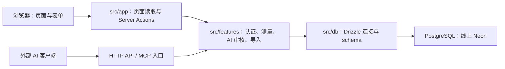

# Formward 项目架构与代码索引

本指南用于建立项目全局视图，并把页面、功能和数据流对应到具体文件。先看架构，再按要修改的功能打开链接；实现细节留在源码、各目录 README 和专题文档中。

- [整体架构与核心模块](#architecture-map)
- [界面由哪些文件组成](#ui-map)
- [功能与接口定位](#logic-map)
- [关键数据流](#data-flow)
- [Vercel、数据库与检查入口](#runtime-map)

<a id="architecture-map"></a>

## 1. 整体架构与核心模块

### 架构为什么这样组织

Formward 的核心需求是：用户通过网页管理健康记录，外部 AI 也能访问同一账号的数据、提出需要审核的操作。因此，网页和 AI 入口共用业务函数、数据库和审计规则。

项目采用一个 Next.js 应用：React 负责界面，页面和 Server Actions 承接网页操作，Route Handlers 承接 HTTP API；业务集中在 `src/features`，通过 Drizzle 访问 PostgreSQL。线上由 Vercel 运行应用、Neon 保存数据库，当前规模下保持统一开发和发布。



页面读取、认证、写入和数据库访问在服务端执行；输入、图表绘制和交互在浏览器执行。`features` 同时包含业务函数和专用界面组件，运行位置要结合调用关系判断；日期、趋势等纯计算函数也可供两端复用。

### 核心模块地图

| 模块 | 主要位置 | 职责 |
| --- | --- | --- |
| 页面与请求入口 | [src/app](../src/app/README.md) | 路由、页面组装、Server Actions、HTTP 接口；首页视觉组件目前也在此目录 |
| 认证与授权 | [features/auth](../src/features/auth/README.md) | 登录、会话、内部账号、AI Token、OAuth 与账号连接 |
| 身体记录 | [features/measurements](../src/features/measurements/README.md) | 测量展示、编辑、估算、来源、时间归属、记录与审计写入；AI 审核也属于该业务 |
| MCP 接入 | [features/mcp](../src/features/mcp/README.md) | 向 AI 暴露工具，适配 OAuth 身份并调用测量业务 |
| 文件导入 | [features/imports](../src/features/imports/README.md) | 当前解析身体记录 TSV，预览后交给测量业务写入 |
| 共享界面 | [src/components](../src/components/README.md) | 全站加载反馈、导航等待、滚动锁、手机模式判断 |
| 数据库与结构演进 | [src/db](../src/db/README.md)、[drizzle](../drizzle/README.md) | 连接、表结构、版本化 migration |
| 管理与验证工具 | [scripts](../scripts/README.md)、[tests](../tests/README.md) | 账号创建、导入、历史维护、迁移与浏览器验收 |

`features/meals`已实现饮食与食材库，`features/activities`和`features/dashboard`目前只有职责说明。当前 `/dashboard` 是身体记录页面，折线图和记录表应到 `features/measurements` 查找。

<a id="ui-map"></a>

## 2. 界面由哪些文件组成

全站外壳由 [app/layout.tsx](../src/app/layout.tsx) 提供，挂载共享加载层并引入 [globals.css](../src/app/globals.css)。登录后由 [dashboard/layout.tsx](../src/app/dashboard/layout.tsx) 统一检查身份，各页面继续校验当前会话；页面共同使用 [dashboard/header.tsx](../src/app/dashboard/header.tsx) 和 [logout-button.tsx](../src/app/dashboard/logout-button.tsx)。

| 页面 / 路径 | 页面入口 | 主要界面组件 | 样式位置 |
| --- | --- | --- | --- |
| 首页与登录 `/` | [app/page.tsx](../src/app/page.tsx) | [home-experience.tsx](../src/app/home-experience.tsx) 组装体验；[login-overlay.tsx](../src/app/login-overlay.tsx) 提供登录框 | `globals.css` 的 `.home-*`、`.login-*` |
| 身体记录 `/dashboard` | [dashboard/page.tsx](../src/app/dashboard/page.tsx) | [measurements-view.tsx](../src/features/measurements/measurements-view.tsx) 组装摘要、双图、记录表和详情面板 | [measurements-view.module.css](../src/features/measurements/measurements-view.module.css)；页头使用 `globals.css` |
| 录入 / 编辑面板 | 在身体记录页面中打开 | [measurement-entry.tsx](../src/features/measurements/measurement-entry.tsx) 提供表单；[source-input.tsx](../src/features/measurements/source-input.tsx) 提供来源输入与建议列表 | `measurements-view.module.css` |
| AI 接入 `/dashboard/ai` | [ai/page.tsx](../src/app/dashboard/ai/page.tsx) | [ai-access.tsx](../src/features/auth/ai-access.tsx) 展示令牌、OAuth 连接和审核请求 | `globals.css` 的 `.ai-*` |
| AI 审核 `/dashboard/ai/operations/[id]` | [operations/[id]/page.tsx](../src/app/dashboard/ai/operations/[id]/page.tsx) | [ai-confirmation.tsx](../src/features/measurements/ai-confirmation.tsx) 展示前后值、修改与确认；复用 `source-input.tsx` | `globals.css` 的 `.ai-*`；来源输入使用 CSS Module |
| OAuth 登录 / 授权 `/oauth/login`、`/oauth/consent` | [login/page.tsx](../src/app/oauth/login/page.tsx)、[consent/page.tsx](../src/app/oauth/consent/page.tsx) | [oauth-form.tsx](../src/features/auth/oauth-form.tsx) 提供登录和授权表单 | `globals.css` 的 `.oauth-*` |

两个较大的界面文件可以直接按组件名定位：

- `home-experience.tsx` 协调首页状态和登录动作。Logo 在 [home-header.tsx](../src/app/home-header.tsx)，概念词在 [home-intro-backdrop.tsx](../src/app/home-intro-backdrop.tsx)，人物图层在 [body-sequence.tsx](../src/app/body-sequence.tsx)。动画与素材的细分位置见 [app README](../src/app/README.md)。
- `measurements-view.tsx` 内的 `MeasurementsView` 是整体界面，`TrendPlot` 是折线图，`MeasurementInspector` 是详情 / 历史 / 编辑面板，`RecordDetails` 是记录详情，`DayOverview` 是晨晚概览。这些组件目前集中在同一个文件。

<a id="logic-map"></a>

## 3. 功能与接口定位

### 修改功能时先找哪里

| 想修改什么 | 主要文件 | 定位说明 |
| --- | --- | --- |
| 登录框输入、按钮、错误显示 | [login-overlay.tsx](../src/app/login-overlay.tsx)、[home-experience.tsx](../src/app/home-experience.tsx) | 前者管表单，后者管提交、认证阶段及成功后的动画 / 导航；外观在 `globals.css` |
| 登录请求与会话规则 | [auth/client.ts](../src/features/auth/client.ts)、[auth/auth.ts](../src/features/auth/auth.ts)、[auth/server.ts](../src/features/auth/server.ts) | 浏览器请求、Better Auth 配置、服务端当前身份分别在这三处 |
| 折线图外观与点击行为 | [measurements-view.tsx](../src/features/measurements/measurements-view.tsx)、[measurements-view.module.css](../src/features/measurements/measurements-view.module.css) | 搜索 `TrendPlot`；SVG 绘制、坐标映射、提示和点选在此 |
| 折线取哪些记录、如何连线与筛选日期 | [trend.ts](../src/features/measurements/trend.ts)、[days.ts](../src/features/measurements/days.ts)、[calendar.ts](../src/features/measurements/calendar.ts) | 趋势与刻度、晨晚配对 / 候选选择、日历窗口分别定位 |
| 当前指标与 7 日摘要 | [summary.ts](../src/features/measurements/summary.ts) | 最新实测值、区间变化与均值 |
| 编辑表单与草稿状态 | [measurement-entry.tsx](../src/features/measurements/measurement-entry.tsx)、[entry-state.ts](../src/features/measurements/entry-state.ts) | 四项输入、保存 / 估算触发、已有记录和缺项判断 |
| 保存、历史编辑与冲突处理 | [editing.ts](../src/features/measurements/editing.ts)、[records.ts](../src/features/measurements/records.ts) | `saveMeasurementDay` 编排事务和版本校验；`records.ts` 提供测量校验、查询和写入能力 |
| 体重 / 体脂估算算法 | [estimation.ts](../src/features/measurements/estimation.ts) | `buildHistoricalEstimates` 是日常估算计算；历史初始化计算另有 `buildInitializationEstimates` |
| 估算执行、落库与说明 | [editing.ts](../src/features/measurements/editing.ts)、[estimate-records.ts](../src/features/measurements/estimate-records.ts)、[estimate-explanation.ts](../src/features/measurements/estimate-explanation.ts) | 估算入口、估计写入 / 被实测替代、依据展示；算法计算与落库分开 |
| 来源建议与时间归属 | [sources.ts](../src/features/measurements/sources.ts)、[assignment.ts](../src/features/measurements/assignment.ts)、[time.ts](../src/features/measurements/time.ts)、[timezone.ts](../src/features/measurements/timezone.ts) | 来源列表 / 移除、晨晚归属、时间解析、时区选项与显示 |
| AI 提交、预览、修改与确认 | [ai-operations.ts](../src/features/measurements/ai-operations.ts) | `submitAiMeasurementOperation` 生成预览；`reviewAiMeasurementOperation` 处理网页审核，确认后调用共同的保存 / 估算函数 |
| AI 身份、权限和撤销 | [ai-tokens.ts](../src/features/auth/ai-tokens.ts)、[oauth-connections.ts](../src/features/auth/oauth-connections.ts)、[auth.ts](../src/features/auth/auth.ts) | 手动令牌、OAuth 连接、OAuth Provider 配置 |
| 导入与历史维护 | [imports/measurements.ts](../src/features/imports/measurements.ts)、[initialization.ts](../src/features/measurements/initialization.ts)、[maintenance.ts](../src/features/measurements/maintenance.ts)、[rebuild.ts](../src/features/measurements/rebuild.ts) | 文件解析、初始化 / 冻结、历史修正、估计重建；调用脚本见 [scripts README](../scripts/README.md) |

网页保存和估算走 [dashboard/actions.ts](../src/app/dashboard/actions.ts) 的 Server Actions；AI 设置和审核走 [dashboard/ai/actions.ts](../src/app/dashboard/ai/actions.ts)。寻找网页保存逻辑时，沿 `actions.ts` 继续到 feature。

### AI MVP 与公开接口

当前 AI MVP 覆盖身体记录查询、批量提交候选、网页审核和结果查询。ChatGPT 等客户端在应用外部；仓库实现协议接入、授权和业务执行。

| 接口 / 能力 | 请求入口或定义 | 实际逻辑 |
| --- | --- | --- |
| 登录与 OAuth 协议 `/api/auth/*` | [api/auth/[...all]/route.ts](../src/app/api/auth/[...all]/route.ts) | 交给 `auth/auth.ts` 配置的 Better Auth；授权页请求校验在 [oauth-pages.ts](../src/features/auth/oauth-pages.ts) |
| OAuth 发现 `/.well-known/*` | [.well-known/[...path]/route.ts](../src/app/.well-known/[...path]/route.ts) | 转发允许的发现请求到认证 Provider |
| MCP `/api/mcp` | [api/mcp/route.ts](../src/app/api/mcp/route.ts) | [mcp/server.ts](../src/features/mcp/server.ts) 定义查询、提交、状态工具并适配 OAuth 身份 |
| HTTP 查询 `GET /api/v1/measurements` | [measurements/route.ts](../src/app/api/v1/measurements/route.ts) | [ai-api.ts](../src/features/measurements/ai-api.ts) 负责令牌鉴权、查询与响应组织 |
| HTTP 提交 `POST /api/v1/measurement-operations` | [measurement-operations/route.ts](../src/app/api/v1/measurement-operations/route.ts) | `ai-api.ts` 解析输入，`ai-operations.ts` 生成审核预览 |
| HTTP 状态 `GET /api/v1/measurement-operations/[id]` | [[id]/route.ts](../src/app/api/v1/measurement-operations/[id]/route.ts) | `ai-operations.ts` 按账号读取审核状态 |
| API 结构与助手规则 | [ai-openapi.ts](../src/features/measurements/ai-openapi.ts)、[ai-instructions.ts](../src/features/measurements/ai-instructions.ts) | 定义公开协议和助手调用说明；MCP 的工具参数定义在 `mcp/server.ts` |

公开协议入口在 [openapi.json/route.ts](../src/app/api/v1/openapi.json/route.ts)。本地 AI 调试工具在 [ai-setup.mts](../scripts/ai-setup.mts) 和 [ai-request.mts](../scripts/ai-request.mts)；使用方式见 [AI 接入文档](ai-api.md)。

<a id="data-flow"></a>

## 4. 关键数据流

以下调用链结合上面的文件索引阅读。浏览器只持有表单和展示数据，数据库连接与实际写入在服务端。

### 登录

```text
login-overlay.tsx 收集邮箱与密码
  → home-experience.tsx 发起登录 → auth/client.ts 的 signIn
  → /api/auth/sign-in/email → auth/auth.ts 校验并建立会话
  → 浏览器取得会话 cookie，首页完成过渡后进入 /dashboard
  → dashboard/layout.tsx 与页面通过 auth/server.ts 校验当前身份
```

### 读取页面并绘制折线图

```text
dashboard/page.tsx 验证身份
  → records.ts / editing.ts / sources.ts 读取本账号快照
  → measurements-view.tsx 接收记录、日期和来源
  → days.ts / calendar.ts / trend.ts / summary.ts 整理展示数据
  → TrendPlot 绘图，记录表和摘要使用同一批事实
```

修改线条样式或点选行为，找界面组件；修改取数、配对或日期窗口，找展示计算；修改缺测如何估算，找 `estimation.ts`。

### 手动保存与估算

```text
measurement-entry.tsx 的草稿与按钮
  → dashboard/actions.ts 验证身份
  ├─ 保存：saveDayAction → editing.ts 的 saveMeasurementDay
  │          → records.ts / sources.ts 等校验与写入，保存审计
  └─ 估算：estimateCellAction → editing.ts 的 estimateMeasurementCell
             → estimation.ts 的 buildHistoricalEstimates 计算结果
             → editing.ts / estimate-records.ts 保存所点指标与审计
  → src/db 访问 PostgreSQL
  → actions.ts 返回最新快照并 revalidatePath
  → measurements-view.tsx 更新图、表、摘要和编辑基线
```

普通保存不自动估算。估算算法本身返回结果和依据，服务端执行函数负责权限、事务及存储；`schema.ts` 的 `measurements` 保存测量，`measurement_events` 保存审计。

### AI 候选到真正保存

```text
AI 客户端 → HTTP Route Handler 或 MCP 工具 → 验证 AI 身份
  → ai-operations.ts 生成预览，写入 measurement_operations
  → 返回审核链接，此时候选尚未写入 measurements
用户打开审核页 → ai-confirmation.tsx 修改 / 更新预览 / 确认
  → dashboard/ai/actions.ts 验证网页登录身份
  → ai-operations.ts 核对审核版本、记录快照和授权
  → 调用 editing.ts 的共同保存 / 估算函数，写入测量与审计
  → AI 客户端查询操作状态，获取逐行结果
```

网页与 AI 共用 `editing.ts` 等业务函数，区别在入口身份和审核流程。HTTP / MCP 负责协议接入，体重 / 体脂计算与保存统一复用测量业务。

<a id="runtime-map"></a>

## 5. Vercel、数据库与检查入口

### 部署和数据连接在哪里

Vercel 托管同一个 Next.js 应用，页面、Server Actions 和 `app/api` 接口随应用一起部署。接口的请求逻辑在上面的路由和 feature 中，平台接入配置集中在下表。

| 位置 | 负责什么 |
| --- | --- |
| [vercel.json](../vercel.json)、[package.json](../package.json) | Vercel 构建命令、函数区域、Node / pnpm 版本与项目运行命令 |
| [.vercelignore](../.vercelignore) | 上传时排除私有数据、环境文件、密钥和本机构建产物 |
| [next.config.ts](../next.config.ts) | Next.js 配置；当前主要设置本机开发资源来源 |
| [auth/site-url.ts](../src/features/auth/site-url.ts)、[auth/auth.ts](../src/features/auth/auth.ts) | 使用 `BETTER_AUTH_URL` 生成正式地址及认证配置；审核链接和 OpenAPI 地址也从这里取得根地址 |
| [db/client.ts](../src/db/client.ts)、[db/schema.ts](../src/db/schema.ts) | 使用 `DATABASE_URL` 连接数据库；定义账号、测量、审核和授权等表 |
| [drizzle](../drizzle/README.md)、[scripts/migrate.mts](../scripts/migrate.mts) | 版本化结构变更和执行入口，迁移单独执行 |

线上环境变量在 Vercel 配置，本机配置在私有 `.env.local`；连接代码相同。`schema.ts` 声明数据结构，真实记录存储在 PostgreSQL；`public/` 用于公开静态资源。发布及平台配置见 [部署文档](deployment.md)，表关系与字段见 [数据库字典](database.md)。

### 继续阅读与验证

- 架构边界看 [architecture.md](architecture.md)，功能当前状态看 [status.md](status.md)，身体记录规则看 [measurements.md](measurements.md)。
- 要深入某个模块，先读该目录 README，再打开本索引中的主要文件；账号创建、导入和维护脚本的入口集中在 [scripts README](../scripts/README.md)。
- 源码检查使用 `pnpm lint`、`pnpm typecheck`、`pnpm test`、`pnpm build`；首页 / OAuth 浏览器入口为 `pnpm test:browser`，身体记录 / AI 审核入口为 `pnpm test:measurements-browser`。环境与具体场景见 [tests README](../tests/README.md)。

页面入口、模块职责或调用链变化时同步更新本索引；仅调整颜色、间距或算法内部参数时，在对应源码和专题说明中维护细节。

## 饮食定位

饮食页面在[dashboard/meals/page.tsx](../src/app/dashboard/meals/page.tsx)，保存与审核入口在[actions.ts](../src/app/dashboard/meals/actions.ts)。[meals-view.tsx](../src/features/meals/meals-view.tsx)包含摘要、NutritionChart、餐次表、MealEditor／FoodEditor／EditorDialog；[meals.module.css](../src/features/meals/meals.module.css)控制间距、颜色与抽屉。营养换算／每日汇总在[model.ts](../src/features/meals/model.ts)，预览、确认事务、食材快照、版本与审计在[records.ts](../src/features/meals/records.ts)，[meal-review.tsx](../src/features/meals/meal-review.tsx)提供统一审核界面。AI由MCP server及HTTP调用这些函数；历史TSV由[imports/meals.ts](../src/features/imports/meals.ts)解析为整餐预览，网页确认后进入同一写入路径。规则与接口见[饮食记录](meals.md)。
