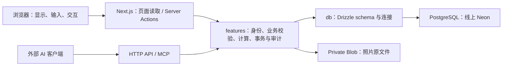
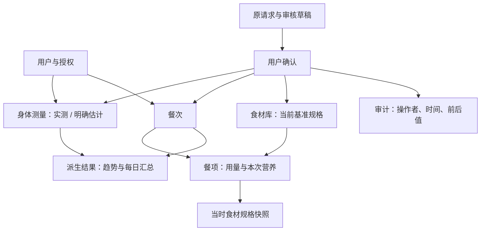

# Formward 架构与代码学习指南

## 这份 Code Study 怎么整理

这份指南按照“先掌握整体，再理解流程，最后判断怎样修改”的学习方式组织：

1. **先给系统地图**：把前端、后端、数据库、图片存储和部署之间的关系放在最前面。
2. **再分别展开三部分**：前端按页面与交互定位，后端按入口与业务定位，数据库从业务对象对应到表、字段和约束。
3. **用完整操作连接源码**：沿登录、页面读取、手动保存、估算、AI 审核和照片保存追踪数据。
4. **在学习中检查设计**：区分已确认的问题、有意保留的设计、待验证的疑点和尚未实现的功能；每项说明是否需要处理及判断依据。
5. **把理解转成修改顺序**：提供自检问题、容易遗漏的边界和修改卡片，让后续需求能对应到代码、数据影响和验证方法。

饮食、食材、总览和统一审核均纳入正文中的地图与流程。文件索引用于找到实现，专题文档用于进一步查规则。本文的核对基准是 2026-10-19 的仓库源码 `ec28406`；源码核对与线上实际部署、数据库实际迁移状态分别确认。

## 阅读顺序与理解标准

| 阅读轮次 | 阅读内容 | 达到什么程度再深入 |
| --- | --- | --- |
| 第一轮：认识整体 | 第 1 节 | 能画出网页、服务端、数据库和图片存储的关系，说明各自职责 |
| 第二轮：认识组成 | 第 2–4 节的地图和表格 | 能找到一个页面、一次保存和一个业务对象对应的主要文件及表 |
| 第三轮：讲通流程 | 第 5 节，再按链接阅读关键函数 | 能说明输入从哪里来、经过什么校验、什么时候成为正式数据、页面怎样更新 |
| 第四轮：判断修改 | 第 6–8 节 | 能区分必须修复、需要验证、可以保留和后续功能，写出修改范围与验收场景 |

每个主题都按“业务问题 → 关系图或流程 → 关键文件 → 自检问题”阅读。先掌握每个模块的轮廓，再按实际需要深入算法和语法。全项目都需要覆盖，深入程度可以不同。

目录导航：

- [1. 整体架构与核心模块](#architecture-map)
- [2. 前端：页面怎样组成并工作](#ui-map)
- [3. 后端：入口怎样调用业务](#logic-map)
- [4. 数据库：业务模型怎样落到物理结构](#database-map)
- [5. 完整数据流](#data-flow)
- [6. 当前问题、取舍与待验证项](#issue-map)
- [7. 学习中容易遗漏的问题](#blind-spots)
- [8. 从理解到修改，以及部署与检查入口](#runtime-map)

<a id="architecture-map"></a>

## 1. 整体架构与核心模块

### 1.1 系统解决什么问题

用户通过网页记录身体指标、饮食和食材；外部 AI 可以查询这些数据、保存私有原图、提出待审核操作。AI 提出的健康记录变更，需要用户登录网页确认。网页与 AI 共用业务规则、数据库和审计能力。

当前是一个 **Next.js 模块化单体**：同一个应用提供页面和后端入口，业务按功能组织。线上应用由 Vercel 运行，PostgreSQL 由 Neon 托管，照片原文件保存在 Private Blob。



| 名称 | 在本项目中承担什么 |
| --- | --- |
| React | 用组件表达页面，管理输入、图表和交互 |
| Next.js | 组织路由、服务端渲染、Server Actions 和 HTTP 入口 |
| TypeScript | 检查代码中的类型；外部输入仍需运行时校验 |
| CSS／CSS Modules | 控制外观；CSS Module 的类名按模块隔离 |
| Better Auth | 提供网页登录会话和 OAuth Provider 等身份能力 |
| Drizzle ORM | 用 TypeScript 表达表结构及数据库查询 |
| PostgreSQL／Neon | PostgreSQL 是数据库系统，Neon 托管线上数据库 |
| Private Blob | 保存照片原字节；图片元数据和关联仍在 PostgreSQL |
| Vercel | 构建并运行应用，提供部署环境配置 |

### 1.2 职责与运行位置要分别理解

“前端、后端、数据库”描述职责；代码目录、运行环境和部署平台是另外几张地图。

- `src/app` 中的页面与 layout 默认是 Server Components，可以在服务端取数并组装界面。
- 标记 `"use client"` 的组件承接状态和交互；初次加载也可能由服务端预渲染 HTML，随后在浏览器接管交互，这个过程叫 hydration（水合）。
- `"use server"` 文件中的 Server Actions 在服务端处理网页动作；浏览器调用需要经过网络，仍要验证身份和输入。
- `src/features` 中既有服务端业务，也有界面组件及两端可复用的纯计算。判断运行位置要看指令、依赖与调用关系。
- 数据库连接、凭据和实际数据库写入属于服务端。浏览器接收页面所需的数据，不能持有数据库连接串。

### 1.3 当前模块地图

| 模块 | 主要位置 | 当前职责与边界 |
| --- | --- | --- |
| 页面与请求入口 | [app README](../src/app/README.md) | 路由、页面组装、Server Actions、Route Handlers；首页视觉组件也在此目录 |
| 身份与授权 | [auth README](../src/features/auth/README.md) | 内部账号、登录、会话、AI Token、OAuth 连接与撤销 |
| 身体记录 | [measurements README](../src/features/measurements/README.md) | 体重／体脂、晨晚归属、实测／估计、来源、编辑、导入写入及审计 |
| 饮食与食材 | [meals README](../src/features/meals/README.md) | 餐次、食材规格、营养换算、照片、审核、删除恢复和历史快照 |
| 统一记录审核 | [records README](../src/features/records/README.md) | 协调身体、摄入和食材子操作，保存草稿并统一事务确认 |
| 总览 | [dashboard README](../src/features/dashboard/README.md) | 聚合身体与饮食事实，展示摄入、相对晨重、晨晚差和模块入口 |
| AI 协议 | [mcp README](../src/features/mcp/README.md) | 注册 MCP 工具，适配 OAuth 身份，调用已有 feature |
| 导入 | [imports README](../src/features/imports/README.md) | 解析身体／饮食 TSV，保留原始文件，通过对应业务完成写入或确认 |
| 共享界面 | [components README](../src/components/README.md) | 加载反馈、导航等待、滚动锁、遮罩手势和设备模式等 |
| 数据与演进 | [db README](../src/db/README.md)、[drizzle README](../drizzle/README.md) | 数据库连接、schema 和版本化 migration |
| 维护与验证 | [scripts README](../scripts/README.md)、[tests README](../tests/README.md) | 账号、导入、历史维护、备份、迁移和隔离验收 |
| 运动 | [activities README](../src/features/activities/README.md) | 当前只有职责说明，尚无运动表和完整业务实现 |

预算、全天消耗、目标、设备连接和通用 Excel 导入等还需后续实现。看见文档中的产品方向或目录名称时，要同时确认是否已有代码、表和可用入口。

**自检**：为什么网页与 AI 需要共用 feature？照片上传成功是否意味着餐次已保存？`features` 中的文件是否都在服务端运行？

<a id="ui-map"></a>

## 2. 前端：页面怎样组成并工作

### 2.1 先认识页面的组成关系

```text
URL
  → layout.tsx：公共外壳与布局
  → page.tsx：检查身份、读取数据、组装页面
  → 业务界面组件：图、表、表单、详情与交互状态
  → CSS：视觉样式
  → 用户动作调用 Server Action
  → 新数据返回、相关路由重新验证，界面更新
```

全站外壳是 [app/layout.tsx](../src/app/layout.tsx)，引入 [globals.css](../src/app/globals.css) 并挂载共享加载层。登录后使用 [dashboard/layout.tsx](../src/app/dashboard/layout.tsx)、[header.tsx](../src/app/dashboard/header.tsx) 和 [logout-button.tsx](../src/app/dashboard/logout-button.tsx)。页面与保存动作仍各自检查身份，layout 的检查不能代替每次服务端操作的授权。

### 2.2 页面、组件、样式与动作地图

下表路径相对于 `src/`；链接可直接打开文件。同一功能可能包含页面组装、交互组件与业务函数，阅读时先按职责定位。

| 页面／区域 | 页面与主要组件 | 样式 | 数据／保存入口 |
| --- | --- | --- | --- |
| 首页与登录 `/` | [app/page.tsx](../src/app/page.tsx) → [home-experience.tsx](../src/app/home-experience.tsx)、[login-overlay.tsx](../src/app/login-overlay.tsx) | `app/globals.css` 的 `.home-*`、`.login-*` | `features/auth/client.ts` 发起登录，Better Auth 建立会话 |
| 总览 `/dashboard` | [dashboard/page.tsx](../src/app/dashboard/page.tsx) → [overview-view.tsx](../src/features/dashboard/overview-view.tsx)、[overview-trend.tsx](../src/features/dashboard/overview-trend.tsx) | [overview.module.css](../src/features/dashboard/overview.module.css) | 页面读取身体与饮食；[dashboard/model.ts](../src/features/dashboard/model.ts) 计算展示结果 |
| 身体 `/dashboard/measurements` | [measurements/page.tsx](../src/app/dashboard/measurements/page.tsx) → [measurements-view.tsx](../src/features/measurements/measurements-view.tsx) | [measurements-view.module.css](../src/features/measurements/measurements-view.module.css) | 页面读取记录、日期和来源；[dashboard/actions.ts](../src/app/dashboard/actions.ts) 保存或估算 |
| 身体录入／来源 | [measurement-entry.tsx](../src/features/measurements/measurement-entry.tsx)、[source-input.tsx](../src/features/measurements/source-input.tsx) | 身体 CSS Module | [entry-state.ts](../src/features/measurements/entry-state.ts) 管草稿与缺项判断；共用身体 actions |
| 饮食 `/dashboard/meals` | [meals/page.tsx](../src/app/dashboard/meals/page.tsx) → [meals-view.tsx](../src/features/meals/meals-view.tsx)、[nutrition-chart.tsx](../src/features/meals/nutrition-chart.tsx) | [meals.module.css](../src/features/meals/meals.module.css) | 页面读取饮食快照；[meals/actions.ts](../src/app/dashboard/meals/actions.ts) 保存并刷新 |
| 本餐编辑／食材库 | [meal-editor.tsx](../src/features/meals/meal-editor.tsx)、[nutrition-fields.tsx](../src/features/meals/nutrition-fields.tsx)、[presets.tsx](../src/features/meals/presets.tsx) | 饮食 CSS Module | 编辑器管理草稿；[meals/model.ts](../src/features/meals/model.ts) 换算；保存走饮食 actions |
| 照片上传／回看 | [photos.tsx](../src/features/meals/photos.tsx) | 饮食 CSS Module | [api/meal-images](../src/app/api/meal-images/README.md) 提供受保护的上传／读取入口 |
| AI 设置 `/dashboard/ai` | [ai/page.tsx](../src/app/dashboard/ai/page.tsx) → [ai-access.tsx](../src/features/auth/ai-access.tsx) | `globals.css` 的 `.ai-*` | [ai/actions.ts](../src/app/dashboard/ai/actions.ts) 管令牌、连接和审核动作 |
| 统一审核 `/dashboard/ai/operations/[id]` | [operations/[id]/page.tsx](../src/app/dashboard/ai/operations/[id]/page.tsx) → [record-review.tsx](../src/features/records/record-review.tsx) | [record-review.module.css](../src/features/records/record-review.module.css)，编辑器复用身体／饮食样式 | `loadRecordReviewAction`／`reviewRecordAction` → `features/records/operations.ts` |
| 饮食旧审核链接 `/dashboard/meals/review/[id]` | [review/[id]/page.tsx](../src/app/dashboard/meals/review/[id]/page.tsx) → 同一个 `RecordReview` | 统一审核及复用组件样式 | 使用 `source: meal` 适配旧子操作 |
| OAuth 登录／授权 | [oauth/login/page.tsx](../src/app/oauth/login/page.tsx)、[oauth/consent/page.tsx](../src/app/oauth/consent/page.tsx) → [oauth-form.tsx](../src/features/auth/oauth-form.tsx) | `globals.css` 的 `.oauth-*` | Provider 与 [oauth-pages.ts](../src/features/auth/oauth-pages.ts) 校验授权请求 |

`presets.tsx` 当前提供食材表格和详情；基础预设采用功能已移除。文件名只帮助定位，具体职责以当前导出和调用为准。

### 2.3 交互、业务与样式怎样分开找

| 想改变什么 | 从哪里深入 |
| --- | --- |
| 首页人物、概念词与登录阶段 | `home-experience.tsx` 协调状态；[body-sequence.tsx](../src/app/body-sequence.tsx) 管人物层；[home-timeline.ts](../src/app/home-timeline.ts) 管动画进度；[home-orbit.ts](../src/app/home-orbit.ts) 管概念词轨道；细分见 app README |
| 身体图的线条、点选和详情 | `measurements-view.tsx` 中的 `TrendPlot`、`MeasurementInspector`、`DayOverview`，以及对应 CSS |
| 身体图选择哪些数据 | [days.ts](../src/features/measurements/days.ts)、[trend.ts](../src/features/measurements/trend.ts)、[calendar.ts](../src/features/measurements/calendar.ts)、[summary.ts](../src/features/measurements/summary.ts) |
| 饮食表格、拖拽与单位初始值 | `meal-editor.tsx` 与 `meals/model.ts`；食材换算和自由填写有不同语义 |
| 饮食柱图的克数／能量占比 | `nutrition-chart.tsx` 与 `meals/model.ts`；切换状态由 `MealsView` 保存 |
| 总览摄入、晨重基准和晨晚差 | `dashboard/model.ts` 选择和计算；`overview-trend.tsx` 绘制 |
| 统一审核分组、修改与确认 | `records/record-review.tsx`；身体编辑说明复用 [ai-confirmation.tsx](../src/features/measurements/ai-confirmation.tsx)，饮食依据复用 [review-details.tsx](../src/features/meals/review-details.tsx) |
| 等待反馈、遮罩和滚动 | [page-loading.tsx](../src/components/page-loading.tsx)、[loading-link.tsx](../src/components/loading-link.tsx)、[scroll-lock.ts](../src/components/scroll-lock.ts)、[use-backdrop-dismiss.ts](../src/components/use-backdrop-dismiss.ts) |

界面中的输入草稿、选中日期和弹窗状态通常在浏览器管理；正式业务是否合法，由服务端再次判断。界面上的“已核对”、内存草稿和正式保存也需要分别识别。

**自检**：改变柱图颜色、改变营养换算公式、增加一个需要保存的指标，分别会经过哪些位置？为什么客户端禁用按钮之后，服务端仍需阻止重复请求？

<a id="logic-map"></a>

## 3. 后端：入口怎样调用业务

### 3.1 三种入口与同一套业务

| 入口 | 对应文件形式 | 谁调用 | 典型处理 |
| --- | --- | --- | --- |
| 服务端页面读取 | `app/**/page.tsx` | 浏览器访问页面，由 Next.js 执行页面服务端逻辑 | 从当前会话取得账号 → feature 取数 → 传给界面组件 |
| Server Action | `app/**/actions.ts` 中的 `"use server"` 函数 | 网页表单或交互组件 | 验证身份与输入 → feature 执行 → 返回结果并刷新相关页面 |
| HTTP Route Handler | `app/**/route.ts` 导出的 `GET`／`POST` 等 | AI、浏览器或协议客户端 | 解析 HTTP 与身份 → feature 执行 → 返回 HTTP 响应；MCP 在单一 HTTP 入口中处理工具协议 |

例如 [api/v1/meals/route.ts](../src/app/api/v1/meals/route.ts) 导出 `GET`，对应 `GET /api/v1/meals`；`[id]` 是 URL 动态参数。`actions.ts` 的文件名是本项目约定，Server Action 的服务端调用由 Next.js 处理，不要求人为定义一个同名 `/api` 路由。

网页当前可以直接在服务端调用 feature 读取数据库，无需再请求自己的 HTTP API。共用业务的意思是入口最终复用功能函数；入口、授权方式和返回格式可以不同。

### 3.2 网页动作与业务函数

| 能力 | 网页／业务入口 | 核心职责 |
| --- | --- | --- |
| 当前身份与登录 | [auth/server.ts](../src/features/auth/server.ts)、[auth/auth.ts](../src/features/auth/auth.ts)、[auth/client.ts](../src/features/auth/client.ts) | 当前会话、Better Auth 配置、浏览器登录调用 |
| 身体保存 | `dashboard/actions.ts` → [editing.ts](../src/features/measurements/editing.ts) 的 `saveMeasurementDay` | 校验、版本检查、事务编排；[records.ts](../src/features/measurements/records.ts) 与 [sources.ts](../src/features/measurements/sources.ts) 等提供读写 |
| 显式估算 | `estimateCellAction` → `estimateMeasurementCell` | 调用 [estimation.ts](../src/features/measurements/estimation.ts) 计算，再由 [estimate-records.ts](../src/features/measurements/estimate-records.ts) 等保存所点指标与依据 |
| 身体来源与时间 | `sources.ts`、[assignment.ts](../src/features/measurements/assignment.ts)、[time.ts](../src/features/measurements/time.ts)、[timezone.ts](../src/features/measurements/timezone.ts) | 来源建议、归属日期、时间解析与时区规则 |
| 饮食与食材保存 | `meals/actions.ts` → [meals/records.ts](../src/features/meals/records.ts) | `submitMealOperation` 生成预览；`decideMealOperation` 确认事务；原始请求、版本、快照与审计保留 |
| 统一审核 | `ai/actions.ts` → [records/operations.ts](../src/features/records/operations.ts) | `loadRecordReview` 读取；`reviewRecordOperation` 更新草稿、核对父子版本并统一确认 |
| AI 授权 | [ai-tokens.ts](../src/features/auth/ai-tokens.ts)、[oauth-connections.ts](../src/features/auth/oauth-connections.ts) | 独立令牌、稳定 OAuth 连接、权限、到期与撤销 |
| 删除与恢复 | 饮食操作 → `meals/records.ts`；永久删除 → [recently-deleted.ts](../src/features/meals/recently-deleted.ts) | 归属、状态、版本、快照保留与审计；永久删除为独立网页能力 |
| 导入与身体维护 | [imports/measurements.ts](../src/features/imports/measurements.ts)、[imports/meals.ts](../src/features/imports/meals.ts)、[initialization.ts](../src/features/measurements/initialization.ts)、[maintenance.ts](../src/features/measurements/maintenance.ts)、[rebuild.ts](../src/features/measurements/rebuild.ts) | 原文件解析、初始化冻结、授权修正与估计重建；脚本入口见 scripts README |

### 3.3 HTTP 与 MCP 地图

| HTTP 入口 | MCP 对应能力 | 主要实现 |
| --- | --- | --- |
| [GET /api/v1/measurements](../src/app/api/v1/measurements/route.ts) | `query_measurements` | [measurements/ai-api.ts](../src/features/measurements/ai-api.ts) 的查询与展示计算 |
| [POST /api/v1/measurement-operations](../src/app/api/v1/measurement-operations/route.ts)、[GET /api/v1/measurement-operations/[id]](../src/app/api/v1/measurement-operations/[id]/route.ts) | `submit_measurement_operation`、`get_measurement_operation` | [measurements/ai-operations.ts](../src/features/measurements/ai-operations.ts) |
| [GET /api/v1/foods](../src/app/api/v1/foods/route.ts)、[GET /api/v1/meals](../src/app/api/v1/meals/route.ts) | `search_foods`、`query_meals` | [meals/ai-api.ts](../src/features/meals/ai-api.ts) → `meals/records.ts` |
| [POST /api/v1/meal-operations](../src/app/api/v1/meal-operations/route.ts)、[GET /api/v1/meal-operations/[id]](../src/app/api/v1/meal-operations/[id]/route.ts) | `submit_meal_operation`、`get_meal_operation` | `meals/records.ts` |
| [POST /api/v1/record-operations](../src/app/api/v1/record-operations/route.ts)、[GET /api/v1/record-operations/[id]](../src/app/api/v1/record-operations/[id]/route.ts) | `submit_record_operation`、`get_record_operation` | `records/operations.ts`；统一身体／摄入／食材任意组合 |
| [POST /api/v1/meal-images](../src/app/api/v1/meal-images/route.ts) | `import_meal_images` | [images.ts](../src/features/meals/images.ts) 下载、校验并保存私有原图 |
| [POST /api/mcp](../src/app/api/mcp/route.ts) | 工具协议入口，另有 `get_profile` | [mcp/server.ts](../src/features/mcp/server.ts) 注册工具并适配 OAuth 身份 |

登录与 OAuth 协议由 [api/auth/[...all]/route.ts](../src/app/api/auth/[...all]/route.ts) 交给 Better Auth；[.well-known/[...path]/route.ts](../src/app/.well-known/[...path]/route.ts) 转发允许的发现请求。网页照片上传／读取使用 `app/api/meal-images`，与 AI 的原图导入入口区分。

[openapi.json/route.ts](../src/app/api/v1/openapi.json/route.ts) 返回接口说明，定义分别位于 [measurements/ai-openapi.ts](../src/features/measurements/ai-openapi.ts)、[meals/ai-openapi.ts](../src/features/meals/ai-openapi.ts)、[records/ai-openapi.ts](../src/features/records/ai-openapi.ts)。OpenAPI 描述 HTTP 协议；实际路由仍由 `route.ts` 实现。MCP 的工具参数和说明在 `mcp/server.ts`，改接口时要检查这几处是否一致。

### 3.4 看懂后端所需的最少概念

| 概念 | 要解决的问题 | 当前例子 |
| --- | --- | --- |
| 身份与授权 | 你是谁，是否允许执行本次操作 | 网页 session、HTTP AI Token、MCP OAuth；随后仍需按可信 `userId` 检查数据归属 |
| 运行时校验 | 网络输入是否符合业务要求 | Zod schema、单位校验、来源核对、时间与空腹条件 |
| 幂等 | 同一操作重试是否重复保存 | 稳定 `operationId` 与内容摘要绑定；同 ID 改内容会冲突 |
| 版本检查 | 旧页面是否覆盖别人或另一个页面的新修改 | `version`、`revision`、`updatedAt`、预览快照摘要分别约束相关对象 |
| 事务 | 一组数据库变化是否一起成功或回滚 | 统一审核中的身体、饮食、父子操作及审计一起确认 |
| 账号锁 | 同账号的相关写入怎样协调并发 | [owner-lock.ts](../src/features/auth/owner-lock.ts) 等锁定账号行；锁与版本检查各有职责 |
| 审计 | 谁在何时以何种来源改了什么 | `measurement_events`、`meal_events` 保存前后快照与操作者 |
| 页面重新验证 | 保存后其他页面怎样看到最新事实 | actions 返回快照并调用 `revalidatePath`，界面接收新状态 |

**自检**：为什么“查询到了某条 ID”还不足以允许修改？同一请求重试与两次不同录入怎样区分？一次事务失败，已上传的 Blob 文件会自动一起回滚吗？

<a id="database-map"></a>

## 4. 数据库：业务模型怎样落到物理结构

### 4.1 三层模型对应关系

| 层次 | 回答什么 | 本项目例子 |
| --- | --- | --- |
| 业务／逻辑模型 | 系统认识什么对象，它们怎样关联 | 用户拥有餐次，一餐有多个餐项；餐项可引用食材；审核批准后才改变正式事实 |
| 物理模型 | 用哪些表、字段、类型、外键、索引与检查实现 | `meals`、`meal_items`、`foods`；组合外键约束账号；`numeric` 保存营养 |
| 读写与展示模型 | 一次请求接受什么，界面收到什么 | `MealInput` 是输入；`MealView` 是展示对象；四个表的查询可组装成一个快照 |

因此，一个页面区域、一个 TypeScript 类型和一张表并不总是一一对应。每日合计与趋势当前从事实计算，不是独立的事实表。



此图表达业务关系。真实外键、可空关联和没有外键的快照关系见 [数据库关系图](database.md#逻辑关系)；`measurement_sources` 的名称建议与测量来源文本就是没有外键联动的例子。

### 4.2 当前全部 30 张表的分组

表名来自 [schema.ts](../src/db/schema.ts)。下表覆盖应用 schema 的全部表，Drizzle 自己的迁移账本另列。

| 分组 | 物理表 | 逻辑用途 |
| --- | --- | --- |
| 登录与基础设施，5 张 | `users`、`accounts`、`sessions`、`verifications`、`rate_limits` | 用户、凭据、会话、验证状态与共享限流 |
| 手动 AI 凭据，1 张 | `ai_tokens` | 可撤销访问令牌摘要与权限状态 |
| OAuth，9 张 | `oauth_client`、`oauth_resource`、`oauth_client_resource`、`oauth_refresh_token`、`oauth_access_token`、`oauth_consent`、`oauth_client_assertion`、`jwks`、`oauth_connections` | 客户端、资源、同意、令牌轮换、签名密钥和稳定连接 |
| 身体，6 张 | `measurements`、`measurement_days`、`measurement_sources`、`measurement_imports`、`measurement_operations`、`measurement_events` | 测量事实、空日期／提醒、来源建议、批次、审核与审计 |
| 饮食与图片，8 张 | `foods`、`meals`、`meal_items`、`meal_imports`、`meal_operations`、`meal_events`、`meal_images`、`meal_image_links` | 食材、餐次、餐项、原始导入、审核、审计及图片元数据／关联 |
| 统一审核，1 张 | `record_operations` | 关联身体／饮食子操作，保存混合原请求、人工草稿与父子版本 |

`drizzle.__drizzle_migrations` 由迁移工具保存执行记录，不计入上述 30 张表。运动、目标与全天消耗尚未建成相应事实模型。认证前限流、验证状态和协议基础设施具有各自的标识规则，不能要求每一张基础设施表都带健康数据的 `user_id`。

### 4.3 一个对象怎样对应到字段

| 要表达的意思 | 对应字段／结构 | 阅读时要问的问题 |
| --- | --- | --- |
| 谁的数据 | 健康表的 `user_id`；餐项／图片关联等使用组合外键 | 服务端是否从可信身份取得账号？关联是否属于同一账号？ |
| 身体数值及真实性 | `weight_kg`、`body_fat_percent`、`record_kind`、`estimation` | 是实测还是估计？是否至少有一项指标？依据是否保留？ |
| 测量实际时间与归属 | `source_local_time`、`occurred_at`、`timezone`、`utc_offset_minutes`、`time_precision`、`record_date`、`period` | 知道的是准确时刻还是日期／时段？凌晨归哪一天？能否确定 UTC？ |
| 食材规格 | `foods.base_quantity`、`unit`、四项营养、`category`、`version` | 营养是每多少单位？当前规格是否已更新？ |
| 本餐摄入 | `meal_items.quantity`、`unit`、营养列、`food_id`、`food_snapshot` | 是食材换算还是自由填写的本次营养？历史是否仍读当时快照？ |
| 未知与缺项 | nullable 数值、`amount_decision`、来源与依据 | `null` 表示什么？零是否确实为零？未知食量是否经过明确选择？ |
| 外部来源与导入 | `source_system`、`source_record_id`、原始输入、批次、来源行和同步状态 | 重导能否识别原记录？人工编辑后会不会被覆盖？ |
| 请求与审核 | `operation_id`、`request_digest`、`payload`、`draft`／`preview`、`revision`、父子审核版本 | 原请求是否不可变？哪个是当前草稿？是否仍允许确认？ |
| 可恢复删除与追溯 | `deleted_at`、版本、事件快照、操作者与时间 | 哪些被隐藏，哪些仍保留？恢复会不会覆盖新事实？ |

身体 `period` 的物理值使用 `daytime`／`evening`；当前网页晨间录入要求空腹。身体规则按测量地当地时间归属，准确发生时刻与记录日期分开理解；未知时区或仅日期／时段不能伪造 UTC。详情见 [身体规则](measurements.md) 和 [数据模型原则](data-model.md)。

### 4.4 怎样判断多余字段与优化空间

先按以下顺序追踪一个字段：**业务含义 → 写入者 → 读取者 → 约束与计算 → 历史兼容 → 删除或重建的影响**。只搜索到很少引用、当前为空或内容相似，都不足以证明可以删除；原始来源、审计、第三方认证协议与未来重放也可能依赖它。

| 看似重复的内容 | 当前设计目的 | 当前判断 |
| --- | --- | --- |
| 食材库规格与餐项 `food_snapshot`／营养 | 食材库更新或删除后，旧餐仍保存当时的用量、单位和营养 | 有意保留；修改当前规格不应无声改写历史 |
| 原始 `payload`、当前草稿、审核预览、事件快照 | 分别保存原始意图、人工修改、可确认结果与操作事实 | 有意保留；需保证角色清晰、版本一致和原请求不可变 |
| 发生时刻、当地原时间、记录日期、创建时间 | 分别表达绝对时刻、来源当地钟点、业务归属和操作时间 | 含义不同；按可确认信息保存，未知为空 |
| `meal_items.user_id` 与餐次的账号 | 支持直接按账号查询，并以组合外键约束同账号关联 | 有意保留；要验证一致性约束 |
| 当前事实与审计中的前后值 | 正常查询使用当前事实，历史追溯使用事件 | 有意保留；清理策略需要单独定义 |

真正的优化候选需要证据：同义字段是否存在多套可变真值，计算结果能否稳定重建，查询是否无界，索引是否覆盖实际过滤与排序，JSON 结构是否有稳定校验，历史与原图保留是否符合产品承诺。数据库索引可能用于唯一性或组合外键，不能只按查询次数决定删除。

目前静态核对没有得出“某字段可以安全删除”的结论，也没有测量生产数据库的查询计划、实际耗时或字段使用率。已确认的结构特点及待验证项见第 6 节。

### 4.5 声明结构、迁移与实际数据库

```text
src/db/schema.ts：当前代码声明
  → pnpm db:generate：生成待审阅的 migration
  → drizzle/*.sql：版本化结构演进
  → pnpm db:migrate：对指定环境执行
  → PostgreSQL 中的实际表 + Drizzle 迁移账本
```

应用通过 [client.ts](../src/db/client.ts) 的 `getDatabase()` 读取 `DATABASE_URL` 并复用连接。开发、本地 PGlite 测试和线上 Neon 使用各自的数据；连接到哪个环境由配置决定，Git 分支名称不能保证数据库隔离。

修改 schema 文件本身不会改变现有数据库。共享 migration 保持不变，后续结构变化追加新 migration。执行前备份、变更审阅和迁移验证见 [数据库字典](database.md)、[接入指南](auth-setup.md) 与 [drizzle README](../drizzle/README.md)。

**自检**：为什么食材库改了，旧餐仍应读快照？一餐为什么能影响多张表？一条数据的测量时间、归属日期和创建时间可以不同吗？代码中的新字段为什么可能还不存在于线上数据库？

<a id="data-flow"></a>

## 5. 完整数据流

### 5.1 登录到进入总览

```text
login-overlay.tsx 收集邮箱与密码
  → home-experience.tsx 调用 auth/client.ts 的 signIn
  → /api/auth/sign-in/email → auth/auth.ts 的 Better Auth
  → 验证凭据，建立 session 与浏览器 cookie
  → 首页完成成功动画，导航到 /dashboard
  → dashboard/layout.tsx 和页面通过 auth/server.ts 验证当前身份
```

界面状态包括等待、认证中、失败保留输入和成功过渡。动画完成与身份验证完成是不同的条件，两者共同决定何时进入页面。

### 5.2 读取总览与身体详情

```text
/dashboard → app/dashboard/page.tsx
  → 当前身份 → listMeasurements + readMealSnapshot
  → measurementDisplay 整理测量序列化数据
  → OverviewView → dashboard/model.ts + OverviewTrend
  → 摄入柱、相对晨重线、晨晚差与入口卡片

/dashboard/measurements → 对应 page.tsx
  → 当前身份 → 身体记录 + 日期／提醒 + 来源建议
  → MeasurementsView
  → days / calendar / trend / summary
  → 身体双图、摘要、记录表和详情／录入面板
```

总览与身体详情是不同页面。总览可展示已有估计并作标记；身体详情的实测摘要和真实晨晚配对有自己的口径。读取页面不生成新估计。图上缺日保持空缺，多候选按规则等待选择，不能任取一条。

### 5.3 手动记录一餐

```text
app/dashboard/meals/page.tsx 验证身份并 readMealSnapshot
  → MealsView 展示本账号食材、餐次、图表和最近删除
  → MealEditor 编辑本餐草稿
  → 食材：按基准规格与实际同单位用量换算
     自由项：填写本次营养
  → saveMealAction 验证当前会话
  → submitMealOperation：校验、去重、生成操作与预览
  → decideMealOperation：复核版本、快照、附件和确认条件
  → 数据库事务：按操作内容保存餐次／餐项／食材／图片关联及审计
  → 返回最新饮食快照，revalidatePath 更新饮食、审核和总览等页面
  → 图、表和已记录摄入显示新事实
```

网页手动保存会在服务端创建并确认饮食操作。AI 提交则停留在待审核阶段，确认来自登录网页。新食材入库与记录本餐是可以分别选择的业务决定；本餐需要保留可解释的规格与营养，即使食材未入库。

**变化场景**：把某食材从 1 勺改为 0.5 勺，先检查基准单位和换算；把自由项填写为 100 kcal，先确认它表达本次摄入，避免再次乘分量。

### 5.4 身体手动保存与显式估算

```text
measurement-entry.tsx → dashboard/actions.ts 验证当前身份
  ├─ saveDayAction → saveMeasurementDay
  │    → 校验指标、来源、时区、空腹条件和历史版本
  │    → 事务保存实测／日期、对应来源建议、估计替代和审计
  └─ estimateCellAction → estimateMeasurementCell
       → buildHistoricalEstimates 计算所点指标的结果与依据
       → 保存估计和审计
  → 返回本账号最新快照，刷新身体页与总览
```

普通保存不自动估算。实测只替代对应的非空指标估计；另一个指标、另一个时段和初始化冻结依据按规则保留。估算样本不足时留空，估算事实与真实测量分别标记。算法细节按需进入 `estimation.ts`、[estimate-explanation.ts](../src/features/measurements/estimate-explanation.ts) 和身体专题。

### 5.5 AI 混合提交到统一确认

```text
外部 AI → submit_record_operation 或 POST /api/v1/record-operations
  → 验证 AI 身份、权限、输入和稳定 operationId
  → records/operations.ts 的 submitRecordOperation
  → 创建身体／饮食子预览与 record_operations 父批次
  → 保存原请求、草稿和父子审核版本，返回一个 confirmationUrl
  → 此时尚未把候选保存为正式健康事实

用户登录打开审核页 → loadRecordReview → RecordReview
  → 核对／修改／取消单项：reviewRecordAction 更新草稿及预览
  → 底部统一确认：reviewRecordOperation
  → 复核归属、授权、到期、父子版本、当前事实快照和照片核对
  → 同一数据库事务调用身体／饮食 feature 保存所选内容和审计
  → 保存成功显示结果，2 秒后返回总览
  → AI 通过 get_record_operation 或 HTTP GET 查询最终状态
```

父批次协调不同业务，子操作继续承担各自的预览与确认规则。旧身体／饮食审核链接通过适配进入同一 `RecordReview`；首次审核写操作才幂等建立必要的统一批次关联。旧子操作仍保留兼容能力，阅读当前网页流程时从 `records` 开始。

**变化场景**：取消食材入库、保留本餐，仍应保存本餐快照与图片；另一个页面修改了子审核，旧父批次不能直接确认；中途一项确认失败，当前这次事务应回滚，不能把部分成功误报成全部保存。

### 5.6 图片与健康事实分开保存

```text
网页：photos.tsx → 受保护上传流程 → 短期凭据 → 直传 Private Blob
AI：import_meal_images / POST /api/v1/meal-images → 下载并校验原字节
  → 保存私有原图及 meal_images 元数据 → 返回稳定 imageId
  → 餐次／食材草稿引用 imageIds
  → 用户确认后，meal_image_links 建立正式关联
  → 查看时按当前账号鉴权读取
```

图片上传可能先于健康事实确认完成；成功保存图片不等于成功保存餐次。数据库事务只能原子处理数据库变化，Blob 上传失败、数据库失败后的文件清理和重试需要单独协调。图片完整性、缺图确认及来源 URL 校验见 [饮食专题](meals.md) 和 `images.ts`／[image-upload.ts](../src/features/meals/image-upload.ts)。

**本节自检**：选一条流程，用自己的话解释“谁触发 → 入口在哪 → 哪些校验 → 哪些表变化 → 失败怎样处理 → 页面怎样更新”，再打开源码验证。

<a id="issue-map"></a>

## 6. 当前问题、取舍与待验证项

### 6.1 证据与优先级

本节记录源码核对能支持的结论。没有复现或测量的影响标为待验证；功能尚未实现时标为产品缺口。测试覆盖情况见测试文档，不以测试数量代替本次核验。

| 编号／状态 | 证据与影响 | 是否需要解决、何时处理 | 修改与验证方向 |
| --- | --- | --- | --- |
| D1：文档地图已校正 | 总览入口实际使用 `OverviewView`，审核页使用 `RecordReview`；本文的页面表、调用链和数据库关系入口按当前代码对应 | 文档必须保持准确；当前指南与关联关系图已统一 | 路由、主组件或模型变更时同步更新地图，检查文件链接和调用链 |
| C1：已确认查询范围，性能影响待测 | `meals/records.ts` 的 `readMealSnapshot` 读取本账号全部食材、餐次、有效餐项和图片关联；`searchFoods` 先读取这份快照再筛选；`queryMeals` 也在快照后按日期过滤 | 值得优先测量；数据量较小时是否必须改，由耗时与返回大小决定 | 用隔离虚构数据测搜索、日期查询、总览的数据库耗时和载荷；按需要拆专用查询、日期过滤、分页或聚合，并保持未知／删除／快照语义 |
| C2：已确认类型依赖耦合 | `db/schema.ts` 的 JSON 字段类型引用 `features/meals`、`features/records`、测量 feature；与 [架构约定](architecture.md) 的依赖方向存在类型层面的反向依赖 | 维护项；类型依赖本身不等于运行时故障。修改持久化 JSON 或业务类型时应评估 | 检查持久化结构与输入／界面类型能否独立变化；必要时在现有模块内整理类型归属，检查 typecheck、旧 JSON 兼容与相关测试 |
| C3：已确认代码表达密集 | `app/dashboard/page.tsx`、`meals/records.ts`、`records/operations.ts`、schema 的部分代码把多步操作压在同一行 | 可在触及相关功能时改善可读性；不能仅按行数决定大规模拆分 | 先展开表达和命名，再按实际职责拆小函数；保持调用、事务与行为，用相关检查验证 |
| V1：待验证约束覆盖 | 餐项和图片有账号组合外键；部分身体批次、审核子操作和凭据关联使用单 ID 外键，账号一致性还由 feature 校验 | 需要逐入口核对；当前证据不足以认定存在越权。发现实际跨账号路径时优先修复 | 对照所有创建／关联入口与跨账号测试，判断是否需要以新 migration 补组合约束；不得凭静态外键形式认定漏洞 |
| G1：已知产品缺口 | 身体准确时间／归属网页纠正、持久代表选择、网页删除恢复及导入入口尚待接入；维护工具能力不等同网页能力 | 在相应使用需求出现时排期；需要先确定交互、历史与审计规则 | 复用现有 feature，覆盖正常、无效、重复、跨账号、历史冲突与冻结范围 |
| G2：已知保留策略边界 | 饮食永久删除仍保留原始导入、操作、审计和原图；当前没有完整 Blob 垃圾清理或隐私擦除流程 | 产品需要明确删除含义；有存储或彻底擦除需求时单独设计 | 先梳理当前、历史与审计引用及保留期限，再设计可重试清理；验证不会误删其他有效引用 |

### 6.2 学习时应保留的设计

- 网页、HTTP 与 MCP 共享 feature，避免同一规则在不同入口出现不同结果。
- 原始输入、草稿、事实和审计分开保存，支持确认、追溯、纠错与幂等。
- 食材规格独立演进，旧餐保留自己的营养、单位、数量与规格快照。
- 未知使用 `null`；实测与估计分开标记；页面读取不自动产生估计。
- 普通删除可恢复；永久删除和历史资料保留具有不同语义。
- 当前采用一个应用和一个业务数据库；拆服务、增加 repository 或队列，应由实际扩容、替换或长任务需求触发。

### 6.3 后续处理顺序

1. **保持地图可信**：文档必须能对应当前代码；本次整理已修正主要入口、统一审核和关系地图。
2. **验证正确性与边界**：重点看归属、授权、历史语义、重复、并发、事务和删除；已复现的数据错误或越权优先处理。
3. **用证据决定性能改动**：先量查询与传输，再选择 C1 中需要优化的入口；增加索引前检查查询计划与约束用途。
4. **在真实改动中改善维护性**：处理 C2／C3，保持模块简单，确认旧 JSON、旧链接和 migration 兼容。
5. **按产品需要增加功能**：为 G1／G2 等写明确目标、数据影响和验收条件。

本次更新的是学习与检查材料，没有执行数据库结构、健康记录或运行代码的修复。

<a id="blind-spots"></a>

## 7. 学习中容易遗漏的问题

以下是结合当前学习目标与项目实际设计提出的自检方向。仓库记录无法逐条还原未提供的历史问答，因此这些是供验证的思维习惯，不是对个人能力的判定。

| 容易停留的位置 | 再往前问一步 | 在 Formward 中怎样验证 |
| --- | --- | --- |
| 知道代码在哪个目录 | 它在哪里运行，依赖会进入哪一端？ | 同在 `features`，界面组件、数据库函数与日期纯计算的运行边界不同 |
| 找到了 API 文件 | 还有哪些服务端入口调用同一业务？ | 对照页面取数、Server Action、HTTP、MCP 和维护脚本 |
| 正常流程能成功 | 重试、并发、过期、部分失败怎么办？ | 两个审核页使用不同 revision；上传成功后数据库写入失败；同 operationId 重试 |
| 已登录／隐藏了按钮 | 服务端是否每次验证权限和数据归属？ | 用虚构 A 账号请求 B 账号 ID；确认前撤销 AI 授权 |
| 字段内容相似 | 保存的是同一意义、同一时点、同一责任的数据吗？ | 当前食材规格、历史快照、原请求和审计分别承担什么 |
| 有数值就能汇总 | 是否已知、有效、完成，是否属于同一统计口径？ | 零摄入与无记录、实测与估计、营养缺项与完整摄入分开处理 |
| 图形一起变化 | 是否能支持因果结论，样本和时间归属是否正确？ | 晨晚差与摄入联动不能直接证明热量因果；运动消耗不能代替全天消耗 |
| 多存字段或多分层就更完善 | 当前要解决什么问题，增加什么维护成本？ | 新指标要先确定来源、单位与含义；新架构层要有真实需求 |
| 代码在本地或 GitHub 更新 | 线上应用与实际数据库分别是什么状态？ | Git 提交、Vercel 部署、migration 账本分别核对，部署见效不代表迁移已执行 |
| 测试通过／数量很多 | 测试证明了哪些行为，哪些仍需检查？ | 单元／集成／浏览器／真实手机的覆盖范围不同；只检查成功路径不能证明边界正确 |
| 想一次掌握所有细节 | 本轮需要达到哪一种理解深度？ | 全模块先能定位，核心操作再能解释，准备修改的模块进一步读约束、算法与失败分支 |

每读完一条完整流程，补一句自己的解释：“这里这样设计，是因为需要保证……；如果省掉它，可能发生……；我能用……验证。”能说出条件、取舍和证据，比背下文件名更能支撑修改判断。

<a id="runtime-map"></a>

## 8. 从理解到修改，以及部署与检查入口

### 8.1 用修改卡片组织后续工作

| 项目 | 要写清楚的内容 |
| --- | --- |
| 问题与证据 | 当前具体触发条件、实际行为、源码位置或复现结果 |
| 目标行为 | 用户期望什么；成功与失败分别怎样表现 |
| 判断 | 必须修复、需要测量、可保留取舍或新功能；为什么 |
| 影响地图 | 页面／交互 → 入口 → feature → 表／字段／原图／外部协议 |
| 数据影响 | 是否涉及历史、快照、来源、估计、删除、旧 JSON 或 migration |
| 实施顺序 | 哪些前置条件先完成，哪些可以在现有模块中独立调整 |
| 验证 | 正常、无效、重复、跨账号，以及相关并发、回滚、时区、手机场景 |

例如优化食材搜索：先用虚构大数据量测量 `searchFoods → readMealSnapshot`，确认问题后考虑直接查询当前账号有效食材；保留名称／品牌／做法的搜索语义与返回规则，检查空结果、已删除、跨账号、排序／结果数量和耗时。是否增加索引由查询方式与查询计划决定。

### 8.2 环境与配置入口

| 位置 | 职责 |
| --- | --- |
| [package.json](../package.json)、[.nvmrc](../.nvmrc) | Node／pnpm 版本、运行命令与实际依赖；当前 `pnpm test` 使用 Node test runner + tsx，浏览器验收脚本见 tests |
| [vercel.json](../vercel.json)、[.vercelignore](../.vercelignore) | 构建与部署配置、上传排除规则 |
| [next.config.ts](../next.config.ts) | Next.js 配置，包括本机开发资源允许来源 |
| [auth/site-url.ts](../src/features/auth/site-url.ts)、`auth/auth.ts` | 正式根地址、认证与审核／OpenAPI 地址生成 |
| `db/client.ts`、`db/schema.ts` | 数据库连接与当前结构声明 |
| [scripts/migrate.mts](../scripts/migrate.mts)、`drizzle/` | 迁移执行和版本化 SQL；与应用发布分别执行 |
| [images.ts](../src/features/meals/images.ts)、[image-upload.ts](../src/features/meals/image-upload.ts) | 私有原图、上传凭据、摘要校验与读取 |

本机配置在私有 `.env.local`，线上配置在部署平台；原始导入在被忽略的 `data/imports/`，私有备份在 `data/exports/`。`public/` 只放允许公开访问的静态资源。本文不包含真实用户数据、连接串或凭据。

### 8.3 按变化选择验证

| 改动 | 应查看与执行的验证 |
| --- | --- |
| 文档地图与索引 | 文件／锚点链接、表名与接口映射、文档之间的一致性、`git diff --check` |
| 运行代码 | 项目质量门槛为 `pnpm lint`、`pnpm typecheck`、`pnpm test`、`pnpm build`；按影响补相关隔离验收 |
| 身体规则／AI 身体入口 | 相关 feature 测试；`pnpm test:measurements-http`、`pnpm test:measurements-browser` |
| 饮食／总览／照片 | 相关模型、事务和图片测试；`pnpm test:meals-browser` |
| 混合审核 | `records/operations.test.ts`；`pnpm test:records-browser`；必要时验证旧身体／饮食链接 |
| 登录／OAuth | 认证与 OAuth 测试；`pnpm test:browser` |
| 数据库结构 | 新 migration 的升级与旧值保留验证，正常／无效／重复／跨账号及相关回滚场景 |

浏览器验收的 production build、工具环境和虚构数据库准备以 [tests README](../tests/README.md) 为准。测试使用独立环境，不向真实健康账号写虚构数据。真实手机与外部客户端的观感／连接也有各自验收范围。

### 8.4 深入文档与维护约定

- 架构边界：[architecture.md](architecture.md)；最新工作状态：[status.md](status.md)、[handoff.md](../handoff.md)。
- 数据语义：[data-model.md](data-model.md)；关系、字段与约束：[database.md](database.md)。
- 业务规则：[measurements.md](measurements.md)、[meals.md](meals.md)；界面：[interface.md](interface.md)。
- 接入和运行：[ai-api.md](ai-api.md)、[auth-setup.md](auth-setup.md)、[deployment.md](deployment.md)。

修改前阅读根 README、AGENTS 与目标目录最近的 README；涉及 Next.js 时先读安装版本 `node_modules/next/dist/docs/` 的相关指南。页面入口、业务调用链、模型或协议变化时，同步更新本文对应章节与问题状态，保持一份当前有效的地图。
