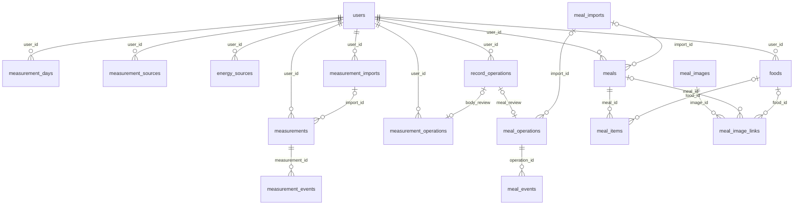
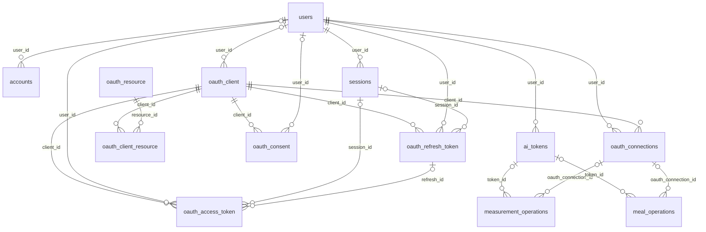

# 数据库连接与字段字典

## 运动分项存储

0026_dark_tana_nile为activities增加calorie_mode、resting_kcal、active_kcal，均可空，旧记录不回填。TypeScript对应calorieMode、exerciseRestingKcal、exerciseActiveKcal，避免与日记录混淆。原calories_kcal保存运动总数；分项模式总数由两项已知时形成，计入值由纯运动产生，未知保持空。账号、来源、版本和审计沿用。当前39张应用表另加Drizzle账本。身体旧实测通过既有deleted_at归档；单指标删除保留另一指标及审计。

本文描述已纳入 migration 的当前物理结构。业务语义见 [数据模型原则](data-model.md)，认证配置见 [接入指南](auth-setup.md)。不包含真实健康数值、账号或连接凭据。当前 schema 有 39 张业务／认证／限流表；`measurements` 为 30 列，`measurement_sources` 为 6 列。

`0007_strong_omega_sentinel.sql` 将测量与日期表统一为 `record_date`，测量表移除重复 `local_date`。实际发生日期从 `source_local_time` 读取；迁移在删除旧列前锁定并验证两者一致，异常则整批停止。凌晨分组、已有指纹、原始输入、旧审计和冻结报告保持。旧私有请求只在读取入口兼容 `analysisDate`；新模型统一使用 `recordDate`，冲突拒绝，旧补全请求指纹仍可识别。

## 连接与演进流程

1. 使用 Node.js 24 和 pnpm 9，安装依赖。把数据库运行连接配置到私有 `.env.local` 的 `DATABASE_URL`；需要直连的 migration 使用 `DATABASE_MIGRATION_URL`，未设置则使用运行连接。Neon 与本机 PostgreSQL 共用 postgres.js／Drizzle。配置不提交 Git、不打印 URL。
2. 在现有数据库上执行结构变更前，运行 `node --env-file=.env.local --import tsx scripts/backup-database.mts data/exports/私有备份.json`。工具在 repeatable read 只读事务中导出 public 和 drizzle 表及字段信息，文件以 0600 创建、拒绝覆盖。备份包括认证数据，保持私有；恢复先还原对应版本结构，再按外键顺序恢复数据和 migration journal，切勿对正式库盲目重放。
3. 修改 `src/db/schema.ts`，执行 `pnpm db:generate`，审阅新 SQL 与快照。已经共享的 migration 不修改；数据转换必须在删列之前完成。生成文件纳入版本控制后，运行 `pnpm db:migrate`。
4. 应用通过 `getDatabase()` 复用服务端连接池，页面与 Server Action 从当前会话获得账号，再调用 feature。查询按账号顺序执行以兼容 PGlite；所有测量写入锁定 users 中的归属账号并在事务内保存批次、事实、来源建议和审计。
5. 需要人工查看数据库时，用支持 PostgreSQL 的私有 SQL 客户端导入同一环境连接，按 `user_id` 限定查询；不要将完整连接地址写入文档、终端历史或公共截图。只读排查不直接改结构，结构变化只走 migration。

`0006_living_tarantula.sql` 合并已知设备和应用为 `device_label`，在删旧列前保存来源合并审计；设备或应用只有一项时保留该项。移除 BMI 数值列与检查约束，但不改旧去重键、原始输入、审计、初始化依据、日期与提醒状态。当前账号未知来源实测的授权补齐由 `fill-measurement-sources.mts` 调用 feature 完成；不在 migration 中硬编码账号或给其他账号猜来源。估计不保存设备来源。旧四列 TSV 的 BMI 仅留在原文件；三列格式为测量时间、体重、体脂率。重导用原始时间、时区、偏移与原始体重／体脂核对，人工编辑或软删除后仍跳过原记录。

## 逻辑关系

业务对象与物理表的对应方法、全部 37 张表的用途分组，见 [Code Study 的数据库地图](code-study.md#database-map)。下图按健康业务和身份授权分别展示主要物理外键；为便于阅读，省略部分重复的 `user_id` 连线。`o|` 表示可选的单个关联，`o{` 表示零到多个。完整字段、组合外键和检查约束以本文字典及 [schema.ts](../src/db/schema.ts) 为准。

### 健康事实、审核与图片

需要与图同时理解的规则：

- `record_operations` 的身体／饮食子操作都可空，每个非空子操作最多关联一个父批次；父子审核版本另外校验。审核确认后才改变正式健康事实，图中的外键本身不代表已经保存。
- `meal_items` 对 `meals`、`foods`，`meal_image_links` 对图片、餐次、食材，以及餐次／饮食操作对导入的关联使用账号组合外键；部分身体批次、审核与凭据关联使用单 ID 外键，其账号一致性还需 feature 校验。不能从图上的连线推断所有归属都由数据库自动保证。
- `meal_image_links.meal_id` 与 `food_id` 恰有一个非空；图片元数据保存在 `meal_images`，原文件在 Private Blob。
- `measurement_days` 保存日期／提醒，`measurement_sources` 保存名称建议；两者均没有外键连接具体测量。测量以 `device_label` 保存来源文本快照，移除建议不会修改历史测量。
- `meal_items.food_snapshot` 是当时食材规格的 JSON 快照，与当前 `foods` 分别保留；食材永久删除可以解除 `food_id`，历史营养和快照继续存在。
- `meal_events.record_id` 配合 `record_type` 表达被修改对象，没有到 `meals`／`foods` 的外键；事件通过 `operation_id` 关联饮食操作。身体操作与测量之间的审核依据也包含在 JSON 和审计中，不是图中省略的一条直接事实外键。

### 登录、AI 凭据与 OAuth

身体 AI 操作的 `token_id`／`oauth_connection_id` 恰有一个非空；饮食操作按 `origin` 校验手动、AI 或初始化对应的凭据与导入关系。OAuth 的 `client_id` 引用客户端业务标识 `oauth_client.client_id`，资源关联引用 `oauth_resource.identifier`，不应一律理解成关联对应表的 `id`。

下列基础设施表没有图中的用户外键：`verifications` 按 `identifier` 管理验证状态；`rate_limits` 保存认证前来源与入口限流；`oauth_client_assertion` 保存协议断言的期限；`jwks` 保存签名密钥。它们与图中表合计为当前 39 张应用表。迁移账本 `drizzle.__drizzle_migrations` 另由工具管理。

`created_by`、`actor_id` 等操作者快照保留文本标识，不是数据归属外键；真正归属由可信身份与 `user_id` 校验。体重单位固定 kg，体脂固定 %；外部原值、来源标识和批次状态独立保存。

## 物理字段

以下类型来自 Drizzle 快照。非空字段的“无空值”表示数据库拒绝 NULL，不代表 feature 接受任意内容。timestamp 均带时区。未知业务数值使用 NULL；JSON 快照及审计保持原始内容。AI 令牌保存在 ai_tokens，只保存不可逆摘要，不能复用网页登录会话令牌。

### `rate_limits`

由 `0010_shared_auth_rate_limits.sql` 创建，保存登录前的服务限流状态，不是用户健康数据。Better Auth 按可信代理提供的来源与入口生成 key，多个服务实例原子计数。

| 字段 | 类型 | 含义 |
| --- | --- | --- |
| id | text PK | 限流状态标识 |
| key | text UNIQUE | 来源与认证入口的限流键 |
| count | integer | 当前窗口请求计数 |
| last_request | bigint | 最后请求的 Unix 毫秒时间 |

last_request 有索引，支持认证存储清理过期计数。限流表不关联用户，因为认证前尚无可信用户身份。

### `ai_tokens`

由 `0008_aspiring_thunderbolt_ross.sql` 创建；完整令牌仅生成时返回，不持久保存。

| 字段 | 类型 | 含义 |
| --- | --- | --- |
| id | text PK | 令牌 ID |
| user_id | text FK | 所属账号，关联 users |
| name | text | 用户填写的名称 |
| token_hash | text UNIQUE | 随机令牌的 SHA-256 摘要 |
| prefix | text | 列表显示前缀，不用于鉴权 |
| permission | text | read／write，数据库 check；write 包含查询与提交预览 |
| created_at | timestamptz | 创建时间 |
| expires_at | timestamptz | 30 天到期 |
| last_used_at | timestamptz nullable | 最近有效使用时间 |
| revoked_at | timestamptz nullable | 撤销时间，鉴权即时检查 |

user_id 有索引，令牌只通过完整随机原文摘要查找并映射账号。创建／撤销锁定所属 users，与确认操作串行。

### `measurement_operations`

由 0008 创建，0009 增加审核版本和混合状态，0011 增加 OAuth 连接归属，记录待确认内容，不是实测事实。

| 字段 | 类型 | 含义 |
| --- | --- | --- |
| id | text PK | 操作 ID，用于状态与网页链接 |
| user_id | text FK | 所属账号 |
| token_id | text FK nullable | 手动发起令牌，关联 ai_tokens |
| oauth_connection_id | text FK nullable | OAuth 发起连接，关联 oauth_connections |
| operation_id | text | 客户端稳定请求 ID，按账号唯一 |
| request_digest | text | 规范化请求摘要，重试须同内容和发起凭据 |
| snapshot_digest | text | 身体记录及初始化冻结依据快照摘要 |
| payload | jsonb | 不可变的批量／兼容单日／单项原始请求，幂等摘要绑定此内容 |
| preview | jsonb | 前后值、冲突、估算依据；items 内保存稳定行 ID、原始内容、当前草稿、编辑者与逐行状态／结果 |
| revision | integer | 默认 1，网页修改／刷新／确认／取消递增，拒绝旧版本覆盖 |
| status | text | pending／partially_confirmed／confirmed／completed／cancelled，数据库 check |
| result | jsonb nullable | 确认后的消息与保存数量 |
| created_at | timestamptz | 预览创建时间 |
| expires_at | timestamptz | 15 分钟到期，更新／刷新续期；尚有待处理行时由读取推导 expired |
| confirmed_at | timestamptz nullable | 最近一次行保存的网页确认时间 |

(user_id, operation_id) 唯一，(user_id, created_at) 索引用于最近提交。读取、修改、取消和确认校验归属；token_id／oauth_connection_id 恰有一个非空，由数据库 CHECK 约束；修改／刷新／确认复核对应令牌或连接有效性，确认另复核快照、有效期和审核版本。身体 feature 保留旧逐行确认能力供兼容；当前网页逐项核对只更新统一草稿，底部确认在同一事务保存所选内容，旧已保存行不重复写入。AI 审计保存在 measurement_events.snapshot.ai，包含 tokenId 或 oauthConnectionId、operationId（此表 id）、confirmedBy、confirmedAt；可编辑审核另保存 review 的行 ID、审核版本、originalInput、reviewedInput 与 editedBy。旧单日／单项 JSON 使用兼容适配，不改原 payload。0009 不改健康表与已有健康数据。

### OAuth Provider 与账号连接

以下 9 张表由 `0011_mcp_oauth.sql` 创建。官方插件管理协议表，Formward 管理稳定连接；均属于私有认证数据。授权码摘要和临时签名状态沿用 verifications。真实数据库执行状态见 [项目交接](../handoff.md)。

#### `oauth_connections`

Formward 的稳定账号连接。user_id／client_id 索引，关联用户及客户端；30 天到期、按账号锁定创建／撤销；刷新不改变归属，重新授权不恢复旧审核。

| 字段 | 类型 | 空值／默认值 | 含义 |
| --- | --- | --- | --- |
| `id` | `text` | 非空 | 稳定标识／主键 |
| `user_id` | `text` | 非空 | 归属账号；用户授权场景必须校验 |
| `client_id` | `text` | 非空 | 注册客户端标识，关联 oauth_client.client_id |
| `scopes` | `text[]` | 非空；默认 '{}' | 实际授权范围 |
| `created_at` | `timestamp with time zone` | 非空；默认 now() | 创建时间 |
| `authorized_at` | `timestamp with time zone` | 可空 | 首次令牌成功签发时间；空值为待授权，不展示为有效连接 |
| `expires_at` | `timestamp with time zone` | 非空 | 到期时间 |
| `last_used_at` | `timestamp with time zone` | 可空 | 最近成功 MCP 访问时间 |
| `revoked_at` | `timestamp with time zone` | 可空 | 用户撤销时间，保留连接与审计 |

#### `oauth_client`

CIMD／DCR 注册客户端及官方协议配置；client_id 唯一，user_id 有索引。服务仅开放 authorization_code 与 refresh_token，普通客户端不能跳过用户同意。

| 字段 | 类型 | 空值／默认值 | 含义 |
| --- | --- | --- | --- |
| `id` | `text` | 非空 | 稳定标识／主键 |
| `client_id` | `text` | 非空 | 注册客户端标识，关联 oauth_client.client_id |
| `client_secret` | `text` | 可空 | 客户端密钥摘要；公开客户端可空 |
| `client_discovery_id` | `text` | 可空 | CIMD 元数据文档标识 |
| `disabled` | `boolean` | 可空；默认 False | 是否停用；停用客户端立即拒绝访问 |
| `skip_consent` | `boolean` | 可空 | 跳过同意配置；普通注册客户端不允许跳过 |
| `enable_end_session` | `boolean` | 可空 | 客户端会话结束能力预留 |
| `subject_type` | `text` | 可空 | subject 类型 |
| `scopes` | `text[]` | 可空 | 实际授权范围 |
| `client_credentials_scopes` | `text[]` | 可空；默认 '{}' | client credentials 预留权限；本服务不启用此 grant |
| `user_id` | `text` | 可空 | 归属账号；用户授权场景必须校验 |
| `created_at` | `timestamp with time zone` | 可空 | 创建时间 |
| `updated_at` | `timestamp with time zone` | 可空 | 更新时间 |
| `name` | `text` | 可空 | 客户端／资源显示名称 |
| `uri` | `text` | 可空 | 客户端网址 |
| `icon` | `text` | 可空 | 客户端图标地址 |
| `contacts` | `text[]` | 可空 | 联系人信息 |
| `tos` | `text` | 可空 | 服务条款网址 |
| `policy` | `text` | 可空 | 隐私政策网址 |
| `software_id` | `text` | 可空 | 软件标识 |
| `software_version` | `text` | 可空 | 软件版本 |
| `software_statement` | `text` | 可空 | 签名软件声明预留 |
| `redirect_uris` | `text[]` | 非空 | 允许的 OAuth 回调地址 |
| `post_logout_redirect_uris` | `text[]` | 可空 | 注销回调预留 |
| `backchannel_logout_uri` | `text` | 可空 | 后端注销回调预留 |
| `backchannel_logout_session_required` | `boolean` | 可空 | 后端注销会话要求预留 |
| `token_endpoint_auth_method` | `text` | 可空 | token 端点客户端认证方式 |
| `application_type` | `text` | 可空 | 客户端类型；native 支持回环可变端口 |
| `jwks` | `text` | 可空 | 客户端公开 JWK 元数据 |
| `jwks_uri` | `text` | 可空 | 客户端公钥文档地址 |
| `grant_types` | `text[]` | 可空 | 允许的授权类型 |
| `response_types` | `text[]` | 可空 | 允许的响应类型 |
| `require_p_k_c_e` | `boolean` | 可空 | 要求 PKCE；注册客户端强制启用 |
| `dpop_bound_access_tokens` | `boolean` | 可空；默认 False | DPoP 令牌绑定预留 |
| `reference_id` | `text` | 可空 | 授权引用；本服务使用 oauth_connections.id，刷新保持 |
| `metadata` | `jsonb` | 可空 | 官方插件扩展元数据 |

#### `oauth_resource`

官方 OAuth 资源配置；identifier 唯一，本服务固定为配置根地址下的 /api/mcp。

| 字段 | 类型 | 空值／默认值 | 含义 |
| --- | --- | --- | --- |
| `id` | `text` | 非空 | 稳定标识／主键 |
| `identifier` | `text` | 非空 | OAuth resource URI，唯一；本服务为正式 /api/mcp |
| `name` | `text` | 非空 | 客户端／资源显示名称 |
| `access_token_ttl` | `integer` | 可空 | 访问令牌秒数，本服务 3600 |
| `refresh_token_ttl` | `integer` | 可空 | 刷新令牌秒数，最多 30 天 |
| `signing_algorithm` | `text` | 可空 | 签名算法配置 |
| `signing_key_id` | `text` | 可空 | 签名公钥标识 |
| `allowed_scopes` | `text[]` | 可空 | 资源允许的权限 |
| `custom_claims` | `jsonb` | 可空 | 自定义 JWT 声明配置 |
| `dpop_bound_access_tokens_required` | `boolean` | 可空；默认 False | 是否要求 DPoP；当前不要求 |
| `disabled` | `boolean` | 可空；默认 False | 是否停用；停用客户端立即拒绝访问 |
| `created_at` | `timestamp with time zone` | 可空 | 创建时间 |
| `updated_at` | `timestamp with time zone` | 可空 | 更新时间 |
| `policy_version` | `integer` | 可空；默认 1 | 资源策略版本 |
| `metadata` | `jsonb` | 可空 | 官方插件扩展元数据 |

#### `oauth_client_resource`

客户端与资源允许关系；client_id／resource_id 联合唯一，双方外键删除级联。

| 字段 | 类型 | 空值／默认值 | 含义 |
| --- | --- | --- | --- |
| `id` | `text` | 非空 | 稳定标识／主键 |
| `client_id` | `text` | 非空 | 注册客户端标识，关联 oauth_client.client_id |
| `resource_id` | `text` | 非空 | 资源 identifier 外键 |
| `metadata` | `jsonb` | 可空 | 官方插件扩展元数据 |
| `created_at` | `timestamp with time zone` | 可空 | 创建时间 |

#### `oauth_consent`

用户明确同意的范围，按账号、客户端、稳定 reference_id 校验；撤销连接删除对应同意，不只依赖 JWT 到期。

| 字段 | 类型 | 空值／默认值 | 含义 |
| --- | --- | --- | --- |
| `id` | `text` | 非空 | 稳定标识／主键 |
| `client_id` | `text` | 非空 | 注册客户端标识，关联 oauth_client.client_id |
| `user_id` | `text` | 可空 | 归属账号；用户授权场景必须校验 |
| `reference_id` | `text` | 可空 | 授权引用；本服务使用 oauth_connections.id，刷新保持 |
| `resources` | `text[]` | 可空 | 授权资源列表 |
| `requested_user_info_claims` | `text[]` | 可空 | 请求的用户信息字段 |
| `scopes` | `text[]` | 非空 | 实际授权范围 |
| `created_at` | `timestamp with time zone` | 非空 | 创建时间 |
| `updated_at` | `timestamp with time zone` | 非空 | 更新时间 |

#### `oauth_refresh_token`

摘要刷新凭据及轮换／重放状态。客户端、账号、授权码有索引；轮换保留稳定 reference_id，重放拒绝并撤销家族。

| 字段 | 类型 | 空值／默认值 | 含义 |
| --- | --- | --- | --- |
| `id` | `text` | 非空 | 稳定标识／主键 |
| `token` | `text` | 非空 | 不可逆令牌摘要，唯一；不保存原文 |
| `client_id` | `text` | 非空 | 注册客户端标识，关联 oauth_client.client_id |
| `session_id` | `text` | 可空 | 签发时的网页登录会话，注销后可为空 |
| `user_id` | `text` | 非空 | 归属账号；用户授权场景必须校验 |
| `reference_id` | `text` | 可空 | 授权引用；本服务使用 oauth_connections.id，刷新保持 |
| `authorization_code_id` | `text` | 可空 | 授权码摘要引用，用于令牌家族追踪 |
| `resources` | `text[]` | 可空 | 授权资源列表 |
| `requested_user_info_claims` | `text[]` | 可空 | 请求的用户信息字段 |
| `expires_at` | `timestamp with time zone` | 非空 | 到期时间 |
| `created_at` | `timestamp with time zone` | 非空 | 创建时间 |
| `revoked` | `timestamp with time zone` | 可空 | 撤销时间 |
| `rotated_at` | `timestamp with time zone` | 可空 | 刷新令牌轮换时间 |
| `rotation_replay_response` | `text` | 可空 | 刷新短窗口重放响应预留；本服务重放间隔为 0 |
| `rotation_replay_expires_at` | `timestamp with time zone` | 可空 | 短窗口重放到期时间预留 |
| `auth_time` | `timestamp with time zone` | 可空 | 原始登录认证时间 |
| `confirmation` | `jsonb` | 可空 | 持有者绑定信息预留，本服务不强制 DPoP |
| `scopes` | `text[]` | 非空 | 实际授权范围 |

#### `oauth_access_token`

官方插件的 opaque token／刷新关联结构；本服务主要签发 JWT，访问时仍复核当前连接。摘要 token 唯一，客户端、账号、会话、授权码及刷新记录有索引。

| 字段 | 类型 | 空值／默认值 | 含义 |
| --- | --- | --- | --- |
| `id` | `text` | 非空 | 稳定标识／主键 |
| `token` | `text` | 非空 | 不可逆令牌摘要，唯一；不保存原文 |
| `client_id` | `text` | 非空 | 注册客户端标识，关联 oauth_client.client_id |
| `session_id` | `text` | 可空 | 签发时的网页登录会话，注销后可为空 |
| `user_id` | `text` | 可空 | 归属账号；用户授权场景必须校验 |
| `reference_id` | `text` | 可空 | 授权引用；本服务使用 oauth_connections.id，刷新保持 |
| `authorization_code_id` | `text` | 可空 | 授权码摘要引用，用于令牌家族追踪 |
| `resources` | `text[]` | 可空 | 授权资源列表 |
| `requested_user_info_claims` | `text[]` | 可空 | 请求的用户信息字段 |
| `refresh_id` | `text` | 可空 | 对应刷新令牌记录外键 |
| `expires_at` | `timestamp with time zone` | 非空 | 到期时间 |
| `created_at` | `timestamp with time zone` | 非空 | 创建时间 |
| `revoked` | `timestamp with time zone` | 可空 | 撤销时间 |
| `confirmation` | `jsonb` | 可空 | 持有者绑定信息预留，本服务不强制 DPoP |
| `scopes` | `text[]` | 非空 | 实际授权范围 |

#### `oauth_client_assertion`

客户端签名 assertion 的已用标识及到期时间，用于防重放，不是用户健康数据。

| 字段 | 类型 | 空值／默认值 | 含义 |
| --- | --- | --- | --- |
| `id` | `text` | 非空 | 稳定标识／主键 |
| `expires_at` | `timestamp with time zone` | 非空 | 到期时间 |

#### `jwks`

JWT 签名公私钥。私钥由 Better Auth 加密保存，公开端点只返回公钥；不能将数据库备份当公开 JWKS。

| 字段 | 类型 | 空值／默认值 | 含义 |
| --- | --- | --- | --- |
| `id` | `text` | 非空 | 稳定标识／主键 |
| `public_key` | `text` | 非空 | 公开 JWK，允许 JWKS 端点提供 |
| `private_key` | `text` | 非空 | 加密签名私钥，仅认证服务可读 |
| `created_at` | `timestamp with time zone` | 非空 | 创建时间 |
| `expires_at` | `timestamp with time zone` | 可空 | 到期时间 |
| `alg` | `text` | 可空 | 密钥算法 |
| `crv` | `text` | 可空 | 密钥曲线 |

### `accounts`

| 字段 | 类型 | 空值／默认值 | 用途 | 维护入口 |
| --- | --- | --- | --- | --- |
| `id` | `text` | 无空值 | 稳定记录标识 | `认证 feature／measurements feature 创建` |
| `user_id` | `text` | 无空值 | 所属账号；读写必须用已验证身份限定 | `认证／measurements feature` |
| `account_id` | `text` | 无空值 | 提供方的账号标识；内部凭据由认证管理 | `Better Auth` |
| `provider_id` | `text` | 无空值 | 登录提供方标识 | `Better Auth` |
| `password` | `text` | 可空：未提供／不适用，具体见用途 | 安全密码哈希；空值表示无密码凭据 | `auth/provision.ts／Better Auth` |
| `access_token` | `text` | 可空：未提供／不适用，具体见用途 | 第三方身份登录提供方令牌；当前为空，不是 Formward OAuth Provider 或 AI Token | `Better Auth` |
| `refresh_token` | `text` | 可空：未提供／不适用，具体见用途 | 第三方身份登录刷新令牌；当前为空 | `Better Auth` |
| `id_token` | `text` | 可空：未提供／不适用，具体见用途 | 第三方身份登录身份令牌；当前为空 | `Better Auth` |
| `access_token_expires_at` | `timestamp with time zone` | 可空：未提供／不适用，具体见用途 | OAuth 访问授权到期时间；空值表示无授权 | `Better Auth` |
| `refresh_token_expires_at` | `timestamp with time zone` | 可空：未提供／不适用，具体见用途 | OAuth 刷新授权到期时间；空值表示无授权 | `Better Auth` |
| `scope` | `text` | 可空：未提供／不适用，具体见用途 | OAuth 授权范围；空值表示无授权 | `Better Auth` |
| `created_at` | `timestamp with time zone` | 无空值；默认 now() | 创建时间；不是测量时间 | `创建记录时由数据库／feature 写入` |
| `updated_at` | `timestamp with time zone` | 无空值；默认 now() | 最近修改时间；测量编辑用它作并发版本 | `对应 feature 更新` |

约束与索引：

- 主键：`id`。
- 索引 `accounts_user_id_idx`：`user_id`。
- 唯一索引 `accounts_provider_account_idx`：`provider_id, account_id`。
- 外键 `accounts_user_id_users_id_fk`：`user_id` → `users.id`；删除规则 `cascade`。

### `measurements`

| 字段 | 类型 | 空值／默认值 | 用途 | 维护入口 |
| --- | --- | --- | --- | --- |
| `id` | `text` | 无空值 | 稳定记录标识 | `认证 feature／measurements feature 创建` |
| `user_id` | `text` | 无空值 | 所属账号；读写必须用已验证身份限定 | `认证／measurements feature` |
| `source_local_time` | `text` | 无空值 | 原始当地时间；day_period 只含记录日期，assumed 含占位钟点，均不能当准确时间 | `records.ts／导入／准确时间维护` |
| `occurred_at` | `timestamp with time zone` | 可空：未提供／不适用，具体见用途 | 准确测量的 UTC 时刻；未知时区或占位／日期时段／估计时为空 | `records.ts／time.ts` |
| `timezone` | `text` | 可空：未提供／不适用，具体见用途 | 当次 IANA 时区；空值表示未知，不用当前所在地改旧数据 | `records.ts／time.ts` |
| `utc_offset_minutes` | `integer` | 可空：未提供／不适用，具体见用途 | 当次相对 UTC 的分钟偏移；空值表示没有准确时刻或未知 | `time.ts` |
| `time_precision` | `text` | 无空值；默认 'second' | second 为准确时间；day_period 为日期时段；assumed 为明确授权占位 | `records.ts／估计 feature` |
| `record_date` | `date` | 无空值 | 唯一记录日期，用于日历、晨晚配对和估计；凌晨仍放前一天晚间 | `records.ts／editing.ts／assignment.ts` |
| `period` | `text` | 无空值 | daytime 或 evening；当地凌晨按前日晚间归属 | `assignment.ts／records.ts` |
| `assignment_method` | `text` | 无空值 | 归属方式，例如 clock、user_period、estimated_target | `assignment.ts／records.ts／estimate-records.ts` |
| `assignment_rule_version` | `text` | 无空值 | 归属规则版本，旧记录不自动重分组 | `assignment.ts／records.ts／estimate-records.ts` |
| `fasting` | `boolean` | 可空：未提供／不适用，具体见用途 | 空腹条件；空值表示未确认，不等同非空腹 | `records.ts／授权 maintenance.ts` |
| `fasting_source` | `text` | 可空：未提供／不适用，具体见用途 | 空腹确认依据；空值表示条件未知 | `records.ts／estimate-records.ts／授权 maintenance.ts` |
| `weight_kg` | `numeric(7, 2)` | 可空：未提供／不适用，具体见用途 | 体重 kg；空值表示该指标未知，不能用 0 代替 | `records.ts／editing.ts／estimate-records.ts` |
| `body_fat_percent` | `numeric(5, 2)` | 可空：未提供／不适用，具体见用途 | 体脂百分比；空值表示未知，0 可为已知数值 | `records.ts／editing.ts／estimate-records.ts` |
| `source_type` | `text` | 无空值 | 原始采集方式：import、manual 或 estimate | `records.ts／estimate-records.ts` |
| `record_kind` | `text` | 无空值；默认 'observed' | observed 为实测，estimated 为系统估计 | `records.ts／estimate-records.ts` |
| `entry_channel` | `text` | 可空：未提供／不适用，具体见用途 | api、manual、development_backend；空值表示旧入口未知 | `records.ts；编辑保留原入口` |
| `device_label` | `text` | 可空：未提供／不适用，具体见用途 | 设备与连接应用的合并名称快照；空值表示未知，估计保持为空 | `editing.ts／records.ts／sources.ts／授权来源维护` |
| `estimation` | `jsonb` | 可空：未提供／不适用，具体见用途 | 估计规则、真实依据和样本快照；实测为空 | `estimate-records.ts／initialization.ts／rebuild.ts` |
| `source_system` | `text` | 可空：未提供／不适用，具体见用途 | 真实外部来源系统；空值表示未提供，不能把输入工具当外部同步 | `records.ts／后续连接器` |
| `source_record_id` | `text` | 可空：未提供／不适用，具体见用途 | 外部稳定记录标识；空值表示来源未提供 | `records.ts／后续连接器` |
| `import_id` | `text` | 可空：未提供／不适用，具体见用途 | 导入或操作批次关联；空值表示无批次 | `records.ts／editing.ts／估计 feature` |
| `source_row` | `integer` | 可空：未提供／不适用，具体见用途 | 原文件行号；非文件来源为空 | `imports/measurements.ts／records.ts` |
| `original_values` | `jsonb` | 无空值 | 不可覆盖的原始输入快照；既有 BMI 可留在历史输入中，新增业务输入无 BMI | `records.ts／estimate-records.ts；编辑不改写` |
| `deduplication_key` | `text` | 无空值 | 账号内唯一写入指纹；旧键保持，重导另核对原始时间和体重／体脂 | `records.ts／estimate-records.ts` |
| `created_by` | `text` | 无空值 | 创建操作者标识，与来源真实性分开 | `各写入 feature` |
| `created_at` | `timestamp with time zone` | 无空值；默认 now() | 创建时间；不是测量时间 | `创建记录时由数据库／feature 写入` |
| `updated_at` | `timestamp with time zone` | 无空值；默认 now() | 最近修改时间；测量编辑用它作并发版本 | `对应 feature 更新` |
| `deleted_at` | `timestamp with time zone` | 可空：未提供／不适用，具体见用途 | 软删除时刻；空值表示有效，可由授权维护恢复 | `maintenance.ts／estimate-records.ts／初始化与重建` |

约束与索引：

- 主键：`id`。
- 唯一索引 `measurements_user_dedup_idx`：`user_id, deduplication_key`。
- 唯一索引 `measurements_active_estimate_idx`：`user_id, record_date, period`；条件 `"measurements"."record_kind" = 'estimated' AND "measurements"."deleted_at" IS NULL`。
- 索引 `measurements_user_record_date_idx`：`user_id, record_date`。
- 外键 `measurements_user_id_users_id_fk`：`user_id` → `users.id`；删除规则 `cascade`。
- 外键 `measurements_import_id_measurement_imports_id_fk`：`import_id` → `measurement_imports.id`；删除规则 `no action`。
- 检查 `measurements_weight_valid`：`"measurements"."weight_kg" > 0`。
- 检查 `measurements_metric_presence`：`"measurements"."weight_kg" IS NOT NULL OR "measurements"."body_fat_percent" IS NOT NULL`。
- 检查 `measurements_body_fat_valid`：`"measurements"."body_fat_percent" IS NULL OR "measurements"."body_fat_percent" BETWEEN 0 AND 100`。
- 检查 `measurements_period_valid`：`"measurements"."period" IN ('daytime', 'evening')`。
- 检查 `measurements_instant_has_timezone`：`"measurements"."occurred_at" IS NULL OR "measurements"."timezone" IS NOT NULL`。
- 检查 `measurements_kind_valid`：`"measurements"."record_kind" IN ('observed', 'estimated')`。
- 检查 `measurements_channel_valid`：`"measurements"."entry_channel" IS NULL OR "measurements"."entry_channel" IN ('api', 'manual', 'development_backend')`。
- 检查 `measurements_estimation_valid`：`("measurements"."record_kind" = 'estimated' AND "measurements"."estimation" IS NOT NULL AND "measurements"."occurred_at" IS NULL) OR ("measurements"."record_kind" = 'observed' AND "measurements"."estimation" IS NULL)`。
- 检查 `measurements_assumed_time_valid`：`"measurements"."time_precision" NOT IN ('assumed', 'day_period') OR "measurements"."occurred_at" IS NULL`。

### `measurement_days`

| 字段 | 类型 | 空值／默认值 | 用途 | 维护入口 |
| --- | --- | --- | --- | --- |
| `id` | `text` | 无空值 | 稳定记录标识 | `认证 feature／measurements feature 创建` |
| `user_id` | `text` | 无空值 | 所属账号；读写必须用已验证身份限定 | `认证／measurements feature` |
| `record_date` | `date` | 无空值 | 唯一记录日期，用于日历、晨晚配对和估计；凌晨仍放前一天晚间 | `records.ts／editing.ts／assignment.ts` |
| `reminder_skipped_at` | `timestamp with time zone` | 可空：未提供／不适用，具体见用途 | 既有当天停止提醒时刻；空值表示未停止，当前网页不暴露开关 | `editing.ts 内部兼容函数` |
| `created_by` | `text` | 无空值 | 创建操作者标识，与来源真实性分开 | `各写入 feature` |
| `created_at` | `timestamp with time zone` | 无空值；默认 now() | 创建时间；不是测量时间 | `创建记录时由数据库／feature 写入` |
| `updated_at` | `timestamp with time zone` | 无空值；默认 now() | 最近修改时间；测量编辑用它作并发版本 | `对应 feature 更新` |
| `deleted_at` | `timestamp with time zone` | 可空：未提供／不适用，具体见用途 | 软删除时刻；空值表示有效，可由授权维护恢复 | `maintenance.ts／estimate-records.ts／初始化与重建` |

约束与索引：

- 主键：`id`。
- 唯一索引 `measurement_days_user_date_idx`：`user_id, record_date`。
- 外键 `measurement_days_user_id_users_id_fk`：`user_id` → `users.id`；删除规则 `cascade`。

### `measurement_events`

| 字段 | 类型 | 空值／默认值 | 用途 | 维护入口 |
| --- | --- | --- | --- | --- |
| `id` | `text` | 无空值 | 稳定记录标识 | `认证 feature／measurements feature 创建` |
| `user_id` | `text` | 无空值 | 所属账号；读写必须用已验证身份限定 | `认证／measurements feature` |
| `measurement_id` | `text` | 无空值 | 审计所关联的测量事实 | `各测量写入 feature／来源合并 migration` |
| `action` | `text` | 无空值 | create、import、update、delete、restore、estimate 等事件类型 | `各写入 feature` |
| `actor_type` | `text` | 无空值 | user、ai、development_backend 等操作者类别 | `各写入 feature／来源合并 migration` |
| `actor_id` | `text` | 无空值 | 实际执行者标识 | `各写入 feature／来源合并 migration` |
| `snapshot` | `jsonb` | 无空值 | 不可改写的前后快照、依据和理由；旧 BMI 与拆分设备字段可保留 | `各写入 feature／来源合并 migration` |
| `created_at` | `timestamp with time zone` | 无空值；默认 now() | 创建时间；不是测量时间 | `创建记录时由数据库／feature 写入` |

约束与索引：

- 主键：`id`。
- 索引 `measurement_events_user_record_idx`：`user_id, measurement_id`。
- 外键 `measurement_events_user_id_users_id_fk`：`user_id` → `users.id`；删除规则 `cascade`。
- 外键 `measurement_events_measurement_id_measurements_id_fk`：`measurement_id` → `measurements.id`；删除规则 `no action`。

### `measurement_imports`

| 字段 | 类型 | 空值／默认值 | 用途 | 维护入口 |
| --- | --- | --- | --- | --- |
| `id` | `text` | 无空值 | 稳定记录标识 | `认证 feature／measurements feature 创建` |
| `user_id` | `text` | 无空值 | 所属账号；读写必须用已验证身份限定 | `认证／measurements feature` |
| `file_digest` | `text` | 无空值 | 文件或稳定操作标识摘要，按账号去重 | `records.ts／editing.ts／维护 feature` |
| `source_label` | `text` | 无空值 | 文件名或操作说明；不存原文件内容 | `records.ts／editing.ts／维护 feature` |
| `capture_channel` | `text` | 无空值 | 批次采集或操作入口 | `records.ts／editing.ts／维护 feature` |
| `status` | `text` | 无空值；默认 'completed' | 批次同步／导入状态，当前完成批次为 completed | `records.ts／维护 feature` |
| `inserted_count` | `integer` | 无空值 | 批次新增记录数量 | `records.ts／editing.ts／维护 feature` |
| `skipped_count` | `integer` | 无空值 | 批次跳过数量 | `records.ts／editing.ts／维护 feature` |
| `created_by` | `text` | 无空值 | 创建操作者标识，与来源真实性分开 | `各写入 feature` |
| `created_at` | `timestamp with time zone` | 无空值；默认 now() | 创建时间；不是测量时间 | `创建记录时由数据库／feature 写入` |
| `initialization_metadata` | `jsonb` | 可空：未提供／不适用，具体见用途 | 一次性初始化范围、冻结策略、快照、报告；空值表示普通批次 | `initialization.ts，其他入口只读冻结依据` |
| `request_digest` | `text` | 可空：未提供／不适用，具体见用途 | 请求内容摘要；空值表示旧批次未绑定内容 | `editing.ts` |

约束与索引：

- 主键：`id`。
- 唯一索引 `measurement_imports_user_digest_idx`：`user_id, file_digest`。
- 唯一索引 `measurement_imports_user_initialization_idx`：`user_id`；条件 `"measurement_imports"."initialization_metadata" IS NOT NULL`。
- 外键 `measurement_imports_user_id_users_id_fk`：`user_id` → `users.id`；删除规则 `cascade`。

### `measurement_sources`

| 字段 | 类型 | 空值／默认值 | 用途 | 维护入口 |
| --- | --- | --- | --- | --- |
| `user_id` | `text` | 无空值 | 所属账号；读写必须用已验证身份限定 | `认证／measurements feature` |
| `label` | `text` | 无空值 | 账号内唯一历史来源名称，去首尾空白，长度 1–300；记录保存自己的快照 | `sources.ts，仅实测成功事务写入` |
| `created_at` | `timestamp with time zone` | 无空值；默认 now() | 创建时间；不是测量时间 | `创建记录时由数据库／feature 写入` |
| `last_used_at` | `timestamp with time zone` | 无空值；默认 now() | 最近成功用于实测的时间；草稿、失败和估计不更新 | `sources.ts` |
| `deleted_at` | `timestamp with time zone` | 可空：建议有效 | 移除建议的时间；仅过滤历史建议，不联动测量名称快照 | `sources.ts／网页来源输入` |
| `deleted_by` | `text` | 可空：建议有效 | 移除建议的已验证账号标识，外键关联 users.id | `sources.ts／网页登录身份` |

约束与索引：

- 唯一索引 `measurement_sources_user_label_idx`：`user_id, label`。
- 索引 `measurement_sources_user_last_used_idx`：`user_id, last_used_at`。
- 外键 `measurement_sources_user_id_users_id_fk`：`user_id` → `users.id`；删除规则 `cascade`。
- 外键 `measurement_sources_deleted_by_users_id_fk`：`deleted_by` → `users.id`；删除规则 `no action`。
- 检查 `measurement_sources_label_valid`：`length("measurement_sources"."label") BETWEEN 1 AND 300 AND "measurement_sources"."label" = btrim("measurement_sources"."label")`。

### `sessions`

| 字段 | 类型 | 空值／默认值 | 用途 | 维护入口 |
| --- | --- | --- | --- | --- |
| `id` | `text` | 无空值 | 稳定记录标识 | `认证 feature／measurements feature 创建` |
| `user_id` | `text` | 无空值 | 所属账号；读写必须用已验证身份限定 | `认证／measurements feature` |
| `token` | `text` | 无空值 | 网页登录会话令牌；由 Better Auth 管理，独立于 AI Token | `Better Auth` |
| `expires_at` | `timestamp with time zone` | 无空值 | 到期时间 | `Better Auth` |
| `ip_address` | `text` | 可空：未提供／不适用，具体见用途 | 会话来源 IP；空值表示未提供 | `Better Auth` |
| `user_agent` | `text` | 可空：未提供／不适用，具体见用途 | 会话客户端信息；空值表示未提供 | `Better Auth` |
| `created_at` | `timestamp with time zone` | 无空值；默认 now() | 创建时间；不是测量时间 | `创建记录时由数据库／feature 写入` |
| `updated_at` | `timestamp with time zone` | 无空值；默认 now() | 最近修改时间；测量编辑用它作并发版本 | `对应 feature 更新` |

约束与索引：

- 主键：`id`。
- 唯一约束 `sessions_token_unique`：`token`。
- 索引 `sessions_user_id_idx`：`user_id`。
- 外键 `sessions_user_id_users_id_fk`：`user_id` → `users.id`；删除规则 `cascade`。

### `users`

| 字段 | 类型 | 空值／默认值 | 用途 | 维护入口 |
| --- | --- | --- | --- | --- |
| `id` | `text` | 无空值 | 稳定记录标识 | `认证 feature／measurements feature 创建` |
| `name` | `text` | 无空值 | 内部账号显示名称 | `auth/provision.ts` |
| `email` | `text` | 无空值 | 规范化登录邮箱，唯一 | `auth/provision.ts` |
| `email_verified` | `boolean` | 无空值；默认 False | 内部账号邮箱验证状态 | `Better Auth` |
| `image` | `text` | 可空：未提供／不适用，具体见用途 | 头像地址；空值表示未设置 | `Better Auth` |
| `created_at` | `timestamp with time zone` | 无空值；默认 now() | 创建时间；不是测量时间 | `创建记录时由数据库／feature 写入` |
| `updated_at` | `timestamp with time zone` | 无空值；默认 now() | 最近修改时间；测量编辑用它作并发版本 | `对应 feature 更新` |

约束与索引：

- 主键：`id`。
- 唯一约束 `users_email_unique`：`email`。

### `verifications`

| 字段 | 类型 | 空值／默认值 | 用途 | 维护入口 |
| --- | --- | --- | --- | --- |
| `id` | `text` | 无空值 | 稳定记录标识 | `认证 feature／measurements feature 创建` |
| `identifier` | `text` | 无空值 | 验证流程的对象标识 | `Better Auth` |
| `value` | `text` | 无空值 | 验证流程的内部凭据值 | `Better Auth` |
| `expires_at` | `timestamp with time zone` | 无空值 | 到期时间 | `Better Auth` |
| `created_at` | `timestamp with time zone` | 无空值；默认 now() | 创建时间；不是测量时间 | `创建记录时由数据库／feature 写入` |
| `updated_at` | `timestamp with time zone` | 无空值；默认 now() | 最近修改时间；测量编辑用它作并发版本 | `对应 feature 更新` |

约束与索引：

- 主键：`id`。
- 索引 `verifications_identifier_idx`：`identifier`。

### `drizzle.__drizzle_migrations`（工具维护）

Drizzle migrator 在业务 schema 外建立此表，保存已执行版本；不由业务 feature 修改。

| 字段 | 类型 | 空值／默认值 | 用途 | 维护入口 |
| --- | --- | --- | --- | --- |
| `id` | `serial` | 无空值；序列生成 | migration journal 主键 | Drizzle migrator |
| `hash` | `text` | 无空值 | migration SQL 摘要 | Drizzle migrator |
| `created_at` | `bigint` | 可空；工具正常执行时提供 | migration 版本时间标识，对应 journal，不是测量或实际操作时间 | Drizzle migrator |

索引／约束：`id` 主键；无用户关联、外键或业务索引。备份和恢复要与对应版本结构一起保留此表，避免重复执行已共享的 migration。

## 约束的业务含义与检查入口

测量至少有体重或体脂之一；体重必须为正，体脂在 0–100 范围。实测 estimation 为空，估计 estimation 非空且 UTC 时刻为空；day_period／assumed 同样不生成 UTC。有效估计按账号、日期和时段唯一；软删除记录仍占去重键，重导不能复活。初始化批次按账号部分唯一，即使冻结范围内仍有空缺也不能重新初始化。来源建议按账号与 label 唯一，最近使用索引用于本账号排序；所有历史名称与使用时间只在成功实测事务里更新。

来源输入只回显保存值，未知值留空，历史建议不自动填入；网页新实测及主动清空可直接留空保存，由网页提交 sourceUnspecifiedConfirmed:true；API 客户端仍须先询问并明确确认，省略来源的旧记录编辑保持原值；留空保存为 null 并进入审计，建议不创建占位名称；旧晨间条件未知／非空腹记录仍只读。仅改来源保留原录入入口、准确时间与数值，并保存修改者和时间。来源不会触发估算或重建冻结历史。

运行 `pnpm lint`、`pnpm typecheck`、`pnpm test`、`pnpm build` 后，在隔离虚构数据库执行开发与 production 浏览器验收。`migration.test.ts` 以旧 schema 验证 33→30 列、设备合并、快照保留、旧文件重导和软删除；`sources.test.ts` 覆盖补填／明确留空、晨晚来源、最近排序、仅来源编辑、建议软删除／恢复、回滚、幂等、跨账号与按钮状态。0012 仅增加建议删除时间和操作者，旧健康字段和值保留。完整运行方式见 [测试目录](../tests/README.md)。

## 饮食表与关系

0013定义六张饮食表，0014增加两张原图表及meal_items.amount_decision，数据库共29表。0016只扩展foods_source_valid接受reference（手动标签／成分表），旧label／composition_table／estimated／unknown保留且不回填。0017增加foods.category（meal／ingredient，NOT NULL默认ingredient，CHECK）；旧列、营养和历史JSON不变。foods保存名称、品牌／规格、base_quantity、unit、四项nullable numeric(14,4)、source_kind、basis／evidence_url、version和软删除；同账号标准化identity_key唯一。meals保存账号、local_date、餐名、可选时刻／时区、备注、入口来源、原始来源标识、同步状态、导入及版本。meal_items保存position、food／misc／whole、名称／数量／单位、food_snapshot、独立四项营养和依据；user_id与meal_id／food_id组合外键保证同账号。

meal_imports保存file_digest、source_label、原始行、参考热量决策、created_by与确认时间；账号／文件摘要唯一。meal_operations保存operation_id、manual／ai／initialization入口、对应令牌或OAuth或import_id、原payload与draft、preview、snapshot_digest、request_digest、revision、pending／confirmed／cancelled状态、到期及结果；只有AI操作有15分钟有效期且恰有一个凭据。meal_events保存record_id／type、operation_id、actor_type／id、confirmed_by、前后快照和时间。

食材与导入的账号／id唯一索引先于组合外键创建；source_record_id保护初始化重试，原21表结构不修改。单餐／每日合计从有效餐项派生，初始化whole不创建食材库条目。原文件及报告保持私有，操作路径见[饮食记录](meals.md)。

### 原图与关联

meal_images：id、user_id、pathname、sha256、mime_type、byte_size、file_name、source、source_file_id、created_by、created_at。账号／内容摘要唯一，账号／id唯一；JPEG／PNG／WebP，1–20971520字节。pathname只由服务端生成，指向私有Blob。

meal_image_links：id、user_id、image_id、meal_id、food_id、position。meal_id／food_id恰有一项，账号／目标／图片唯一；三项组合外键保证图片、餐次、食材归属一致。原图不随软删除销毁；修改关联后的旧附件仍在不可变请求与审计中追溯。

meal_items.amount_decision 可为provided、estimate_accepted、unknown_accepted或null，区分食量提供、接受估算、明确未知和旧记录未注明。明确未知的食材引用保留food_snapshot，营养不换算。0014仅新增表和nullable列，既有营养与记录保持。

### 饮食审核说明

meal_items.review_explanation为可空JSONB，包含identity、amount、cooking、nutrition四项可选说明，每项保存source、basis和可选uncertainty。source可为user、label、food_library、composition_table、estimate或unknown。旧记录为null，不倒推依据。0015新增此列并扩大原图大小约束，表数保持29。

meal_operations.payload／draft保存可选expectedImageCount，preview中的missingImages与确认能力由实际附件派生。用户网页登录选择缺图保存时，meal_events.snapshot记录confirmedWithoutImages及missingImages，不将模型选择当作人工确认。

永久删除仅由已鉴权网页调用 feature 事务。删除 food 前清除当前 image_links、将全部版本 meal_items.food_id 置空，原 food_snapshot、数值和原图保持；受影响 meal.version 递增并写审计。删 meal 先删全部子项和当前链接。审计及原操作保留，operation_id 保持有效；归属、已软删除状态、版本、重复请求和审计失败回滚在事务内校验。

## 统一审核批次 record_operations

0018 新增统一批次，不改身体、饮食及认证旧表和值。字段如下：

| 字段 | 类型 | 用途 |
| --- | --- | --- |
| id / user_id | text | 批次主键及归属账号 |
| operation_id / request_digest | text | 本账号请求幂等键及不可变内容摘要 |
| payload | jsonb | 原始混合请求 |
| draft | jsonb | 稳定项目 key、当前／原始输入、核对／排除／已保存状态、人工编辑者与时间 |
| measurement_operation_id / meal_operation_id | text nullable | 既有身体／饮食子操作外键 |
| measurement_revision / meal_revision | integer nullable | 父批次采用的子审核版本，防止旧链接并发改写后直接确认 |
| revision | integer | 从1递增的统一审核版本 |
| status | text | pending、confirmed、cancelled、completed |
| created_at / confirmed_at | timestamptz | 创建时间及可空确认时间 |

(user_id, operation_id) 唯一；两个子操作标识各自唯一，账号／创建时间用于最近提交。旧链接 GET 只读，首次审核写操作在账号锁下幂等建立关联批次。事实写入复用子 feature，在父事务中一起确认和审计；子审核失败时全部回滚。饮食 preview 的 excluded 与 review 为服务端生成，审计记录统一操作／项目标识、原始与人工核对内容。取消食材入库时餐项保留 food_snapshot，不产生 food_id 外键，也不接受客户端伪造营养快照。

## 消耗、活动与公式资料

0019新增以下5表，并为`record_operations`增加`energy_operation_id text NULL`与`energy_revision integer NULL`。组合外键`(user_id, energy_operation_id)`确保同账号，消耗关联唯一，旧记录两列保持NULL。旧链接继续读取原身体／饮食关联。

`energy_profiles`、`energy_days`、`activities`共用：

| 物理字段 | 类型／空值 | 用途 |
| --- | --- | --- |
| id | text主键 | 记录身份 |
| user_id | text非空，users外键 | 归属账号 |
| version | integer非空，默认1，正数 | 编辑与删除恢复冲突保护 |
| deleted_at | timestamptz可空 | 软删除，恢复清空 |
| created_at／updated_at | timestamptz非空，默认now | 创建／最近更新时刻 |

`energy_days`和`activities`另共用`timezone text NOT NULL`、可空`source_system text`、`source_record_id text`、`source_occurred_at timestamptz`、`source_unit text NOT NULL DEFAULT kcal`、`sync_status text NOT NULL DEFAULT confirmed`。时间保存真实发生时刻与时区，不将保存时间伪装为发生时间；原单位及带偏移原输入保留在操作／事件快照，当前只接受kcal。

| 表 | 专有字段 | 约束与语义 |
| --- | --- | --- |
| energy_profiles | effective_from date非空；height_cm numeric(7,4)非空；birth_date date非空；sex text非空 | 有效账号／生效日唯一；身高(0,300]，male／female，出生早于生效。成人年龄由feature校验；不复制身体记录 |
| energy_days | local_date date非空；resting_kcal／active_kcal／total_kcal numeric(14,4)可空 | 有效账号／日期唯一；数值非负。entry_mode决定分项或总数，activity_mode决定合计或明细；旧行模式为空时兼容原优先级，空值保留未知 |
| activities | local_date date非空；name text非空；duration_minutes／calories_kcal numeric(14,4)可空；completed boolean非空默认true | 名称非空、数值非负；按账号／日期索引；有效来源系统＋来源记录编号按账号唯一。只有有效完成项汇总 |

`energy_operations`字段：`id text PK`、`user_id text FK`、`operation_id text`、`origin text`、可空`token_id text FK`／`oauth_connection_id text FK`、`request_digest text`／`snapshot_digest text`、`payload jsonb`／`draft jsonb`／`preview jsonb`、`revision integer DEFAULT 1`、`status text DEFAULT pending`、可空`expires_at timestamptz`／`confirmed_at timestamptz`、`created_at timestamptz DEFAULT now`。除已注明可空列均非空。账号／请求编号与账号／ID唯一；origin为manual或ai，AI恰有一个凭据，人工无凭据；状态pending／confirmed／cancelled，revision正数。payload不可变，draft独立；AI15分钟到期。actor凭据和请求内容共同绑定幂等。

`energy_events`字段：`id text PK`、`user_id text FK`、`operation_id text`、`record_id text`、`record_type text`、`actor_type text`、`actor_id text`、`confirmed_by text FK users`、`snapshot jsonb`、`created_at timestamptz DEFAULT now`，均非空。账号／操作组合外键指向energy_operations，账号／record_id索引。snapshot包含originalInput、最终action、before、after；保存来源、操作者、确认者和时间，事实与审计同一事务。删除保留事实和事件，恢复递增版本，不提供物理删除接口。

最终消耗由`energyDays`派生，公式独立由`restingEstimate`计算，未建另一份每日合计表。读写关系与数值示例见[热量消耗](energy.md)。

## 日常消耗默认值

`energy_defaults`使用消耗身份公共字段id、user_id、version、deleted_at、created_at、updated_at。专有字段为`resting_from date NOT NULL`、`resting_kcal numeric(14,4) NULL`、`zero_activity_from date NULL`；有效user_id唯一，静息非负，版本正数。该表仅保留退役规则及其历史审计，不再参与消耗取值，不接受新增／删除／恢复。旧审核必须刷新并取消退役项。

`energy_days.active_estimated boolean NOT NULL DEFAULT false`标记活动合计估算；`notes text NULL`保存初始化依据等备注。0020仅新增上述结构，既有字段和值保持，不批量修改历史或其他账号。数值、日期范围和有效性见[消耗规则](energy.md)。

## 显式消耗模式字段

0021为energy_days新增下列字段，36张应用表原字段和值保持，不批量补零或修改其他账号。

| 字段 | 类型与约束 | 用途 |
| --- | --- | --- |
| entry_mode | text NULL；components／total | 分项合计或只记总数；新保存显式写入，旧行null兼容原覆盖口径 |
| activity_mode | text NULL；total／activities | 直接活动合计或完成运动累计，隐藏旧数值不参与 |
| resting_source_system | text NULL | 静息来源，旧记录可回退显示原共享来源 |
| active_source_system | text NULL | 活动合计来源，与静息独立 |
| resting_estimated | boolean NOT NULL DEFAULT false | 内部静息估算标识，初始化平均值不伪装为逐日实测 |

模式CHECK只接受列出的值或旧行null；新请求不自动注入schema默认值，避免改变旧请求摘要。活动／静息原值、停用模式中的旧值、估算备注和来源元数据保留，使用哪组数值由模式决定。正式写入、版本递增和事件仍在同一事务，旧消耗快照的规则版本变化要求重新预览。

## 消耗来源建议

0022_daily_marauders新增六列energy_sources，按账号／名称唯一，名称1–200字，保存创建／最近使用及软删除时间、删除操作者。迁移从未删除日记录的来源字段和运动来源按账号去重建立建议；不改任何既有表、健康事实、原始请求或审计。

| 字段 | 类型 | 语义 |
| --- | --- | --- |
| user_id | text NOT NULL FK users | 来源建议所属账号，删除账号级联清理 |
| label | text NOT NULL | 账号内唯一名称，去首尾空白 |
| created_at | timestamptz NOT NULL DEFAULT now | 建议创建时间 |
| last_used_at | timestamptz NOT NULL DEFAULT now | 正式保存采用该来源的最近时间，按账号索引排序 |
| deleted_at | timestamptz NULL | 建议移除时间，仅影响候选列表 |
| deleted_by | text NULL FK users | 移除建议的操作者 |

消耗来源使用独立于身体的账号建议池，静息、活动合计、总数与运动共用。输入仅回显已保存值，点击展开全部历史，输入筛选，支持键盘和触屏；“×”只软移除建议，保留草稿和历史快照。正式保存成功才更新建议，普通编辑保留旧来源不会恢复已移除项；新记录或明确更换来源并保存后恢复。统一AI审核共用相同输入与事务，来源仍可留空。

## 每日饮食完成状态

0023新增meal_days和meal_day_events，应用表共39张（另有Drizzle账本）。不修改旧表字段或既有健康事实。

| 表 | 字段 | 用途 |
| --- | --- | --- |
| meal_days | id、user_id、date | 账号／日期唯一的日状态 |
| meal_days | status | complete／incomplete／unconfirmed，与营养字段是否未知分开 |
| meal_days | content_digest、version | 当前有效餐次ID／版本的摘要与状态版本，确认后餐次变化使状态失效 |
| meal_days | source、updated_by、updated_at | 用户确认、餐次变化或一次性历史初始化的来源和操作者 |
| meal_day_events | id、user_id、date | 日状态审计归属 |
| meal_day_events | request_id、request_digest | 本账号请求幂等和内容绑定 |
| meal_day_events | actor_id、snapshot、created_at | 状态前后、变更原因及关联操作 |

历史初始化只覆盖固定截至2026-10-23已有有效餐次的日期，按本次用户明确选择视为已记完；空日不创建。私有维护记录初始化审计，不改旧餐、原始请求、来源或数值。新增日、未来补录和餐次修改不会套用历史规则。

## 录入口径与包含关系

0024仅增加六列及配对约束，不回填个人热量，不改旧营养、数量、时间、版本、来源或历史JSON，表数仍为39张应用表及迁移账本。

| 表 | 字段 | 用途与兼容 |
| --- | --- | --- |
| foods | serving_quantity numeric(14,4)、serving_unit text | 一包装对应的基准数量及包装单位；同时为空或同时有效，包装单位与基准单位区分。旧行null，不猜重量 |
| meal_items | nutrition_basis text NOT NULL DEFAULT consumed_total | consumed_total保留旧总量语义；per_portion明确按每份计算，不自动转换旧餐 |
| meal_items | per_portion_nutrition jsonb | 每份四项可空营养。per_portion必须有此值，原四列仍是本次实际营养 |
| activities | inclusion text、inclusion_basis text | included／additional与服务端绑定的日记录、日期、模式、原录值成对保存；旧行null沿用原结果 |

同批计算先形成最终草稿，再验证关系，因此两种录入顺序一致。更改采用总数会要求重新核对；来源备注不影响绑定。原始请求摘要不变，刷新不代替用户选择，所有正式写入与来源／审计在同一事务。旧公式、默认值存储及审计继续保留，但新动作、恢复和普通导出停用。

0025仅将foods_owner_identity_idx改为deleted_at IS NULL的有效条目唯一索引；不新增列、不回填和清理旧记录。旧软删除食材保留，允许创建新的同规格有效条目。网页永久删除保留操作／事件，餐项保留食材规格及营养快照；energy_events的after在永久删除时为null，结构仍为既有JSONB。
